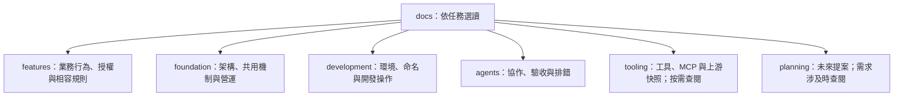

# 專案文件入口

先依任務選一個入口，讀相關規格與局部指引後再查程式碼；不需要依序讀完所有分類。文件與設定存在不代表已完成部署或真實環境驗收。

## 按任務開始

| 要做的事 | 先讀 | 再按需要查閱 |
| --- | --- | --- |
| 找修改位置 | [需求到實作導航](foundation/architecture/layout.md#從需求定位修改範圍) | 所屬功能規格與目錄 AGENTS.md |
| 修改業務或授權 | [功能索引](features/README.md) | [操作模型](foundation/architecture/business-operation.md)、[契約歸屬](foundation/architecture/dependencies.md#契約與不變條件的維護位置) |
| 修改公開 API | [API 契約與生成流程](../api/README.md) | 對應功能與 [HTTP 契約](foundation/api/README.md) |
| 準備開發環境 | [開發入口](development/README.md) | [工具與 MCP](tooling/README.md) |
| 判定修改是否完成 | [驗收矩陣](agents/acceptance.md#變更驗收矩陣) | 對應功能及外部環境驗收 |
| 部署、發布或排錯 | [營運入口](foundation/operations/README.md) | 相關設定與真實環境證據 |
| 評估未來能力 | [規劃與提案](planning/README.md) | 已接受 ADR 與現行功能規格 |

## 目錄責任

分類入口：[features](features/README.md) · [foundation](foundation/README.md) · [development](development/README.md) · [agents](agents/README.md) · [tooling](tooling/README.md) · [planning](planning/README.md)。圖表示文件分類，非固定閱讀順序。

## 按模組閱讀

[Backend](../backend/README.md) · [API](../api/README.md) · [Frontend](../frontend/README.md) · [Scripts](../scripts/README.md) · [Deploy](../deploy/README.md)

## 文件歸屬與維護

功能規則維護於 features，共用機制維護於 foundation；已接受的重大架構決策維護於 [ADR](foundation/architecture/decisions/README.md)。規劃不覆蓋現行契約；舊報告不再保存在 docs，歷史變更透過 Git 查閱。其他入口以連結引用完整規則，不複製政策或版本。

新增或搬移頁面時，同步更新所屬索引、引用、相對路徑與錨點；依[文件規範](development/documentation.md)驗證。工具版本與命令以 [mise.toml](../mise.toml)及工作區設定為準。
