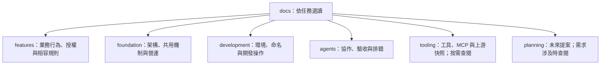

# 專案文件入口

先依任務選一個入口，讀相關規格與局部指引後再查程式碼；不需要依序讀完所有分類。文件與設定存在不代表已完成部署或真實環境驗收。

## 日常開發看哪張圖

[全部圖表按狀態查閱](diagrams.md)。初次接手先看執行入口；修改功能時，依手上的問題選讀一張。

| 開發問題 | 現行實作圖 |
| --- | --- |
| 瀏覽器、LINE 與 Cloud Tasks 的請求在哪裡匯合？ | [系統執行入口](foundation/architecture/overview.md#執行入口) |
| 前端從背景回到頁面，何時重新核驗身分？ | [頁面與身分生命週期](foundation/frontend/react-frontend.md#頁面與身分生命週期) |
| MINI App 的 LINE token 如何換成 Session，資源操作在哪裡授權？ | [MINI App 信任流程](foundation/api/http-contracts.md#mini-app-信任流程) |
| LINE Webhook 何時回成功、何時要求重送？ | [Webhook 事件處理](foundation/api/http-contracts.md#基礎入口) |
| 改 API 或 Firestore 欄位時，格式在哪一層轉換？ | [後端資料邊界](foundation/architecture/backend-boundaries.md#格式與資料相容) |
| 專案如何收錄多個 Repository的來源項目？ | [Project 與來源引用](features/project/projects.md#最小來源引用骨架) |

出勤、請假、送件等流程從[功能索引](features/README.md)進入。評估未來設計時才讀[平台規劃](planning/README.md)；[Inbox、Outbox 與 Webhook 時序](foundation/reliability/state-machines.md)描述規劃中的持久接收機制。

## 按任務開始

| 要做的事 | 先讀 | 再按需要查閱 |
| --- | --- | --- |
| 找修改位置 | [需求到實作導航](foundation/architecture/layout.md#從需求定位修改範圍) | 所屬功能規格與目錄 AGENTS.md |
| 修改業務或授權 | [功能索引](features/README.md) | [操作模型](foundation/architecture/business-operation.md)、[契約歸屬](foundation/architecture/dependencies.md#契約與不變條件的維護位置) |
| 修改公開 API | [API 契約與生成流程](../api/README.md) | 對應功能與 [HTTP 契約](foundation/api/README.md) |
| 準備開發環境 | [開發入口](development/README.md) | [工具與 MCP](tooling/README.md) |
| 判定修改是否完成 | [驗收矩陣](agents/acceptance.md#變更驗收矩陣) | 對應功能及外部環境驗收 |
| 部署、發布或排錯 | [營運入口](foundation/operations/README.md) | 相關設定與真實環境證據 |
| 評估未來能力 | [規劃與提案](planning/README.md) | 已接受 ADR 與現行功能規格 |

## 目錄責任

**開發與維運指引**

分類入口：[features](features/README.md) · [foundation](foundation/README.md) · [development](development/README.md) · [agents](agents/README.md) · [tooling](tooling/README.md) · [planning](planning/README.md)。圖表示文件分類，非固定閱讀順序。

## 按模組閱讀

[Backend](../backend/README.md) · [API](../api/README.md) · [Frontend](../frontend/README.md) · [Scripts](../scripts/README.md) · [Deploy](../deploy/README.md)

## 文件歸屬與維護

功能規則維護於 features，共用機制維護於 foundation；已接受的重大架構決策維護於 [ADR](foundation/architecture/decisions/README.md)。規劃不覆蓋現行契約；舊報告不再保存在 docs，歷史變更透過 Git 查閱。其他入口以連結引用完整規則，不複製政策或版本。

新增或搬移頁面時，同步更新所屬索引、引用、相對路徑與錨點；依[文件規範](development/documentation.md)驗證。工具版本與命令以 [mise.toml](../mise.toml)及工作區設定為準。
