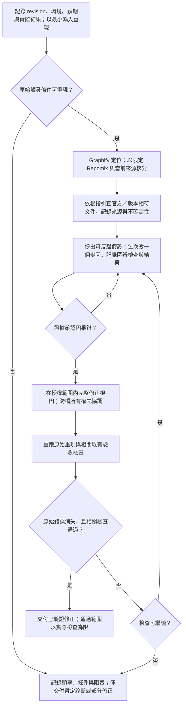

# Systematic debugging and root cause analysis

Orchestrator assigns debugger for error messages, logs, reproducible bugs and
unexplained test failures. Debugger owns diagnosis and scoped fixes; orchestrator
owns priorities, dependencies, file ownership and final acceptance. Small obvious
fixes can stay with implementer; do not start every role for every bug.

## Assignment and collaboration

Provide expected versus observed behavior, exact sanitized error or log, revision,
runtime/dependency versions, reproduction inputs, owned files, constraints and
acceptance commands. Distinguish read-only diagnosis from authorized fixes.
Debugger never invokes orchestrator or delegates. Request scope reassignment
through orchestrator when a cause crosses file ownership. Implementer may take a
larger fix after an explicit handoff; never edit the same files concurrently.
Tester checks reproduction and relevant regressions; reviewer checks causal
reasoning and fix scope; integrator handles combined acceptance when needed.
Orchestrator decides completion from this evidence, not from a role's confidence.

## Diagnostic loop

來源與限制：[根查證路由](../../AGENTS.md#mandatory-documentation-verification) · [驗收矩陣](acceptance.md) · [證據重用](workflow.md#minimal-handoff-and-evidence-reuse)。本圖定義除錯流程，不代表已執行某次診斷。

- Context7 先 resolve ID 再查適用版本，與安裝依賴比對；Codex、LINE 與 Google 採根指引的特定官方來源。查詢不可用時明列限制。
- 區分觀察、推論、排除的假設與確認根因。AST／bundle 不證明執行結果；不收錄憑證或私人原始日誌。
- 不吞錯、不削弱驗證或 assertions、不關檢查、不加無界重試；無關重構不納入修正。環境或依賴修復須明確協調。
- 沿用目前不新增測試方案／案例／工具的限制；若階段調整，優先提供修正前失敗、修正後通過的回歸證據。缺少憑證、重現或整合驗收時，不以假設宣稱完成、發布或部署。

## Completion and handoff

使用[六欄交接](workflow.md#minimal-handoff-and-evidence-reuse)，保留症狀與影響、版本／環境、重現命令、已確認因果鏈與檔案／行號或去識別日誌、排除假設、修改必要性、修正後重現結果、回歸命令／exit status／skips／涵蓋限制、文件來源與版本。發布另依任務授權及主機邊界。

## Configuration and activation

The role is registered as `[agents.debugger]` in `.codex/config.toml`, with
`config_file = "agents/debugger.toml"` relative to that configuration file.
Role instructions inherit parent permissions and MCP availability; a role file
does not grant a sandbox or extra tools. Role configuration parsing is separate
from successful host loading and execution. Reload/start a session that loads
this project configuration before expecting debugger to appear. Respect actual
host restrictions, concurrency and depth; nine roles do not require nine workers.
