# 共用系統基礎

[跨領域契約](contracts/README.md) · [執行架構](runtime/README.md) · [身分與工作階段](identity/README.md) · [外部服務整合](integrations/README.md) · [資料儲存](storage/README.md)

## 用途與範圍

保存系統架構、契約、整合與執行邊界的說明。

## 架構與責任邊界

跨模組設計放在此處，單一領域的規則由領域文件維護。

## 閱讀與修改入口

[DDD 戰略與戰術設計、上下文映射及六邊形架構](ddd/README.md)

先查閱、[本目錄工作指引](AGENTS.md)。

## 相關規格

[文件總入口](../README.md) · [HTTP 與身分契約](contracts/http.md)

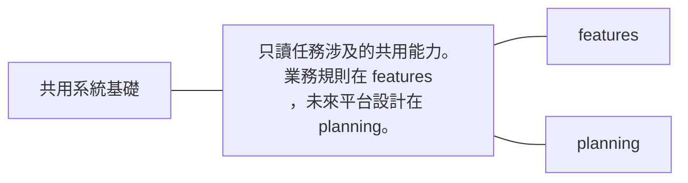

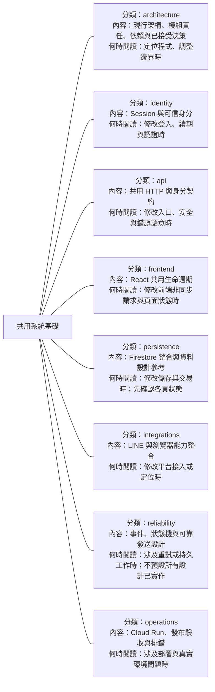

## 共用系統基礎

[文件總入口](../README.md)

現行實作圖索引 · 未來設計圖。

[現行實作圖索引](../diagrams.md#現行實作)

[未來設計圖](../diagrams.md#未來設計)

## HTTP 契約

[HTTP 與身分契約](contracts/http.md)

現行實作圖索引 · 未來設計圖。

[現行實作圖索引](../diagrams.md#現行實作)

[未來設計圖](../diagrams.md#未來設計)

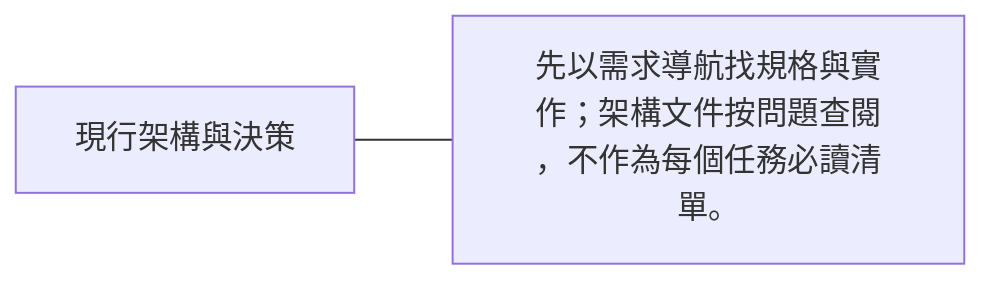

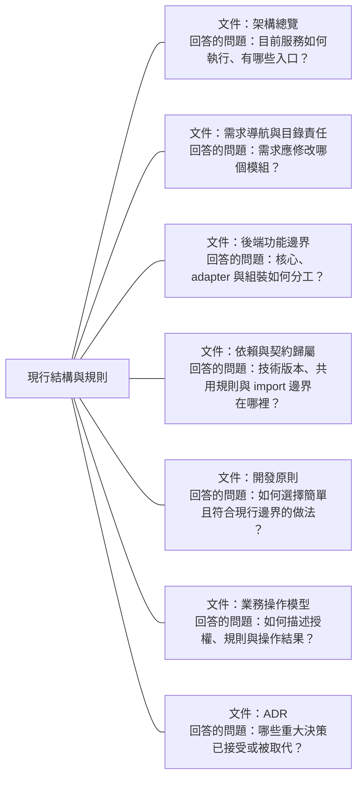

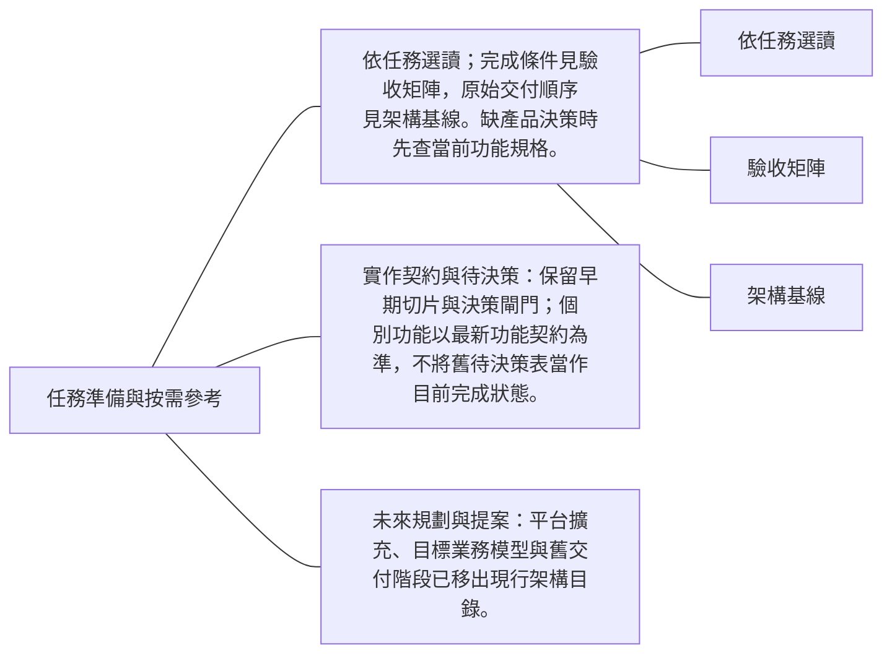

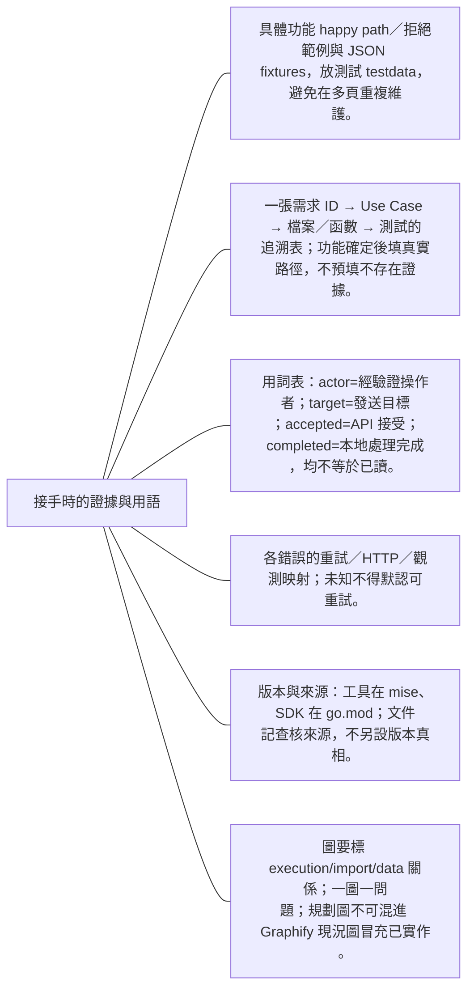

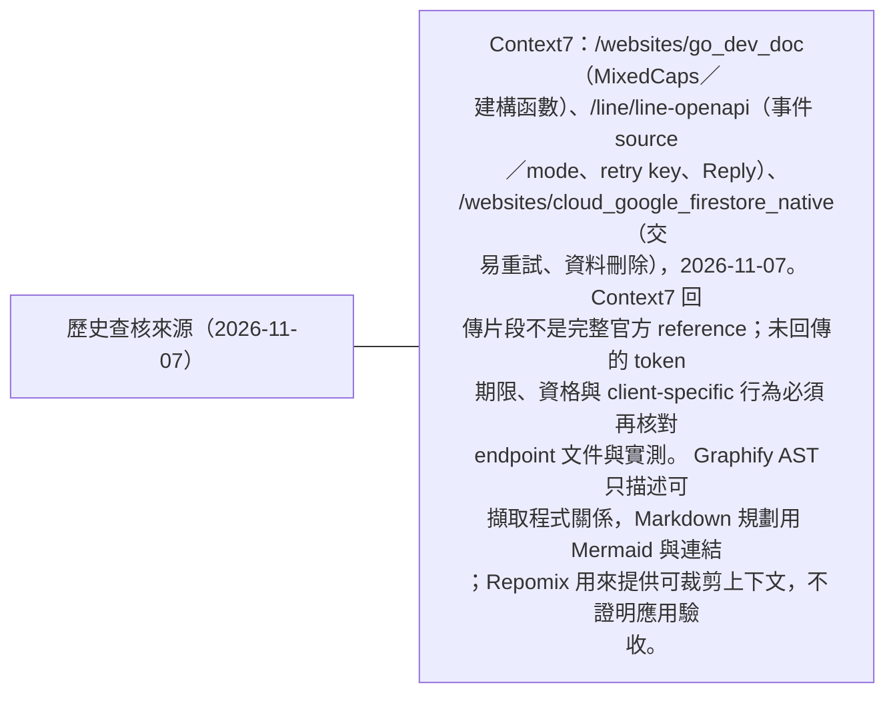

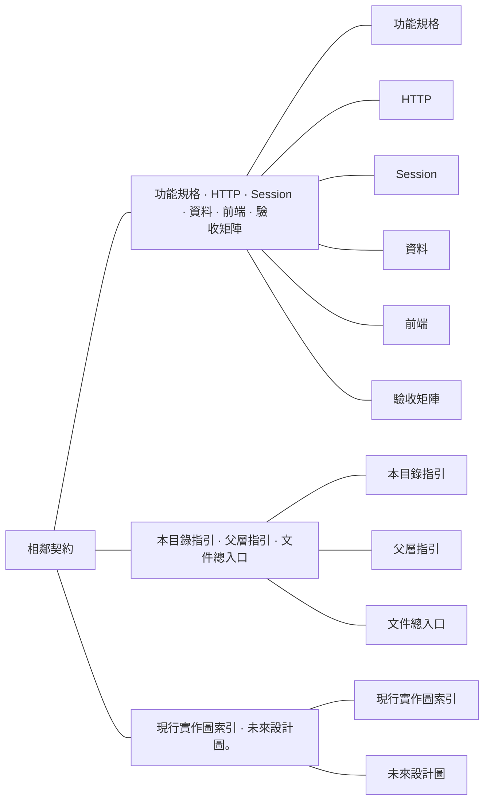

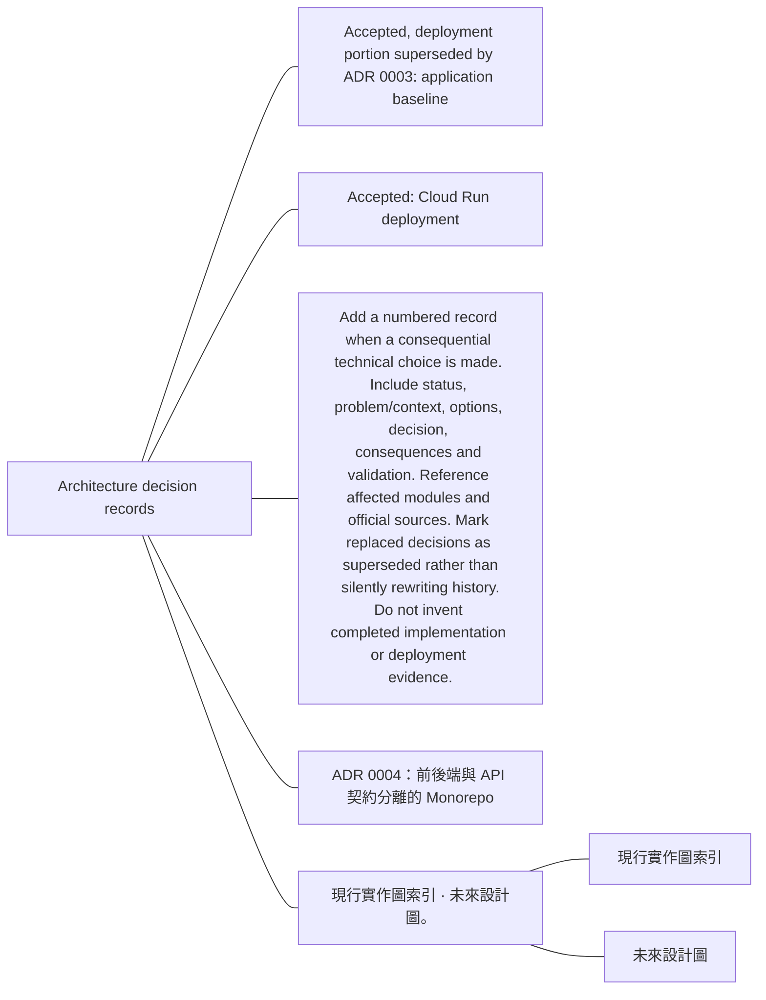

## 共用前端

[React 前端生命週期](runtime/react-lifecycle.md)

現行實作圖索引 · 未來設計圖。

[現行實作圖索引](../diagrams.md#現行實作)

[未來設計圖](../diagrams.md#未來設計)

## 身分與登入

[Go browser Session 與 Firestore](identity/browser-session.md)

現行實作圖索引 · 未來設計圖。

[現行實作圖索引](../diagrams.md#現行實作)

[未來設計圖](../diagrams.md#未來設計)

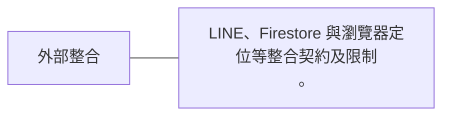

## 文件索引

[Firestore integration](storage/firestore.md)

[LINE 環境變數規格](integrations/line-environment.md)

[LINE 呈現方式選型](integrations/line-presentation-options.md)

[LINE 整合：能力與邊界](integrations/line.md)

[Web Geolocation API 整合契約](integrations/web-geolocation.md)

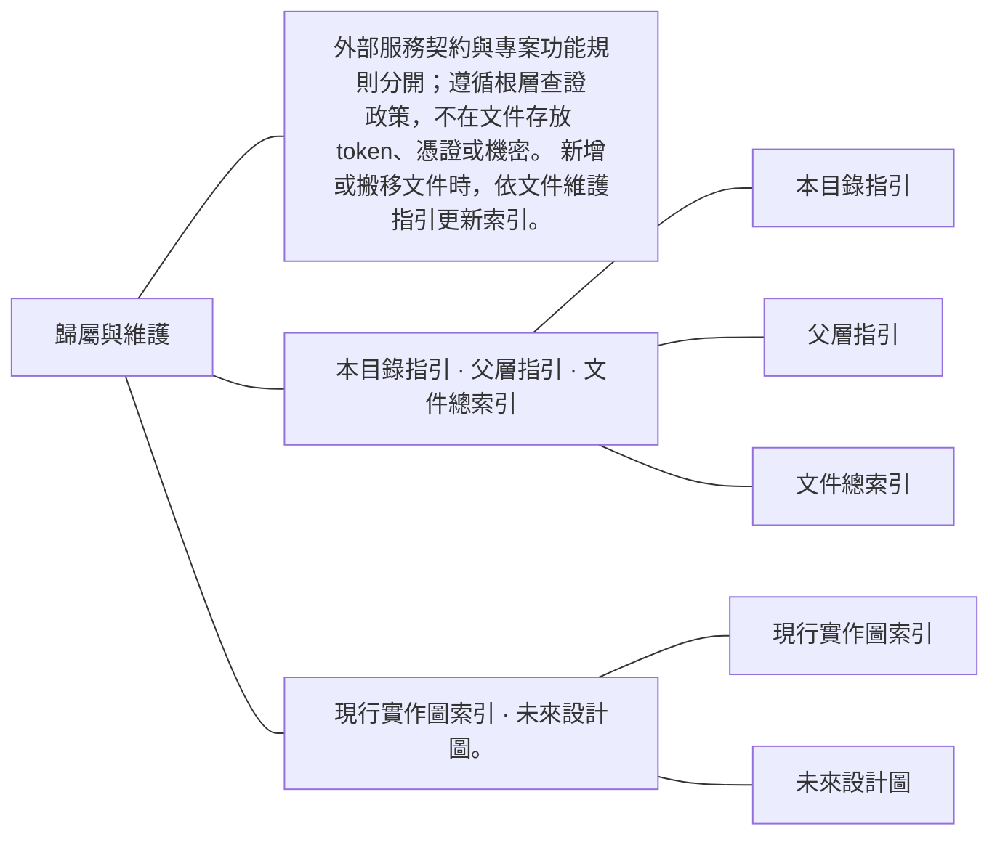

## 部署與營運

Cloud Run 部署、發布驗收與故障排查。

Cloud Run 部署 · 建置入口圖

[Cloud Run 部署](../guides/release/cloud-run.md)

[建置入口圖](../guides/release/cloud-run.md#建置入口)

Monorepo 整合、發布與回復 · 切流與回復圖

[Monorepo 整合、發布與回復](../guides/release/release-acceptance.md)

[切流與回復圖](../guides/release/release-acceptance.md#切換觀察回復)

[Troubleshooting](../guides/release/troubleshooting.md)

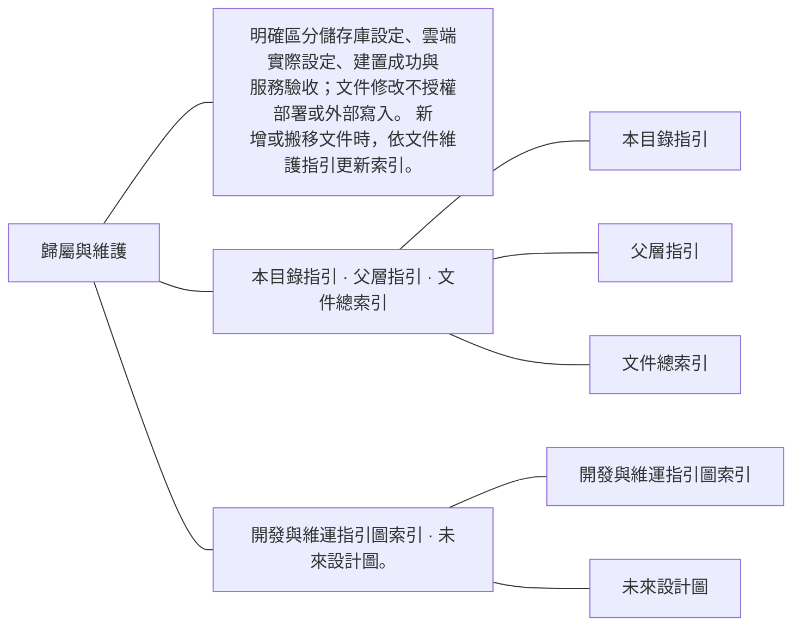

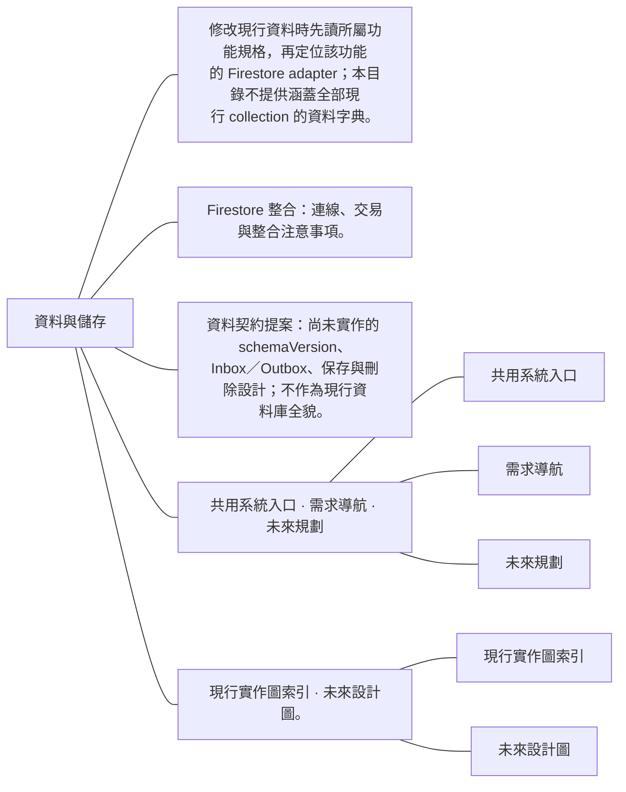

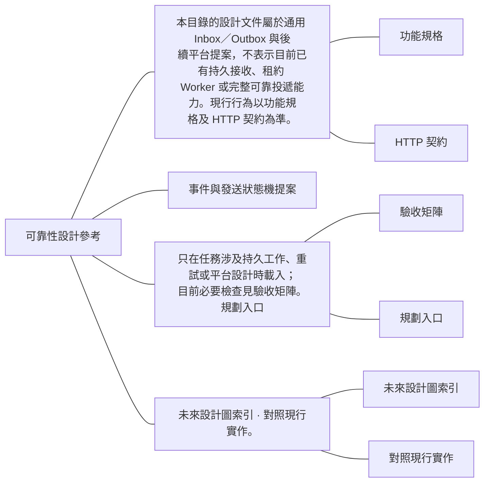
