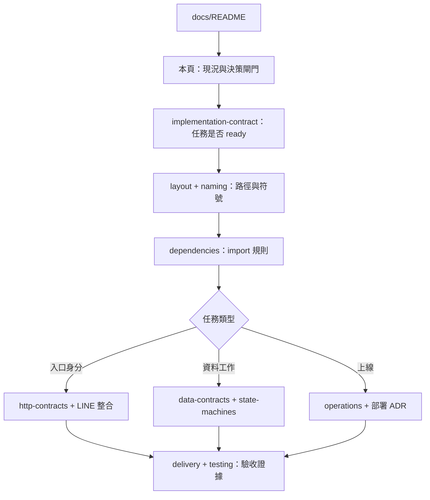

# Codex 接手索引與完整度

> 狀態：文件導覽；不是所有產品決策已完成。最後核對：2026-11-07。

## 最短閱讀路徑

| 文件 | 唯一責任 |
| --- | --- |
| overview | 系統邊界、模組與來源依據 |
| layout | 目標目錄與 ownership |
| development/naming | package、檔案、函數、DTO 命名 |
| dependencies | compile-time 允許依賴 |
| implementation-contract | ready/blocked、產品決策、任務範本 |
| http-contracts | 入口、安全、狀態碼與身分時序 |
| data-contracts | 欄位、索引、保存與資料關係 |
| state-machines | 交易、重試、租約、結果不明 |
| reliability | 整合注意事項與運行約束 |
| delivery | 切片順序與驗收 |

## 現況與設計分開

目前程式：cmd/server/main.go 提供 GET /healthz 與 graceful shutdown；尚無 internal/ 或 cmd/worker。
Dockerfile 目前只複製 go.mod 與 cmd；導入 internal/、go.sum 與 SDK 實際 import 時必須調整 COPY 與 module download，現在不能宣稱目標應用容器已可建置。
Fly.io 已確定為唯一部署目標（ADR 0001）；現有配置僅支援 HTTP，Worker process、Google ADC/IAM 與實際部署尚未驗收。

## 讓 Codex 不猜的額外材料

- 具體功能 happy path／拒絕範例與 JSON fixtures，放測試 testdata，避免在多頁重複維護。
- 一張需求 ID → Use Case → 檔案／函數 → 測試的追溯表；功能確定後填真實路徑，不預填不存在證據。
- 用詞表：actor=經驗證操作者；target=發送目標；accepted=API 接受；completed=本地處理完成，均不等於已讀。
- 各錯誤的重試／HTTP／觀測映射；未知不得默認可重試。
- 版本與來源：工具在 mise、SDK 在 go.mod；文件記查核來源，不另設版本真相。
- 圖要標 execution/import/data 關係；一圖一問題；規劃圖不可混進 Graphify 現況圖冒充已實作。

## 本輪查核

Context7：`/websites/go_dev_doc`（MixedCaps／建構函數）、`/line/line-openapi`（事件 source／mode、retry key、Reply）、`/websites/cloud_google_firestore_native`（交易重試、資料刪除），2026-11-07。
Context7 回傳片段不是完整官方 reference；未回傳的 token 期限、資格與 client-specific 行為必須再核對 endpoint 文件與實測。
Graphify AST 只描述可擷取程式關係，Markdown 規劃用 Mermaid 與連結；Repomix 用來提供可裁剪上下文，不證明應用驗收。
