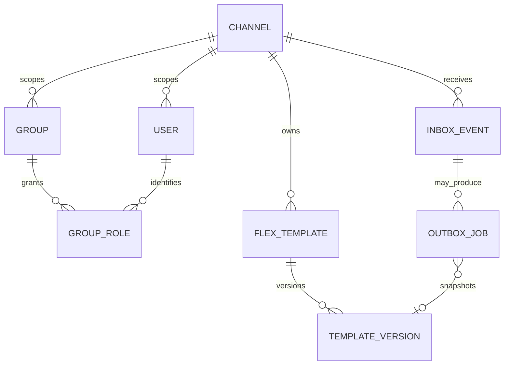

# Firestore 資料契約

範圍：本頁保留後續平台擴充的設計參考，不是首版必建清單。
當前依 [ADR 0002](decisions/0002-baseline.md)、[分階段落地](../development/foundation.md)
與 [基礎出勤](../features/attendance.md) 先完成基礎，再建立出勤所需的 API／資料／套件。
不預建 Worker、Garr、群組角色、管理後台或模板；不新增測試工程。

> 狀態：技術基線 schemaVersion=1，尚未實作。業務欄位依 P01 加入；保存期與刪除 SLA 待 P05，不默認永久保存。

## 路徑與欄位

所有資料以 channels/{channelID} 隔離。ID 需驗證不含 slash／路徑控制字元；不得直接拼接任意請求路徑。
時間使用 Firestore timestamp／Go time.Time UTC；版本與 attempt 使用整數，optional 欄位省略而非空字串混用。

| 相對 collection | 文件 ID | 必要欄位／語義 |
| --- | --- | --- |
| users | LINE userId | schemaVersion、createdAt、updatedAt；profile 非必要不保存 |
| groups | LINE groupId | schemaVersion、botState(active/left)、updatedAt；加入事件不自動設定 owner |
| groups/{groupID}/roles | userId | role、grantEvidenceRef、grantedBy、updatedAt；role 值待 P02 |
| webhookEvents | webhookEventId | schemaVersion、eventType、sourceType、sourceID(可缺)、actorID(可缺)、occurredAt、receivedAt、status、attempt、leaseVersion、必要處理 payload |
| outbox | SHA-256(eventID + useCase + actionSlot) 的具名 canonical 編碼 | schemaVersion、jobKind、targetType(user/group)、targetID、status、payloadVersion、內容快照、retryKey、attempt、nextRunAt、leaseVersion、createdAt |
| flexTemplates/{templateID}/versions | immutable version ID | schemaVersion、content、altText、createdAt、createdBy、validationStatus |
| richMenus | 本地 menu ID | schemaVersion、LINE richMenuId(建立後)、發布狀態、imageRef、updatedAt |
| auditLogs | 隨機 ID | actorRef、action、resourceRef、occurredAt、outcome；不含 token／完整 payload |

Outbox ID：用 JSON array 編碼 [channelID,eventID,useCase,actionSlot] 再 SHA-256，避免字串串接碰撞；API 操作另以 scoped idempotency key 定義事件來源。
retryKey 在交易外產生並於首次建立固定保存；重試不更換。payload 不保存 reply token 或長期使用者認證。
Inbox 的 reply token／敏感 payload 如確有必要，最小化保存、限制存取且按短期政策清理；尚無保存政策前不開正式流量。

租約欄位：leaseOwner、leaseUntil、leaseVersion；每次領取遞增 version。terminal 欄位：completedAt、errorCode、上游 request ID；不得保存原始機密錯誤。

## 查詢與索引需求

| 查詢 | 複合索引欄位（ASC） |
| --- | --- |
| 到期待執行 | status、nextRunAt、__name__（穩定排序） |
| 可回收租約 | status、leaseUntil、__name__ |
| 稽核列表 | resourceRef、occurredAt（列表若倒序則該欄 DESC） |

索引檔以實際查詢生成並在 staging 驗證；此表不是已部署索引。禁用大型 payload/content 的非必要單欄索引。
批次查詢有上限、游標分頁，避免 offset 與全庫掃描。資料遷移採 schemaVersion reader 相容與可重跑 migration；不得在請求路徑無界遷移。
TTL 僅在終態加 expireAt，工作中不可被 TTL 清除；刪除父文件不假設子集合一起刪除，刪除作業需列出所有子集合與驗證。

## 邏輯關係（非資料庫外鍵）

Firestore 不強制圖中關聯；Outbox 必須含快照或不可變版本，版本刪除不得破壞未完成工作。
參考：[Firestore transactions](https://docs.cloud.google.com/firestore/native/docs/manage-data/transactions)、[刪除資料](https://docs.cloud.google.com/firestore/native/docs/manage-data/delete-data)。
