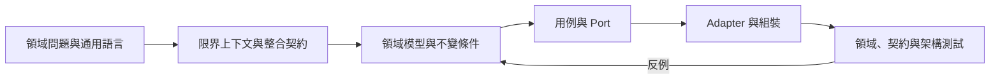
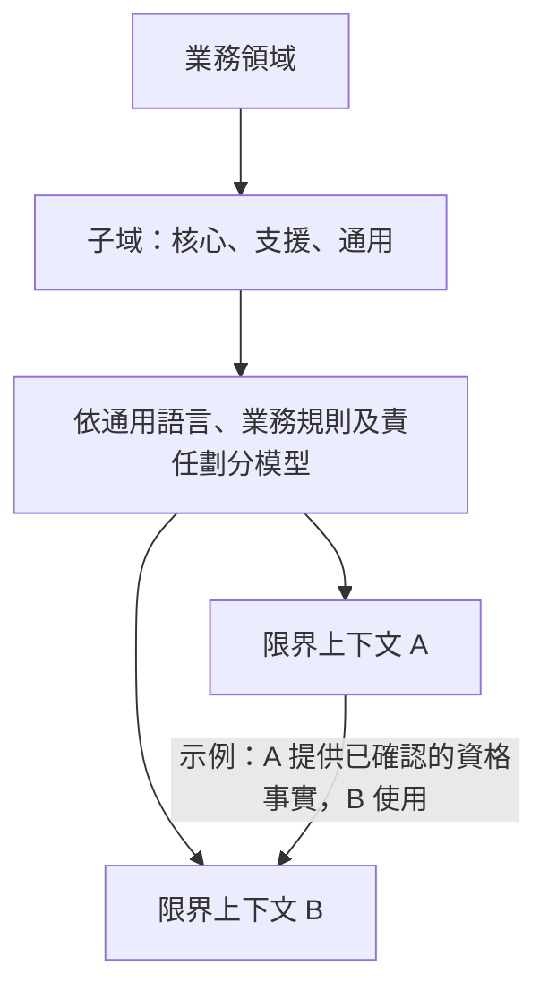
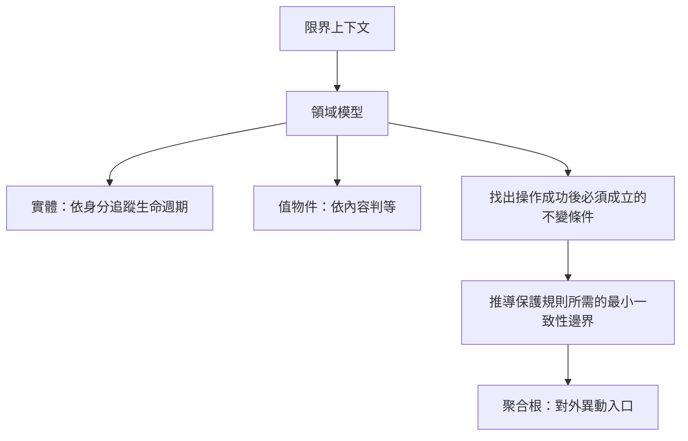
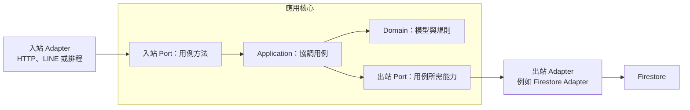

# DDD 設計

本目錄提供戰略設計、戰術建模與六邊形架構的閱讀入口。先釐清業務問題與模型邊界，再選擇實作模式；文件分類不代表每個領域都要建立相同套件。

## 如何使用

具體通用語言、規則及功能狀態維護於[領域規格](../../domains/README.md)。本目錄提供設計方法，不取代已接受 ADR、公開契約或驗收規範。分類與未來案例均須由業務事實驗證，不把示例當成已實作功能。

開始新設計時依[七階段流程](design-process.md)記錄問題、語言、邊界、模型與架構產出；修正既有能力時，從下面問題索引選讀，不必每次讀完整目錄。

從用例的成功、拒絕與併發反例找出規則，再依下列次序推導程式設計：

1. **值與身分。** 記錄哪些概念依內容判等，哪些對象靠身分跨時間追蹤。將值本身的合法性與當下是否可以使用該值分開。
2. **規則與聚合。** 寫明成功後必須成立的條件、規則擁有者、需要一起載入與提交的最小狀態。用並行操作驗證這個邊界。實體有 ID，尚不足以判定它是聚合根。
3. **用例與依賴。** 確認入站操作、應用層要取得的外部事實、領域判斷及提交邊界。從這些需求推導 Port、Adapter、公開函數和檔案配置。

概念頁的業務例子各自用來說明該頁的概念。即使多頁使用相同領域名詞，也不構成一份整合設計規格。評審檔案樹或函數時，應能將每個公開入口連回用例或規則；缺少證據的邊界標為待決定。

## 戰略設計

| 概念 | 英文術語 | 設計用途 |
| --- | --- | --- |
| [領域](domain.md) | Domain | 界定業務問題、參與者與成果 |
| [子域](subdomain.md) | Subdomain | 按業務能力劃分問題空間 |
| [核心子域](core-subdomain.md) | Core Subdomain | 找出值得集中投入的差異化能力 |
| [支援子域](supporting-subdomain.md) | Supporting Subdomain | 識別需貼合本業流程的支援能力 |
| [通用子域](generic-subdomain.md) | Generic Subdomain | 評估可採用成熟方案的能力 |
| [限界上下文](bounded-context.md) | Bounded Context | 指定模型、語言與規則的有效範圍 |
| [通用語言](ubiquitous-language.md) | Ubiquitous Language | 統一上下文內的詞義與例句 |
| [上下文映射](context-mapping.md) | Context Mapping | 調查契約、依賴及整合方式 |
| [上下文映射圖](context-map.md) | Context Map | 呈現模型邊界及事實影響方向 |
| [上游／下游](upstream-downstream.md) | Upstream / Downstream | 說明契約變更影響哪一方 |
| [上下文整合模式](context-mapping-patterns.md) | Context Mapping Patterns | 選擇契約與模型的合作方式 |

## 戰術設計概念

| 概念 | 英文術語 | 設計用途 |
| --- | --- | --- |
| [實體](entity.md) | Entity | 追蹤穩定身分與合法狀態轉換 |
| [值物件](value-object.md) | Value Object | 封裝按內容判等的有效值 |
| [不變條件](invariant.md) | Invariant | 明定規則的擁有者與成立時間 |
| [聚合與聚合根](aggregate.md) | Aggregate / Aggregate Root | 劃分規則與一致性邊界 |
| [工廠](factory.md) | Factory | 封裝完整物件的建立與初始規則 |
| [儲存庫模式](repository.md) | Repository | 以 Aggregate 為單位載入、重建及保存 |
| [領域服務](domain-service.md) | Domain Service | 表達不屬於單一物件的領域決策 |
| [領域事件](domain-event.md) | Domain Event | 表達已發生的業務事實與後續處理需求 |

## 用例與架構落地

| 主題 | 設計用途 |
| --- | --- |
| [應用服務](application-service.md) | 協調用例、授權、模型、保存與結果 |
| [一致性與交易](consistency.md) | 決定原子範圍、版本、重送與副作用 |
| [六邊形架構](hexagonal-architecture.md) | 區分核心、入站／出站 Port、Adapter、組裝與依賴方向 |

六邊形架構是承載業務模型的架構方法，不是 DDD 的同義詞。CQRS、Event Sourcing、微服務與通用事件平台不因採用本索引而成為必要條件。

[Go 檔案樹示範、職責對照與實作限制](hexagonal-architecture.md#go-檔案配置範例)提供按需拆分的參考。

## 進階模式：按需採用

以下文件只提供選型與設計參考，不是每個領域都必須採用的模式，也不表示已部署相關基礎設施。採用時先比較較簡單方案，明列必要性、失敗語意與維運成本；不因文件存在就改變現行 ADR 或驗收基線。

| 主題 | 按需採用的條件 |
| --- | --- |
| [CQRS](cqrs.md) | 讀寫模型的差異或效能需求足以抵銷分離成本 |
| [Saga](saga.md) | 需要協調跨交易操作、補償與失敗恢復 |
| [Process Manager](process-manager.md) | 需要跨事件的持久進度、等待、逾時與續跑 |
| [Transactional Outbox](outbox-pattern.md) | 業務提交後不能因程序中斷遺失發布意圖 |
| [Event Sourcing](event-sourcing.md) | 確定以事件序列作狀態權威來源，且能承擔演進與重播成本 |

## 按問題查閱

| 問題 | 閱讀入口 |
| --- | --- |
| 這項能力是否應獨立成一個上下文？ | [子域](subdomain.md)、[限界上下文](bounded-context.md) |
| 需要追蹤身分，還是只需要一個值？ | [Entity](entity.md)、[Value Object](value-object.md) |
| 哪些狀態必須一起成立？ | [Invariant](invariant.md)、[Aggregate](aggregate.md)、[一致性](consistency.md) |
| 建立與持久資料重建放哪裡？ | [Factory](factory.md)、[Repository](repository.md) |
| 業務判斷放模型還是服務？ | [Entity](entity.md)、[Domain Service](domain-service.md)、[Application Service](application-service.md) |
| Port、Adapter、交易與錯誤如何劃分？ | [六邊形架構](hexagonal-architecture.md)、[一致性](consistency.md) |
| 資料提交後如何避免遺失發布意圖？ | [Outbox（按需）](outbox-pattern.md#提交與失敗窗口圖) |
| 跨領域交換什麼，是否需要事件？ | [上下文映射](context-mapping.md)、[整合模式](context-mapping-patterns.md)、[Domain Event](domain-event.md) |

## 概念細目

### 模型與上下文整合

- [領域模型](domain-model.md)
- [限界上下文整合](bounded-context-integration.md)
- [防腐層](anti-corruption-layer.md)

### 領域模型與規則

- [識別](identity.md)
- [領域基本型別](domain-primitive.md)
- [聚合根](aggregate-root.md)
- [領域政策](domain-policy.md)
- [規格物件](specification.md)
- [領域錯誤](domain-error.md)
- [領域事件處理器](domain-event-handler.md)

### 用例及讀寫意圖

- [用例](use-case.md)
- [領域命令](domain-command.md)
- [命令](command.md)
- [查詢](query.md)

### 六邊形架構細節

- [依賴規則](dependency-rule.md)
- [依賴反轉](dependency-inversion.md)
- [埠](port.md)
- [入站埠](driving-port.md)
- [出站埠](driven-port.md)
- [轉接器](adapter.md)
- [入站轉接器](driving-adapter.md)
- [出站轉接器](driven-adapter.md)
- [組裝根](composition-root.md)

### 交易與跨邊界一致性

- [交易](transaction.md)
- [工作單元](unit-of-work.md)
- [樂觀並行控制](optimistic-concurrency.md)
- [冪等](idempotency.md)
- [最終一致性](eventual-consistency.md)
- [整合事件](integration-event.md)

### 建模與驗證

- [領域建模](domain-modeling.md)
- [領域測試](domain-testing.md)
- [架構測試](architecture-testing.md)

## Mermaid 圖表

Mermaid 適合回答「誰呼叫誰、何時提交、失敗後去哪裡」。圖上的箭頭標清楚呼叫、依賴或事件方向。名詞定義、規則、前置條件與例外仍用文字或表格，供 Codex 查找和引用。

| 想釐清的問題 | 圖表入口 |
| --- | --- |
| 哪個上下文提供契約，哪裡轉譯語意？ | [上下文映射圖](context-map.md)、[防腐層](anti-corruption-layer.md#圖解) |
| 執行呼叫與程式碼依賴各往哪裡？ | [六邊形架構](hexagonal-architecture.md#執行與程式碼依賴) |
| 哪些狀態共同維護？讀寫模型如何更新？ | [聚合](aggregate.md)、[CQRS](cqrs.md#圖解) |
| 何時提交與發布？如何處理衝突及重送？ | [交易](transaction.md#提交與發布)、[Outbox](outbox-pattern.md)、[樂觀並行控制](optimistic-concurrency.md#圖解)、[冪等](idempotency.md#圖解) |
| 跨交易失敗如何恢復？誰維護流程進度？ | [Saga](saga.md#圖解)、[Process Manager](process-manager.md#圖解) |

下圖為設計參考，從業務問題推進至模型、用例與驗證。模型和上下文可以隨反例反覆調整。



### 戰略設計：從問題到模型邊界

開發與維運指引。子域劃分業務問題，限界上下文劃分模型適用範圍。先用語言、規則與責任決定哪些模型應分開，再畫出具體契約。子域分類不會自動決定上下文的數量或邊界。



最後一條箭頭表示契約的影響方向，由提供者指向使用者。若 B 另有契約提供給 A，應以另一條具名關係表達。詳見 [限界上下文](bounded-context.md)與[上下文映射圖](context-map.md)。

### 戰術設計：從不變條件到聚合

開發與維運指引。圖中連線表示設計推導，無程式呼叫含義。實體和值物件各按業務語意建模，只有共同保護不變條件所需的狀態才納入同一聚合。



聚合可以只有根實體。工廠、領域服務、政策與事件按需要採用，詳見[聚合](aggregate.md)與[不變條件](invariant.md)。

### 六邊形架構：一次用例如何執行

開發與維運指引。實線表示執行時呼叫。HTTP、LINE 和排程是可能的入站方式；下圖以讀寫資料為例，外部服務與訊息系統也可由各自的出站 Adapter 接入。



程式碼依賴方向需另外核對：出站 Adapter 依賴並實作核心需要的契約，由 Bootstrap 注入。參見[程式碼依賴圖](hexagonal-architecture.md#程式碼依賴)。

[六邊形架構](hexagonal-architecture.md#執行與程式碼依賴)分開呈現執行與程式碼依賴，[交易](transaction.md#提交與發布)呈現提交和發布的時間差。可將 Markdown 圍欄內的圖表原始碼存為 `diagram.mmd`，從儲存庫根目錄執行。

```sh
bash scripts/tooling/tool-exec.sh mermaid render diagram.mmd --format svg > diagram.svg
```

使用專案鎖定的 `mermaid@13.0.0-alpha.3`，版本及操作方式見 [Mermaid 專案指引](../../../.codex/README.md#mermaid)。概念資料以匿名 Context7 查閱 [Domain-Driven Hexagon](https://github.com/sairyss/domain-driven-hexagon)，文件索引未固定 revision。Context7 另查得 [Mermaid CLI](https://github.com/mermaid-js/mermaid-cli) 的 `mmdc` 用法，渲染命令以專案鎖定版本為準。

## 維護與驗證

新增概念頁需交代定義、適用條件、責任邊界、可辨識狀態的例子、設計產出及相關來源；不為每個名詞預建空目錄。概念間以連結引用，具體業務政策只保留在所屬規格。

圖表依[圖表索引](../../diagrams.md)區分現行實作、未來設計與開發指引。改動本目錄時，核對索引、相對連結、錨點與來源；Mermaid 依[文件規範](../../standards/documentation.md)渲染。純文件修改不執行無關應用測試。

來源查閱與文件檢查不等於功能驗收；證據範圍、新案例限制及實際檢查依[驗收矩陣](../../development/acceptance.md)。

## 相關規格

[業務操作模型](../contracts/business-operations.md) · [現行後端功能邊界](../runtime/backend-boundaries.md) · [已接受 ADR](../../decisions/README.md) · [領域規格](../../domains/README.md)

[適用工作指引](../AGENTS.md) · [上層導覽](../README.md)
