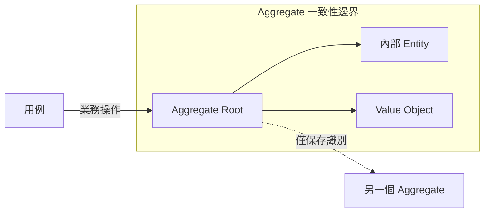

# 聚合與聚合根（Aggregate / Aggregate Root）

Aggregate 是需要一起保護不變條件的模型邊界，由一個 Aggregate Root 作為對外異動入口。它可以只有一個 Entity，也可以包含必要的內部 Entity 與 Value Object。

## 如何決定邊界

先問「哪些規則在一次成功操作後必須立即成立」，再把保護它們需要的狀態納入邊界。資料有關聯、屬於同一畫面或存在父子關係，都不足以證明它們是同一 Aggregate。

保持邊界小，評估成員數量、載入成本與競爭寫入。跨 Aggregate 優先使用身分引用；跨限界上下文交換契約，不能共享可修改的內部模型。

## 邊界與存取入口

開發與維運指引；實線表示業務操作或根管理的內部物件，虛線表示對外部 Aggregate 的身分引用，不表示共用交易。

外部透過 Root 執行異動；讀取投影可有自己的查詢路徑，但不得透過投影繞過根修改內部 Entity。圖只說明模型邊界，不限定資料庫文件數量或 Go 套件數量。

## 規則與持久化

Root 的業務方法保護合法轉換；Repository 與交易實作負責讓讀取版本及寫入保持一致。記憶體裡驗證成功，不能排除另一個請求同時改寫。

Aggregate 不等於一份資料庫文件，但若拆成多份文件，仍須說明哪些資料一起載入、如何防止部分保存與繞過根。宣稱「只載入部分成員」時，必須證明摘要、版本與必要事實足以保護所有受影響規則，不能忽略未載入資料。

## 設計例子

若成員範圍必須保留至少一位 Owner，須評估由範圍根保護計數，或採較小 Aggregate 並明確協調一致性。不能直接把全組織所有成員放進一個無上限 Aggregate；Membership 的具體邊界仍需量測與設計確認。

## 設計產出與核對

列出 Root、內部物件、外部身分引用、不變條件、最大規模、載入／保存單位與衝突策略。兩個 Aggregate 共用一次本機交易是須說明的取捨，不能因此把兩者稱為同一 Aggregate。

概念參考：[Microsoft Learn：戰術 DDD](https://learn.microsoft.com/en-us/azure/architecture/microservices/model/tactical-domain-driven-design)。僅採概念，不採其微服務部署前提。

[Invariant](invariant.md) · [Repository](repository.md) · [一致性](consistency.md) · [DDD 設計索引](README.md)
