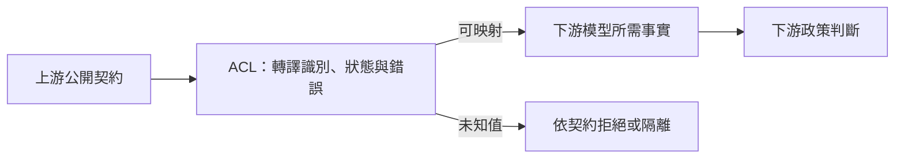

# 防腐層（Anti Corruption Layer）

在模型邊界轉譯語意以保護下游模型。

## 設計時要確認

為枚舉、識別、單位和錯誤建立明確映射；未知值依契約拒絕或隔離。

## 示例

上游的 active 只表示帳戶已啟用，轉譯後仍須依本地規則判定能否接受邀請。

## 圖解

**設計參考。**

## 延伸閱讀

[bounded-context-integration](bounded-context-integration.md) · [driven-adapter](driven-adapter.md) · [DDD 設計索引](README.md)
