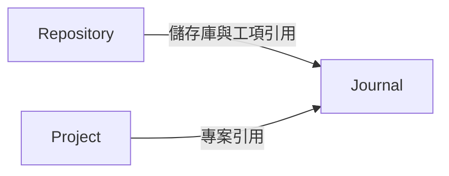

# 上下文映射圖（Context Map）

用圖呈現模型邊界、依賴及關係。

下圖只示範日誌引用的局部關係。箭頭由資料語意的提供方指向使用方；標籤說明交換的事實。它描述現有功能，不推論團隊之間的協作模式。

現行實作：日誌引用的局部上下文關係。

[日誌引用與可見性規格](../../domains/journal/journal.md)

**設計產出**　圖旁附上關係的依據、圖例及範圍。現況與目標若不同，分圖說明。

[戰略設計索引](README.md)
