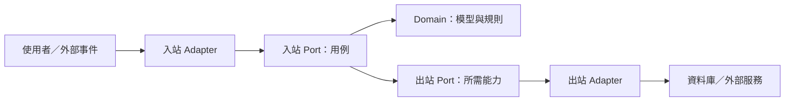
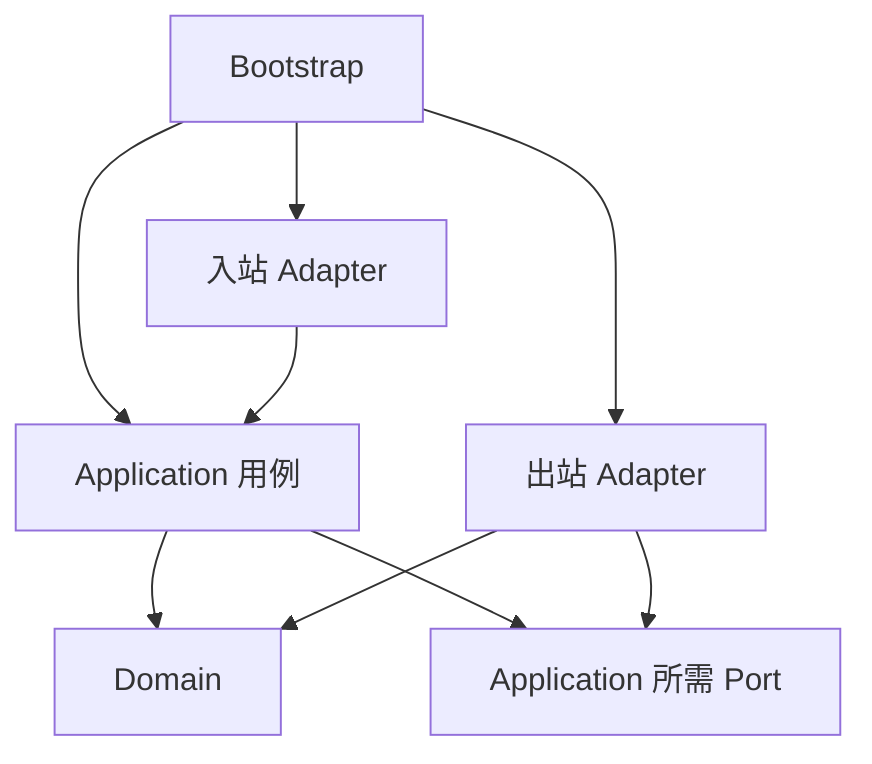
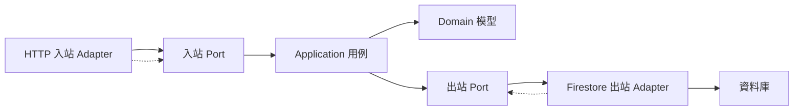

# 六邊形架構（Hexagonal Architecture）

六邊形架構也稱 Ports and Adapters：以應用程式的能力為邊界，讓業務不依賴特定輸入介面、資料庫或遠端服務。重點是內部與外部的分離；六個邊只是畫法，不代表六層、六個 Port 或六個目錄。

本頁先解釋概念，再說明本專案的採用方式與設計示例。這是開發指引，不表示所有現有功能已符合，也不將 Membership 提案視為已實作。現行依賴與檢查以[後端功能邊界](../runtime/backend-boundaries.md)為準。

## 核心、Port、Adapter 與組裝

| 概念 | 責任 | 不應混入的內容 |
| --- | --- | --- |
| 內部核心 | Application 執行用例，Domain 表達規則與模型 | HTTP request、Firestore document、LINE SDK client |
| Port | 定義某種有目的的互動：操作、輸入、結果、失敗及語意 | 任意可呼叫方法的集合、未說明行為的空介面 |
| Adapter | 將特定外部技術或模型轉換成 Port 能理解的互動 | 複製用例、另訂角色政策或繞過 Aggregate |
| Composition Root | 選擇實作、建立 client、注入依賴、管理啟停 | 資源授權與領域狀態轉換 |

Port 是契約，不等於網路連接埠或 Go interface 關鍵字。公開用例函數或方法也能作為入站 Port；interface 只是一種實作方式。一個 Port 可有多個 Adapter，一個 Adapter 也可實作同一技術下的多項能力。

## 入站與出站依誰驅動判斷

| 方向 | 誰驅動互動 | 專案例子 | 核心與 Adapter 的關係 |
| --- | --- | --- | --- |
| 入站／Driving | 外部要求應用執行能力 | HTTP handler、LINE event handler、批次入口 | Adapter 呼叫用例；核心不需知道請求來自哪種技術 |
| 出站／Driven | 應用需要外部完成某項能力 | 儲存、群組資格查詢、訊息傳送 | 用例依賴能力契約，Adapter 實作它 |

依「互動用途」分類，不依網路封包方向：HTTP response 不是出站 Port；HTTP client 查外部資格才是出站互動。訊息送入與訊息送出可以是兩個不同角色的 Adapter。

已驗證 LINE webhook 的身分與瀏覽器 Session 有不同來源，各自由入站邊界驗證，再轉成用例要求的可信 Actor。共用用例不代表免除各入口的驗簽、同源或輸入限制。

## 執行流程與程式依賴

### 執行時互動

開發與維運指引；箭頭表示發起呼叫，結果沿呼叫路徑回傳。



用例可多次讀取事實與呼叫模型；圖不表示每次操作都必須用到所有節點。純運算可能不需要出站 Port。

### 程式碼依賴

開發與維運指引；箭頭表示原始碼 import／型別依賴，Port 節點代表獨立契約套件。



執行時用例呼叫注入的出站實作，但 Application 不 import 該實作。這是依賴反轉；不是要求所有箭頭在執行時也向內。Adapter 可以依賴內層型別，內層不能為了呼叫 Adapter 而反向 import SDK。

DDD 的上下文映射箭頭則表示事實與契約的影響方向，與上面兩種圖不同，見[Context Map](context-map.md)。畫圖時必須註明箭頭語意。

## Application 與 Domain 各做什麼

| 問題 | 責任 |
| --- | --- |
| 哪個 Actor 要對哪個 Resource 做哪個 Action？ | Application 接受入站已驗證事實並協調 |
| 哪個角色可以執行此操作？ | 所屬領域的政策；Application 取得當前事實並套用 |
| 已撤銷的邀請能否接受？ | Domain 的合法狀態轉換 |
| 本次要載入哪些資料、共同保存哪些結果？ | Application 表達需要的原子工作，Adapter 實現交易 |
| 如何解析 JSON、回 HTTP 錯誤？ | 入站 Adapter |
| 如何把 gRPC unavailable 轉成穩定錯誤？ | 出站 Adapter |
| 使用哪個 Firestore client、timeout 或 Secret？ | 組裝及技術設定 |

Application 不只是轉呼叫一層：它擁有用例順序、失敗與提交語意。Domain 也不只是 DTO：它保護不變條件。業務 Actor／Authority／Policy 的完整描述沿用[操作模型](../contracts/business-operations.md)。

## 執行與程式碼依賴

**開發與維運指引。** 實線是執行呼叫，虛線是 Adapter 對核心契約的程式碼依賴。組裝根將出站實作注入用例。



## 如何定義 Port

本專案採消費端需要導向：Application 定義它需要的出站能力。入站 Adapter 若只需要某個服務的少數方法，也可在消費端定義小介面；不要因此複製整套用例型別。

每個 Port 都要交代以下內容，不能只有 signature：

- 輸入的信任來源、租戶與資源範圍、單位及值限制。
- 操作是否寫入、讀取何種一致性與資料版本。
- 結果的缺席、拒絕、衝突、不可用及部分成功語意。
- context 取消、期限、重試、防重鍵及版本衝突。
- 是否參與工作單元，callback 是否會重跑。

名稱應表達能力，例如 MembershipReader、ReplySender。只需要查詢時，不要求它同時提供建立／更新／刪除。不是每個 struct 都要 interface，也不以 interface 數量衡量架構完整性。

本專案 I/O 契約接受 `context.Context`；純領域決策以必要的值與事實作參數。context 不用來偷偷攜帶 SDK transaction 或可由客戶端偽造的角色。

## 跨邊界資料與錯誤

入站 DTO、用例命令／結果、Domain 模型與持久化 document 有不同目的。Adapter 負責明確轉換；不要為少寫轉換而在 Domain 加 HTTP 或 Firestore tags，也不要求每次傳遞都無條件複製所有型別。

錯誤在技術邊界轉為核心契約可理解的類別。不可用不等於不存在，查不到資格不等於資格有效。HTTP 再依既有公開契約轉成 status 與 envelope；核心不選 HTTP status。取消與期限保留可識別語意，但逾時不能自行推定沒有提交。

客戶端傳入 userId、resourceId 或 role 的格式合法，仍不代表它們具有操作權。驗證身分、授權操作與驗證領域狀態是三件事。

## 交易與 Unit of Work

Port 隔離技術不自動保證原子性。若用例需要最新授權、邀請與成員一起成立，須設計工作單元，讓相關讀取與寫入共用一致性機制。

以下偽碼只示範交易內的能力如何共用同一工作單元。範例採用的邀請、範圍與保存方法是示意，Membership 的聚合、公開函數和實際讀寫集合仍須從其用例推導。

```text
AcceptInvitation(actor, command):
    committedResult = UnitOfWork.Run(work):
        prior = work.Receipts.Find(actor, command.resource, "AcceptInvitation", command.requestId)
        if prior exists:
            verifySameRequest(prior, command)
            verifyReplayVisibility(actor, prior)
            return prior.result
        invitation = work.Invitations.Load(command.invitationId)
        verifyRequestedResource(command.resource, invitation.resource)
        scope = work.Scopes.Load(invitation.resource)
        facts = work.Resources.ReadCurrentFacts(invitation.resource)
        authority = work.Memberships.ReadRequiredQualifications(actor, invitation)
        authorizeAcceptance(actor, invitation, facts, authority)
        result = applyDomainTransition(invitation, scope)
        work.Save(invitation, scope, result.receipt, result.audit)
        return result
    return committedResult
```

`UnitOfWork.Run` 只在提交成功後回傳 callback 的結果；失敗須回傳錯誤，不把未提交的記憶體結果視為成功。範例中的 resource 是請求提出的範圍，須與讀取的 invitation.resource 核對，不能只依前端宣告授權。

`work` 暴露的是用例能力，SDK transaction 僅在 Adapter 內。不同 reader 若未綁定同一交易，將它們放進一個結構也不會產生原子性。外部 LINE 查詢無法加入本機資料庫交易，須另行定義證據有效時間與失敗策略，不可宣稱一併原子提交。

冪等回放的回傳可見性、request 指紋與目前身分仍須按操作契約定義。交易重跑不得發通知或洩漏失敗嘗試的結果；提交後通知失敗也不能重新建立資格。跨 Aggregate、本機交易、重送及結果未知的細節見[一致性](consistency.md)。

## 跨限界上下文接線

另一個業務上下文即使在同一程序內，也有自己的模型與契約。消費方的出站 Adapter 可以呼叫提供方公開的應用能力，將結果轉成自己需要的事實；不要直接讀對方的 collection 或 import 對方儲存 Adapter。

例如 Team 查 Organization 資格：Team 定義所需契約，轉譯 Adapter 使用 Organization 公開查詢，再由 bootstrap 注入 Team。這個 Adapter 可構成防腐層；只有實際存在語意轉譯時才值得這個名稱。

整合不強制 HTTP，也不強制每對領域都有專屬 wrapper。語意相符且直接契約足夠時，可採小型函數或直接實作介面；跨上下文的共用 DTO 必須有明確契約擁有者。

避免 A 的資格查詢同步呼叫 B，B 的政策又回頭查 A。把所需事實與純決策分開，明定誰先取得什麼，才能讓失敗、期限與一致性可追蹤。bootstrap 組裝依賴，實際模型轉譯留在具名整合 Adapter。

## Go 檔案配置範例

先從具名用例找出核心判斷，以及「誰發起互動」「核心需向外取得什麼」。再用程式碼依賴確認 Adapter 依賴核心契約，應用層不依賴技術實作。下列配置只示意一個規模較大的模組如何放置這些責任。只有當用例或依賴需要分隔時才拆檔或建套件；例如一個對外用例方法就可以是入站 Port。

以下是完整概念示範。尖括號表示待替換的業務名稱；確認責任與依賴後才建立實際需要的檔案，不預建空目錄。

```text
backend/
└── internal/
    ├── business/
    │   └── <bounded-context-name>/
    │       ├── domain/
    │       │   ├── entity/<aggregate-root>.go
    │       │   ├── valueobject/<value>.go
    │       │   ├── service/<domain-service>.go
    │       │   ├── policy/<policy>.go
    │       │   ├── event/<domain-event>.go
    │       │   └── factory/<factory>.go
    │       ├── application/
    │       │   ├── command/<command>.go
    │       │   ├── query/<query>.go
    │       │   └── port/<output-port>.go
    │       └── adapter/
    │           ├── http/<handler>.go
    │           ├── line/<handler-or-sender>.go
    │           ├── firestore/<repository>.go
    │           └── external/<client>.go
    └── bootstrap/
        └── <bounded-context-name>.go
```

### 職責對照

| 目錄 | 架構角色 | 職責 |
| --- | --- | --- |
| `domain/entity` | DDD 領域模型 | 以身分追蹤實體；聚合根保護聚合的不變條件及對外異動入口。 |
| `domain/valueobject` | DDD 領域模型 | 表達依內容判等的值，保護值本身的合法性。 |
| `domain/service` | DDD 領域模型 | 執行不自然屬於單一實體或值物件的領域決策。 |
| `domain/policy` | DDD 領域模型 | 依明確輸入事實評估業務規則。 |
| `domain/event` | DDD 領域模型 | 表達已發生的業務事實；發布由核心外圍協調。 |
| `domain/factory` | DDD 領域模型 | 建立具備初始不變條件的複雜領域物件。 |
| `application/command` | 應用層 | 協調寫入用例、政策與提交。 |
| `application/query` | 應用層 | 協調有可見性限制的查詢及投影。 |
| `application/port` | 六邊形出站 Port | 定義用例需要的外部能力與失敗語意。 |
| `adapter/http` | 入站 Adapter | 解析 HTTP 輸入、建立可信 Actor、呼叫用例及轉換回應。 |
| `adapter/line` | 入站或出站 Adapter | Webhook 驅動用例；發送訊息或讀取 LINE 資料由用例驅動。 |
| `adapter/firestore` | 出站 Adapter | 實作持久化與交易能力，轉換文件與技術錯誤。 |
| `adapter/external` | 出站 Adapter | 將外部服務的資料與失敗語意轉成核心契約。 |
| `bootstrap` | Composition Root | 建立、接線及注入依賴，管理實作的生命週期。 |

### Go 實作的關鍵限制

- 小型限界上下文可直接用 `domain/*.go`、`application/*.go`。只有封裝或依賴有實際需求才拆子套件。
- 聚合根與保護同一不變條件的邏輯應保持內聚。若分包迫使公開可直接修改的內部狀態，應先重新檢視分包。上表中的 `entity` 位置不決定哪些實體是聚合根。
- 出站介面由消費端按實際能力定義。入站 Port 可直接是公開用例方法。單純的領域建構也可使用具名函數，無須獨立工廠套件。
- `command` 與 `query` 可按用例需求分類，共用資料來源；此拆分不要求完整 CQRS。
- Adapter 可依賴核心契約。核心不可 import 具體 Adapter 或使用它的 SDK 型別。Bootstrap 負責接線，業務政策及狀態轉換由核心擁有。

## 如何核對設計

| 核對層面 | 應取得的證據 |
| --- | --- |
| Domain | 合法／非法轉換、不變條件、純決策可用明確輸入解釋 |
| Application | 相同業務入口共用政策；取消、重送與錯誤結果明確 |
| Adapter | 格式、驗簽、技術錯誤與核心契約轉換符合約定 |
| 儲存整合 | 交易衝突、並行撤權、防重與資料相容性有實際證據 |
| 組裝 | 實際注入正確實作，生命週期及設定完整 |

以上是證據種類，不要求本次新增測試工具或案例；實際檢查依[驗收矩陣](../../development/acceptance.md)。替身可協助隔離核心，但不能證明 Firestore 交易或真實 LINE 行為。

常見反例：handler 直接讀庫再決定角色、核心 import SDK、Adapter 彼此串接以繞過用例、只有 CRUD interface 卻沒有業務契約、Unit of Work 各方法實際開不同交易、bootstrap 長出業務規則。這些都不能靠重新命名目錄修正。

## 來源與適用限制

概念來源：[Alistair Cockburn：Hexagonal Architecture 原文](https://alistair.cockburn.us/hexagonal-architecture)，2005-09-04 v0.9，2026-11-21 查閱。匿名 Context7 另查 `/sairyss/domain-driven-hexagon` 作概念交叉核對，未固定 revision；不照搬其 TypeScript 類別結構。本文對 Go 契約、核心純度、組裝與工作單元的安排為本專案採用方式，現行規則以已連結的契約為準。

[DDD 設計索引](README.md) · [Application Service](application-service.md) · [上下文整合模式](context-mapping-patterns.md) · [Factory](factory.md)
