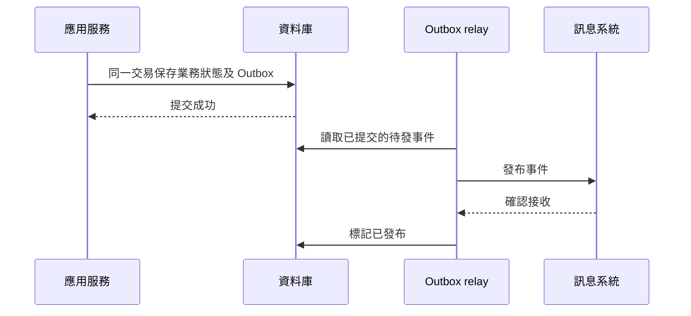

# 交易（Transaction）

具有明確提交結果及隔離語意的一組資料操作。

## 設計時要確認

說清楚哪些讀寫共用交易、哪些會被重跑，以及何時能回報完成。

## 示例

邀請狀態和收據一起提交，通知的發布安排在提交後。

## 提交與發布

**設計參考。** 本圖以 Transactional Outbox 作示例。Outbox relay 必須能重試，消費端應按事件 ID 防重。

## 延伸閱讀

[consistency](consistency.md) · [unit-of-work](unit-of-work.md) · [outbox-pattern](outbox-pattern.md) · [DDD 設計索引](README.md)
