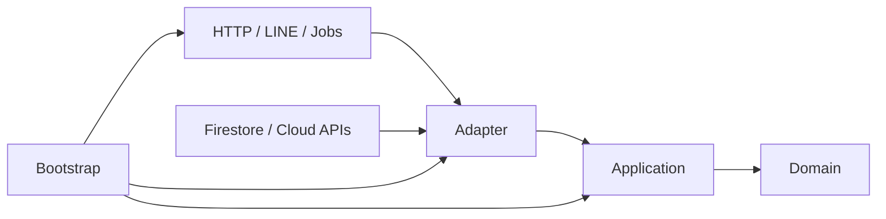

# 依賴方向

依賴必須由外向內，核心不認識技術入口。

## 允許方向

- Domain 只依賴標準庫或同一 bounded context 的純核心。
- Application 可以依賴 Domain，並定義自身需要的 port。
- Adapter 可以依賴 Application／Domain 契約及供應端 SDK。
- Bootstrap 可以依賴所有組裝目標。
- 共用 transport 依賴產生型別與抽象 handler，不反向匯入功能內部。

## 禁止方向

- Domain 匯入 Firestore、HTTP、LINE、OpenTelemetry exporter 或生成路由。
- HTTP handler 自行建立資料庫 client。
- 一個業務 adapter 直接呼叫另一業務 adapter。
- 前端 shared 元件擁有具體業務 API 或授權判斷。
- 為共用而建立沒有明確擁有者的全域 service 或資料模型。

## 技術依賴

Go 模組版本以 `backend/go.mod`／`go.sum` 為準；Node 套件以各 `package.json` 與 `pnpm-lock.yaml` 為準。重要技術包含 Firestore、Cloud Storage、LINE Bot SDK、OpenAPI middleware、OpenAI SDK 與 OpenTelemetry；版本文件不能取代 manifest。

## 變更依賴

有意更新依賴時，必須檢查 changelog、契約相容性、產生碼差異、執行環境與鎖檔。下載成功只證明套件可取得，不證明整合行為正確。
