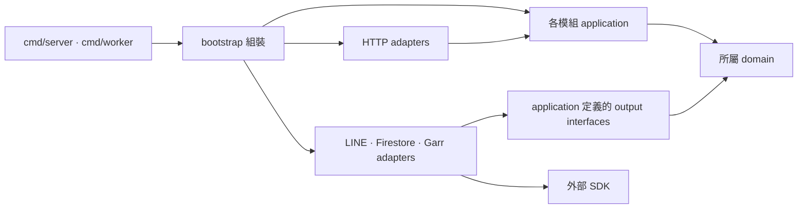

# 套件依賴與圖譜

> 狀態：目標 import 規則；圖中是允許依賴，不是假稱現有程式已實作。

## 允許方向

圖表示 compile-time import；Use Case 執行時透過介面呼叫 adapter。Go 使用隱式介面實作，組裝時可驗證相容性。

| 套件 | 允許 | 禁止 |
| --- | --- | --- |
| domain | 標準庫、明確核准的領域值型別 | HTTP、LINE、Firestore、Garr、application、adapter |
| application | 所屬 domain、所需的小介面；有向且明確的跨模組契約 | adapters、SDK、組裝入口 |
| HTTP adapter | application、請求／回應轉換 | 直接寫 Firestore、跳過 Use Case 授權 |
| 外部 adapter | application 契約、domain、對應 SDK | import HTTP handlers、依賴 bootstrap |
| bootstrap | 設定、applications、adapters | 業務判斷 |

## 跨模組規則

- direct 與 group 不互相依賴，不把群組角色等同個人資源擁有權。
- application 如需通知，以使用端定義的介面接受交易性工作寫入；由 Firestore adapter 實作。
- 業務狀態與 Outbox 的原子提交介面以實際使用案例定義，不傳 Firestore transaction 型別進核心。
- jobs 不依賴 direct/group application；事件 dispatch 與具體 handler 綁定在 bootstrap，避免循環依賴。
- LINE rendering 留在 adapter，不能把 Flex JSON 型別當成領域實體。

## Graphify 與 Repomix 工作流

1. Graphify query 找已索引符號與關係；無結果時讀當前程式，不能解讀為沒有依賴。
2. 實作改動後使用 `mise run graphify-update` 重建；AST 圖可能遺漏 Go 隱式介面、動態 dispatch、TOML 與 Markdown。
3. 用 `go list -deps ./...`／gopls 與原始碼核對 import；上方 Mermaid 才是尚未實作架構的設計圖。
4. 使用 Repomix 完整包做全局審查；日常審查按 docs 與 Go 原始碼範圍打包，避免工具生成技能與 binary 噪音。
5. Repomix 安全掃描保留開啟；排除提示需個別檢查，不能當成絕對無機密證明。

Graphify 統計不等同架構合規，Repomix token 減少不等同功能最佳化。本輪不為改善圖形而改應用程式。
