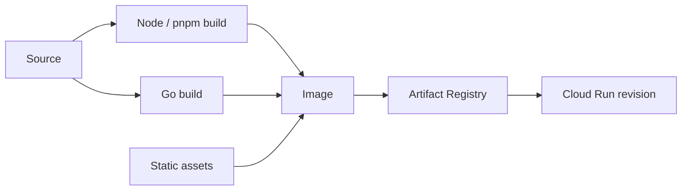

# 部署架構

正式形態是單一容器部署至 Cloud Run。映像包含 Go server、Next.js 靜態輸出、Rich Menu 圖片與必要的系統工具。

## 建置階段

`Dockerfile` 固定 Node、pnpm、Go 與基底映像；Go 以 `GOTOOLCHAIN=local`、唯讀模組模式及 `CGO_ENABLED=0` 建置。Runtime 以非 root 使用者執行。

## 部署路徑

`cloudbuild.yaml` 描述手動或自訂 trigger 的驗證、建置、推送、Firestore policy、LINE navigation job 與 Cloud Run deploy。GitHub managed trigger 可能使用平台內嵌流程，因此不能只靠此檔推定目前服務設定。

## Runtime 設定

非機密值以環境變數注入，秘密以 Secret Manager reference 注入。新 revision 必須在服務設定、Secret version、service account、資料庫與外部 endpoint 均正確後才接流量。

## 發布安全

發布前取得目標 project、region、service、revision、執行身分、目前流量與回退 revision。候選 revision 先做健康與核心流程驗證，再逐步切流量並觀察錯誤、延遲和未授權結果。資料格式變更必須先確認舊、新版本可同時運作。

## 證據界線

映像建置、設定解析與 mock 通過不代表部署成功；revision Ready 不代表 LINE、Firestore、任務與真實裝置流程通過。正式結果需記錄目標環境、revision、時間、檢查與回退狀態。
