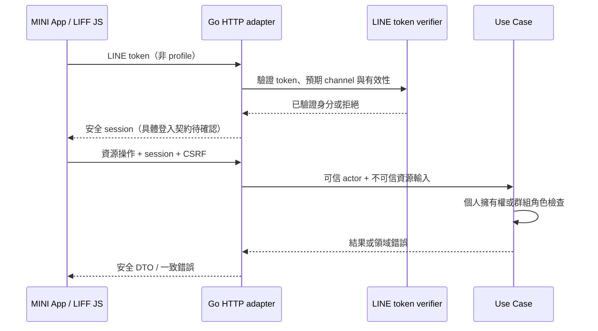

# HTTP 與身分契約

範圍：本頁保留後續平台擴充的設計參考，不是首版必建清單。
當前依 [ADR 0002](decisions/0002-baseline.md)、[分階段落地](../development/foundation.md)
與 [基礎出勤](../features/attendance.md) 先完成基礎，再建立出勤所需的 API／資料／套件。
不預建 Worker、Garr、群組角色、管理後台或模板；不新增測試工程。

> 狀態：本專案技術基線；尚未實作。產品路由必須經功能契約補足，不預設完整 CRUD。

目前已實作的連線入口見 [LINE 接入能力](../development/line-prototype.md)：
Webhook、MINI App 公開設定與每次驗證 ID token 的本人 API。
目前沒有 session／業務 CRUD／持久 Inbox；下列持久接收回應仍屬目標契約。

## 基礎入口

| Route | 驗證 | 成功 | 失敗 |
| --- | --- | --- | --- |
| POST /webhooks/line/{channelID} | 對該 channel 原始 body 驗簽 | 200 所有事件持久接收／已存在；空事件 200 | 400 無效結構、413 過大、401 簽章錯誤、404 未配置渠道、503 持久接收失敗 |

channelID 是配置選擇器，不是認證。預設 body 上限 1 MiB，需實際事件／負載驗證再調整；不是 LINE 官方上限。
逐事件保存後部分失敗可以回 503，重送以事件 ID 去重；未知／無 source 的範圍外事件回成功且不得觸發業務。
standby 事件不得觸發回覆或 Push。對事件內容進行 action allowlist 與授權，不能直接執行 data 內指令。

## API 一致性

新產品 API 使用 /api/v1，JSON lowerCamelCase；非預期欄位拒絕，明確設定 body 限制。
錯誤 envelope：`{"error":{"code":"forbidden","message":"operation not allowed"},"requestId":"..."}`。
invalid_argument=400、unauthenticated=401、forbidden=403、not_found=404、conflict=409、rate_limited=429、unavailable=503。
資源是否存在會洩漏資料時統一 not_found；LINE 上游錯誤不直接透傳給用戶。逾時與取消需依是否已提交保存結果，不假設請求中斷會回滾。
Session cookie：Secure、HttpOnly、Path=/、SameSite=Lax 作基線；跨站嵌入與實機登入驗證後再決策。修改操作檢查 CSRF token 與 Origin。
管理登入、session 建立／撤銷 endpoint 與 TTL 待 P03／P04，不以臨時密碼或任意 LINE user ID 代替。

## MINI App 信任流程

LINE token 不能當成任意群組授權證明；網址、postback data 都不是授權。
依據：[LIFF 後端驗證](https://developers.line.biz/en/docs/liff/using-user-profile/)、[LINE 整合](../integrations/line.md)。
