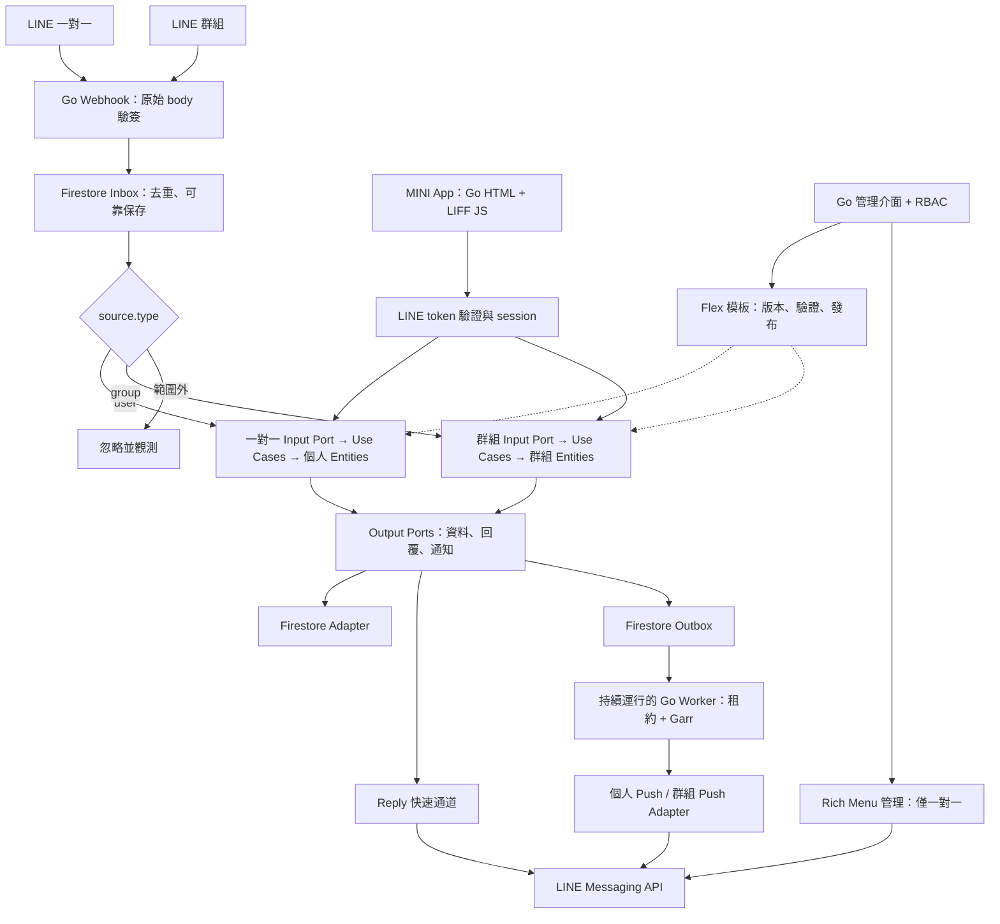

# LINE 平台架構總覽

> 狀態：架構基線已接受，應用功能尚未實作。後端採 Go、LINE Messaging API 與 Firestore，只部署 Fly.io。
> MINI App 由 Go 提供 HTML/CSS，瀏覽器仍需 LIFF JavaScript；不需要 Node.js 後端。

## 目前基線

依 [已接受的基線](decisions/0002-baseline.md) 與 [分階段落地](../development/foundation.md)，
先穩定 HTTP／容器／Fly，再接入資料與首期 LINE 入口，最後實作基礎出勤。
維持一個服務，HTTP、使用案例與 adapter 分工；業務層不依賴 SDK 型別，由 main 組裝。
Webhook 與 MINI App 若提供相同出勤操作，共用使用案例。
Worker、Garr、群組角色、管理後台、Rich Menu 與定位不列為首版必做項目。

## 文件路由

| 任務 | 必讀文件 |
| --- | --- |
| 新增或移動套件 | [目錄規劃](layout.md)、[依賴規則](dependencies.md) |
| Webhook、Reply、Push、Worker | [可靠性與資料](reliability.md)、[LINE 整合](../integrations/line.md) |
| 排定實作與驗收 | [交付計畫](delivery.md) |
| Go 實作慣例 | [開發原則](principles.md)、[Go 慣例](../development/go.md) |

## 後續平台擴充參考流程

以下保留遠端平台設計，僅供後續需求成立時參考；不是當前首版架構或實作清單。

## 核心邊界

首版功能方向為「基礎出勤」。Webhook 與 MINI App API 若提供相同出勤操作，
共用業務使用案例，出勤操作資格與規則只在業務層定義一次。
首版範圍為上班、下班與本人紀錄，具體規則見 [基礎出勤](../features/attendance.md)。
依 [分階段落地](../development/foundation.md) 先穩定執行與部署基礎、再完成資料與 LINE 接入，
最後實作出勤；不要求兩個入口同時開發。本頁不表示這些行為已實作。

以下模組表是後續平台能力參考，不預建全部目錄或介面。

| 模組 | 身分與狀態 | 使用案例與授權 |
| --- | --- | --- |
| direct | User、DirectConversation、個人資源 | Message/Postback、Follow/Unfollow、Unsend；資源擁有權 |
| group | Group、GroupRole、群組資源 | Message/Postback、Join/Leave、成員事件、Unsend；群組角色與資源權限 |
| identity | 經驗證的 LINE 身分、session | 驗證預期 channel 與有效性；不信任前端 profile 或 decoded token |
| templates | 模板與不可變發布版本 | 驗證、測試發送、發布、回復 |
| richmenu | 選單、圖片參照、alias、指派 | 預設／個人化／切換；統一以 Messaging API 管理 |
| jobs | Inbox/Outbox 狀態、租約、typed target | 領取、重試、完成、人工處理 |

群組 userId 可能缺少，需個人權限的操作拒絕執行。平台群組管理角色須明確綁定，不假設 LINE 提供完整管理員名單。
群組內容對成員可見，私人結果導向 MINI App／一對一。群組不提供 Rich Menu。
新產品只支援 user/group；room 是仍有官方相容支援的歷史來源，不宣稱 API 全部已淘汰。
Service Message 待資格與模板確認後使用獨立 adapter，不當作任意 Flex Push。

## 模組拆分

採模組化單體：一個 Go 服務僅部署至 Fly.io，依實際業務能力劃分套件。
先圍繞已確認的「基礎出勤」方向逐步實作；會員管理與通知等能力待需求確認後再加入，
不預建這些模組。
先保留簡單套件，當責任或依賴明確分化時再拆分，避免為每項功能建立固定四層目錄。

## 歷史查核依據與限制

2026-11-07：Context7 查詢 `/line/line-openapi`（source、Reply、Push retry key、Rich Menu）、
`/line/line-liff-v2-starter`（vanilla LIFF）、`/websites/cloud_google_firestore_native`（交易、IAM）。
LIFF starter 不涵蓋完整 token 驗證，該項以官方 LIFF 文件補足。Garr 無 Context7 專屬索引，核對已安裝模組文件。
官方來源庫 main 查核提交：`090500a12f9777995006d9fb5cafab8d83a792b2`；不代表官方網站所有頁面均被來源庫收錄。

- [LINE 官方來源快照](https://github.com/line/line-developers-docs-source/tree/090500a12f9777995006d9fb5cafab8d83a792b2)
- [群組](https://developers.line.biz/en/docs/messaging-api/group-chats/)、[Rich Menu](https://developers.line.biz/en/docs/messaging-api/rich-menus-overview/)
- [LIFF 後端身分](https://developers.line.biz/en/docs/liff/using-user-profile/)
- [Firestore transactions](https://docs.cloud.google.com/firestore/native/docs/manage-data/transactions)
- [Garr](https://github.com/line/garr)

| 問題 | 文件 |
| --- | --- |
| 實作時採哪些原則？ | [開發原則與決策](principles.md) |
| Webhook、MINI App 如何驗證？ | [LINE 整合](../integrations/line.md) |
| Firestore 權限、交易如何處理？ | [Firestore 整合](../integrations/firestore.md) |
| Go 程式怎麼寫、怎麼驗證？ | [Go 慣例](../development/go.md)、[測試](../development/testing.md) |
| 如何部署與管理機密？ | [Fly.io](../operations/fly.md) |

文件核對不取代真實渠道、IAM、索引、裝置與發布資格驗收。

詳細契約入口：[Codex 接手索引](codex-readiness.md)。

部署已決定：[Fly.io ADR](decisions/0001-fly-deployment.md)。後續若啟用定位才參考 [Web Geolocation 契約](../integrations/web-geolocation.md)。
