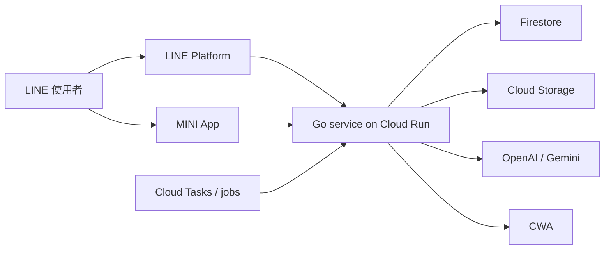

# 架構總覽

本專案是一個部署於 Cloud Run 的模組化單體。Go 程序同時提供 HTTP API、LINE Webhook、MINI App 靜態檔案與內部工作端點；前端由 Next.js 在映像建置階段輸出靜態內容。

## 系統上下文

## 執行入口

- `backend/main.go` 啟動服務或具名維運命令。
- `backend/internal/bootstrap/` 建立外部 client、業務模組、路由與生命週期。
- `backend/internal/transport/http/` 提供 HTTP、瀏覽器靜態檔與診斷入口。
- `backend/internal/transport/line/` 接收已驗簽 LINE 事件。
- `frontend/miniapp/` 是 Pages Router 靜態 MINI App。
- `api/contract/` 是公開、內部與診斷 API 契約來源。

## 主要能力

後端按 attendance、discussion、enterprise、issue、journal、membership、object、organization、project、repository、summary、team 與 weather 等 bounded context 組織。Identity、LINE group、Firestore key、object storage 與 text generation 提供跨功能但有清楚邊界的能力。

## 權威文件

- [架構邊界](boundaries.md)
- [依賴方向](dependencies.md)
- [整合架構](integration.md)
- [部署架構](deployment.md)
- [OpenAPI 契約](../../api/contract/)
