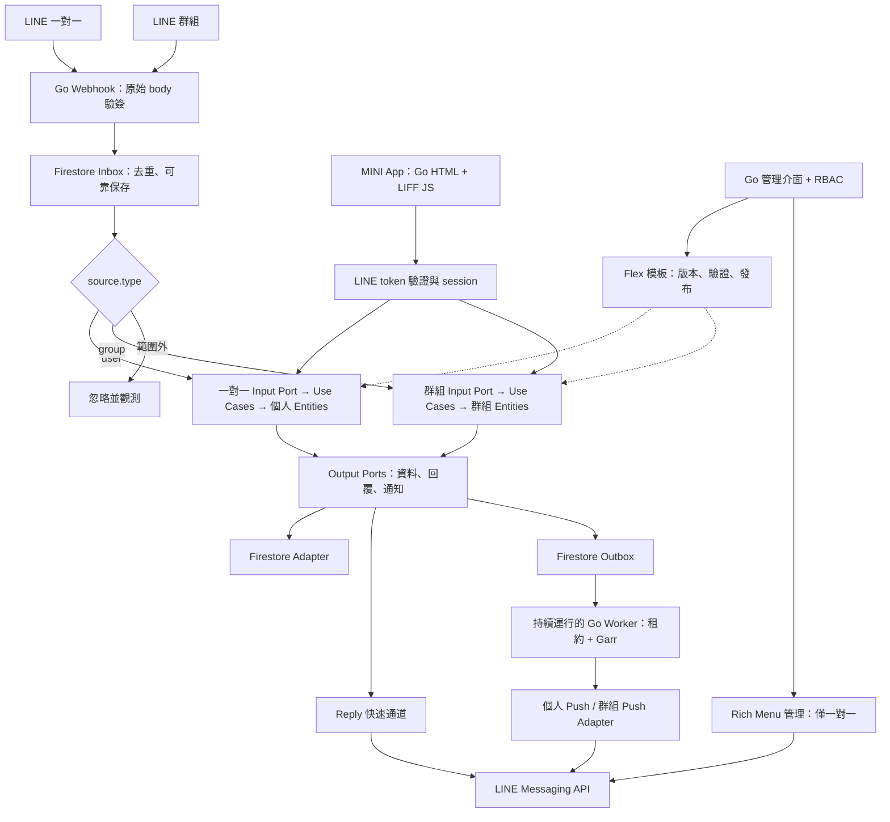

# LINE 平台架構總覽

> 狀態：目標設計；不是功能已實作的證明。後端使用 Go、LINE Messaging API、Firestore、Garr。
> MINI App 由 Go 提供 HTML/CSS，瀏覽器仍需 LIFF JavaScript；不需要 Node.js 後端。

## 文件路由

| 任務 | 必讀文件 |
| --- | --- |
| 新增或移動套件 | [目錄規劃](layout.md)、[依賴規則](dependencies.md) |
| Webhook、Reply、Push、Worker | [可靠性與資料](reliability.md)、[LINE 整合](../integrations/line.md) |
| 排定實作與驗收 | [交付計畫](delivery.md) |
| Go 實作慣例 | [開發原則](principles.md)、[Go 慣例](../development/go.md) |

## 執行流程

## 核心邊界

| 模組 | 身分與狀態 | 使用案例與授權 |
| --- | --- | --- |
| direct | User、DirectConversation、個人資源 | Message/Postback、Follow/Unfollow、Unsend；資源擁有權 |
| group | Group、GroupRole、群組資源 | Message/Postback、Join/Leave、成員事件、Unsend；群組角色與資源權限 |
| identity | 經驗證的 LINE 身分、session | 驗證預期 channel 與有效性；不信任前端 profile 或 decoded token |
| templates | 模板與不可變發布版本 | 驗證、測試發送、發布、回復 |
| richmenu | 選單、圖片參照、alias、指派 | 預設／個人化／切換；統一以 Messaging API 管理 |
| jobs | Inbox/Outbox 狀態、租約、typed target | 領取、重試、完成、人工處理 |

群組 userId 可能缺少，需個人權限的操作拒絕執行。平台群組管理角色須明確綁定，不假設 LINE 提供完整管理員名單。
群組內容對成員可見，私人結果導向 MINI App／一對一。群組不提供 Rich Menu。
新產品只支援 user/group；room 是仍有官方相容支援的歷史來源，不宣稱 API 全部已淘汰。
Service Message 待資格與模板確認後使用獨立 adapter，不當作任意 Flex Push。

## 查核依據與限制

2026-11-07：Context7 查詢 `/line/line-openapi`（source、Reply、Push retry key、Rich Menu）、
`/line/line-liff-v2-starter`（vanilla LIFF）、`/websites/cloud_google_firestore_native`（交易、IAM）。
LIFF starter 不涵蓋完整 token 驗證，該項以官方 LIFF 文件補足。Garr 無 Context7 專屬索引，核對已安裝模組文件。
官方來源庫 main 查核提交：`090500a12f9777995006d9fb5cafab8d83a792b2`；不代表官方網站所有頁面均被來源庫收錄。

- [LINE 官方來源快照](https://github.com/line/line-developers-docs-source/tree/090500a12f9777995006d9fb5cafab8d83a792b2)
- [群組](https://developers.line.biz/en/docs/messaging-api/group-chats/)、[Rich Menu](https://developers.line.biz/en/docs/messaging-api/rich-menus-overview/)
- [LIFF 後端身分](https://developers.line.biz/en/docs/liff/using-user-profile/)
- [Firestore transactions](https://docs.cloud.google.com/firestore/native/docs/manage-data/transactions)
- [Garr](https://github.com/line/garr)

文件核對不取代真實渠道、IAM、索引、裝置與發布資格驗收。

詳細契約入口：[Codex 接手索引](codex-readiness.md)。

部署已決定：[Fly.io ADR](decisions/0001-fly-deployment.md)。定位功能依 [Web Geolocation 契約](../integrations/web-geolocation.md)，前端 API 與 Go 後端授權分離。
