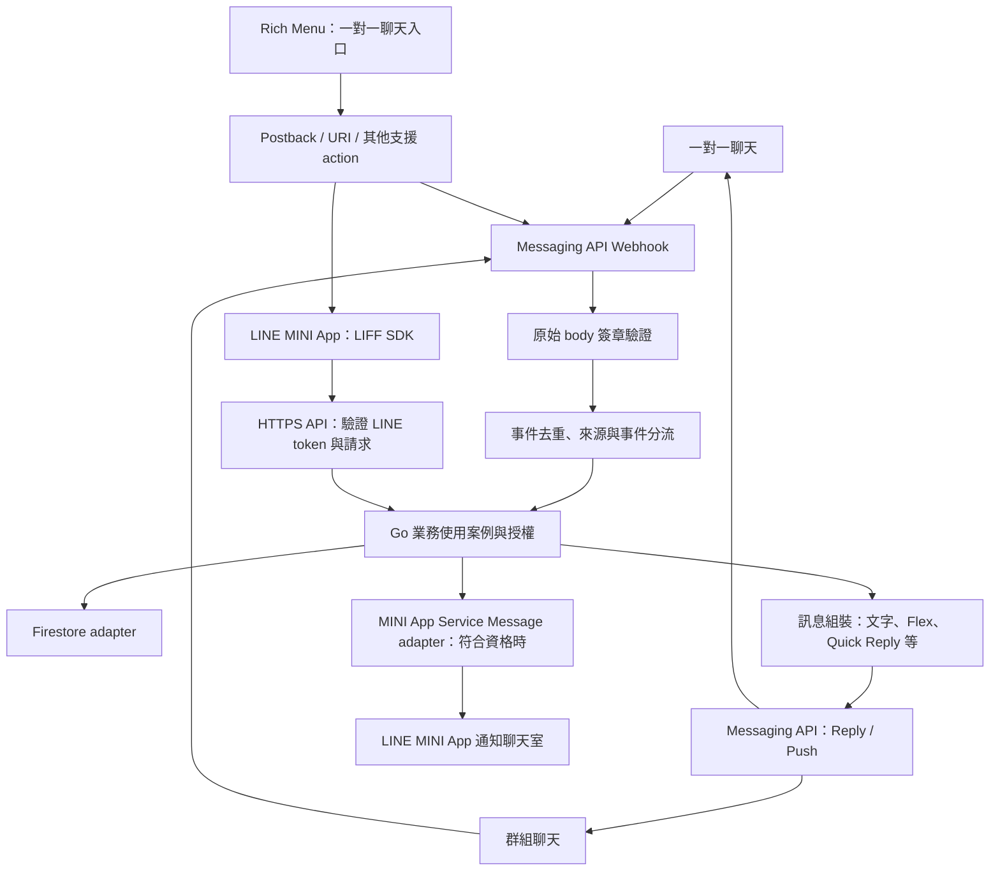

# 應用架構

> 目標設計：LINE Messaging API＋LINE MINI App＋Go＋Firestore。
> 本頁描述設計方向，不表示應用或部署已實作。

## 1. 先看整體流程

圖中 action 是概念分流：Postback 產生事件；URI 開啟頁面，不會直接產生 postback。
Rich Menu、Flex 與發送方式分屬互動入口、訊息內容、傳遞管道，不能合併為單一功能。
完整能力與限制見 [LINE 整合](../integrations/line.md)。

首版功能方向為「基礎出勤」。Webhook 與 MINI App API 若提供相同出勤操作，
共用業務使用案例，出勤操作資格與規則只在業務層定義一次。
首版範圍為上班、下班與本人紀錄，具體規則見 [基礎出勤](../features/attendance.md)。
依 [分階段落地](../development/foundation.md) 先穩定執行與部署基礎、再完成資料與 LINE 接入，
最後實作出勤；不要求兩個入口同時開發。本頁不表示這些行為已實作。

## 2. 每層只負責什麼

| 層級 | 責任 | 不應放入 |
| --- | --- | --- |
| HTTP 入口 | 簽章／身分驗證、請求解析、呼叫使用案例、轉換回應 | 業務規則、Firestore 查詢 |
| 業務使用案例 | 協調操作、授權、業務規則、定義需要的小介面 | HTTP 狀態碼、LINE SDK 與 Firestore 型別 |
| 技術 adapter | 實作資料存取與訊息發送介面、轉換外部型別 | 跨入口共用的業務判斷 |
| 組裝入口 `main` | 建立 client、注入依賴、啟動與關閉服務 | 業務流程 |

執行時由使用案例呼叫 adapter；程式碼依賴方向則由 adapter 實作業務端需要的介面。
只在實際需要隔離外部依賴時建立介面，不為每個 struct 配一個介面。

## 3. 模組如何拆分

採模組化單體：一個 Go 服務僅部署至 Fly.io，依實際業務能力劃分套件。
先圍繞已確認的「基礎出勤」方向逐步實作；會員管理與通知等能力待需求確認後再加入，
不預建這些模組。
先保留簡單套件，當責任或依賴明確分化時再拆分，避免為每項功能建立固定四層目錄。

## 4. 接下來查哪裡

| 問題 | 文件 |
| --- | --- |
| 實作時採哪些原則？ | [開發原則與決策](principles.md) |
| Webhook、MINI App 如何驗證？ | [LINE 整合](../integrations/line.md) |
| Firestore 權限、交易如何處理？ | [Firestore 整合](../integrations/firestore.md) |
| Go 程式怎麼寫、怎麼驗證？ | [Go 慣例](../development/go.md)、[測試](../development/testing.md) |
| 如何部署與管理機密？ | [Fly.io](../operations/fly.md) |

影響模組邊界、資料一致性或部署方式的決策，記錄於 [ADR](decisions/README.md)。
