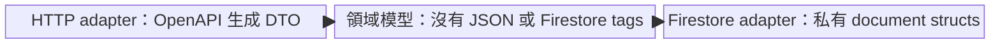

# 後端功能邊界

<a id="後端功能邊界"></a>

第三階段已完成 HTTP、領域與持久化格式的分離；公開 OpenAPI、資料文件與交易語意保持相容。

## 六邊形分層參考

每個 bounded context 位於 `backend/internal/business/<context>/`，依實際責任採用下列結構。簡單功能可以少用層級；不得為了符合範本而建立空套件或搬移程式碼。

```text
internal/business/
└── <Bounded Context>/
    ├── domain/                  # Domain layer
    │   ├── entity/              # Entity / Aggregate Root
    │   ├── valueobject/         # Value Object
    │   ├── service/             # Domain Service
    │   ├── event/               # Domain Event
    │   └── policy/              # Domain Policy
    ├── application/             # Application layer
    │   ├── command/             # Write operations / Use cases
    │   ├── query/               # Queries / Use cases
    │   ├── port/                # Output Port / Interface
    │   └── dto/                 # Application DTO
    └── adapter/                 # Adapter layer
        ├── http/                # HTTP Handler
        ├── line/                # LINE Webhook / API
        ├── firestore/           # Database Adapter
        ├── messaging/           # Message Queue Adapter
        └── scheduler/           # Scheduled Trigger
```

依賴必須指向內層。Application 協調領域規則並定義所需介面；Adapter 呼叫 use case 或實作 output port；Domain 不依賴 HTTP、LINE 或 Firestore；`bootstrap/` 負責組裝依賴。

- [目錄：business/attendance/domain、business/attendance/application<br>責任與允許依賴：各子功能的模型、規則與能力契約；依賴方向見 目前模組與責任](code-layout.md)

- 目錄：business/attendance/adapter/http<br>責任與允許依賴：出勤 HTTP、生成 DTO 轉換、認證後的契約驗證；依賴消費端 Authenticator 介面

- 目錄：business/issue<br>責任與允許依賴：事項用例、建立者權限與生命週期規則；只依賴標準庫與 Repository 核心契約

- 目錄：business/issue/adapter/http、business/issue/adapter/firestore<br>責任與允許依賴：分別擁有 HTTP DTO／契約驗證與文件／交易；bootstrap 注入既有身分、Repository client 及共用編號

- 目錄：business/discussion<br>責任與允許依賴：主題、單層留言及各自作者編輯規則；只依賴標準庫與 Repository 核心

- 目錄：business/discussion/adapter/http、business/discussion/adapter/firestore<br>責任與允許依賴：分別擁有主題／留言 HTTP 契約及文件／交易；討論配置共用 number，留言不配置 number

- 目錄：business/repository/application/labels、business/repository/adapter/http/labels<br>責任與允許依賴：標籤目錄列出／建立與 HTTP 轉換；Firestore 實作保留於既有 repository/firestore，重用 client；共享 ID 正規化及交易內引用核驗，實際分類寫入仍由 Issue／Discussion 負責

- 目錄：business/attendance/adapter/firestore<br>責任與允許依賴：文件 DTO、查詢／交易、錯誤轉譯、固定版本防重編碼

- 目錄：business/attendance/adapter/line、business/attendance/adapter/presentation<br>責任與允許依賴：聊天流程、出勤卡片與不依賴 SDK 的共用呈現

- 目錄：business/summary/application/messagecollection、business/summary/adapter/line/messagecollection<br>責任與允許依賴：訊息模型與收集契約；LINE 文字收集、編輯與收回，不依賴摘要生成

- 目錄：business/summary/adapter/line<br>責任與允許依賴：收集與摘要指令的組合入口，先處理指令，再靜默收集一般文字

- 目錄：business/summary/application/summarization<br>責任與允許依賴：摘要用例與能力契約；不依賴 SDK

- 目錄：business/summary/adapter/line/summarization、business/summary/adapter/messaging/cloudtasks/summarization<br>責任與允許依賴：摘要指令、佇列排程與結果傳送

- 目錄：business/summary/adapter/http/summarization<br>責任與允許依賴：摘要工作 HTTP，透過 WorkerVerifier 驗證工作身分

- 目錄：business/summary/adapter/firestore<br>責任與允許依賴：收集與摘要共用的文件、版本狀態與交易

- 目錄：business/weather/adapter/cwa/forecast、business/weather/adapter/line/forecast<br>責任與允許依賴：預報來源與聊天呈現；組裝由 bootstrap 負責

- 目錄：identity<br>責任與允許依賴：身分資料、Verifier 契約及 request context；不依賴 HTTP／SDK

- 目錄：identity/http<br>責任與允許依賴：Bearer 輸入、身分回應、HTTP 錯誤與 MINI App 設定入口

- 目錄：identity/line、identity/google<br>責任與允許依賴：LINE 本人身分與 Google 工作身分驗證的外部整合

- 目錄：transport/http/browser、transport/http/geolocation<br>責任與允許依賴：靜態頁面／CSP，以及獨立定位診斷

- 目錄：transport/http/api<br>責任與允許依賴：生成介面接線與 spec，不 import 功能實作

- 目錄：transport/http、transport/line<br>責任與允許依賴：共用 HTTP 格式與 LINE 傳輸；不依賴功能

- 目錄：bootstrap<br>責任與允許依賴：設定、外部 client 建立、手動注入、路由與生命週期

- HTTP adapter 不建立 Firestore／LINE／Google client，也不讀 gRPC 狀態碼。出勤、摘要、事項與討論的資料層在 output port 邊界將技術錯誤轉成所屬 ErrUnavailable 或既有業務錯誤；context cancellation 保留 Go 標準錯誤語意。技術原因保存在 adapter 的私有錯誤值，Unwrap 只公開領域類別，不讓上層依賴 SDK 錯誤。

- 出勤 Firestore 公開方法在回傳邊界轉譯錯誤；需統一處理多個提早回傳時，以具名 error 回傳搭配 defer 完成，不保留僅轉呼叫的 xxxOperation 方法。私有共用交易只供 adapter 內部使用，保留技術錯誤供公開邊界轉譯。 PunchSubmitter、PunchResolver 與 GroupHistoryReader 分別表達定位提交、可能寫入拒絕收據的操作解析，以及本人歷史查詢；讀取分支不因缺少定位提交能力而切換。

- 身分驗證與契約驗證仍依既有順序。已驗證身分只在同次 request context 共用；它不是跨請求登入快取。摘要 HTTP 依賴 WorkerVerifier 最小介面，由 bootstrap 注入 Google verifier。

<a id="格式與資料相容"></a>

## 格式與資料相容

現行實作



- 雙方 adapter 各自負責格式與領域型別之間的明確轉換。打卡 Request 屬於儲存憑證，由儲存層維護。

- 原文件欄位名稱、omitempty、巢狀位置、事件回執及核准稽核格式保持不變。更正防重雜湊的 <br>JSON 格式是已持久化的 v1 契約：由 Firestore codec 保留原欄位順序、伺服器欄位排除、UTC 與空休息區間正規化，不能改用 HTTP DTO 或直接序列化核心型別。

- HTTP 舊月報以遷移前捕捉的 JSON fixture 驗證。Firestore 相容測試使用獨立凍結的舊模型比對新文件，並確認舊防重回執可重播；測試僅對本機模擬器執行，沒有正式資料寫入或回填。

<a id="持續檢查"></a>

## 持續檢查

- 既有 Go suite 包含 architecture/TestDependencyBoundaries，阻擋：核心引入外部實作、核心帶序列化 tags、HTTP 直接引入 SDK 或 outgoing adapter、共用傳輸反向依賴功能，以及 OpenAPI 接線依賴功能實作。此檢查驗證直接依賴與結構，不取代行為或整合驗證。

- 前端已完成 React hooks/state；剩餘真實 LINE／正式環境整合驗收；此階段不新增框架、部署或變更資料庫索引。

- 里程碑、專案與統計的操作及保存規格見 里程碑、Project與統計。repository/milestones 與 project 各自保留核心及 HTTP adapter；Milestone 由既有 Repository Firestore Store 保存，Project adapter 注入同一 client；repository/statistics 只讀。

  - [里程碑](../../domains/repository/design.md#milestones)

  - [Project](../../domains/project/project.md)

  - [洞察（Insights）](../../domains/repository/design.md#insights)

- [後續分層構想見未來套件依賴方向。](dependencies.md#允許方向)
