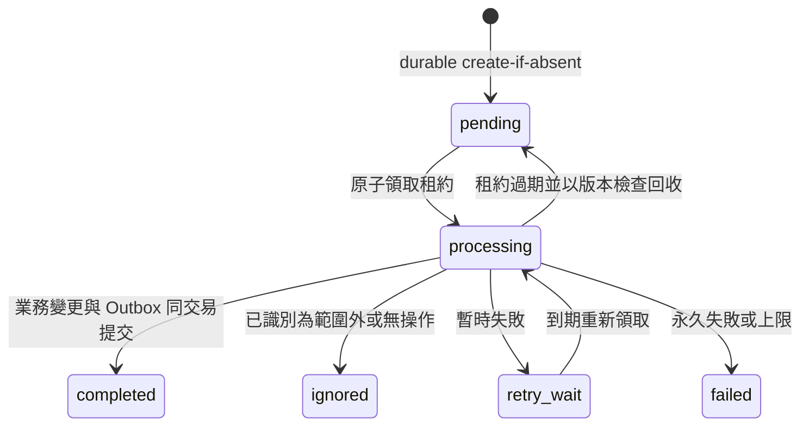
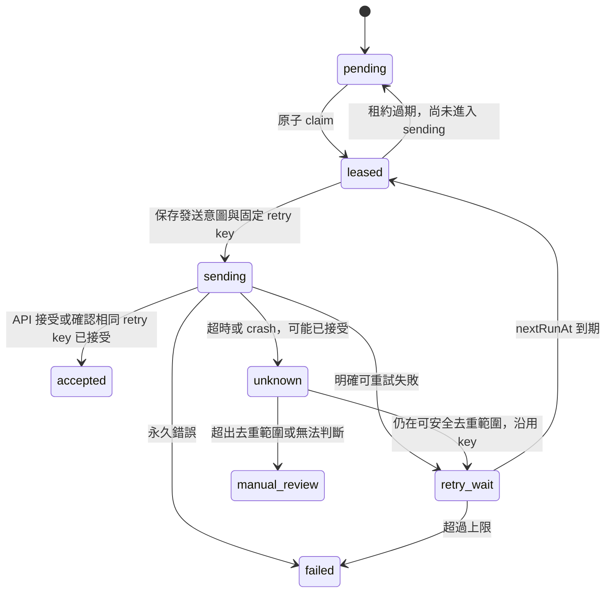
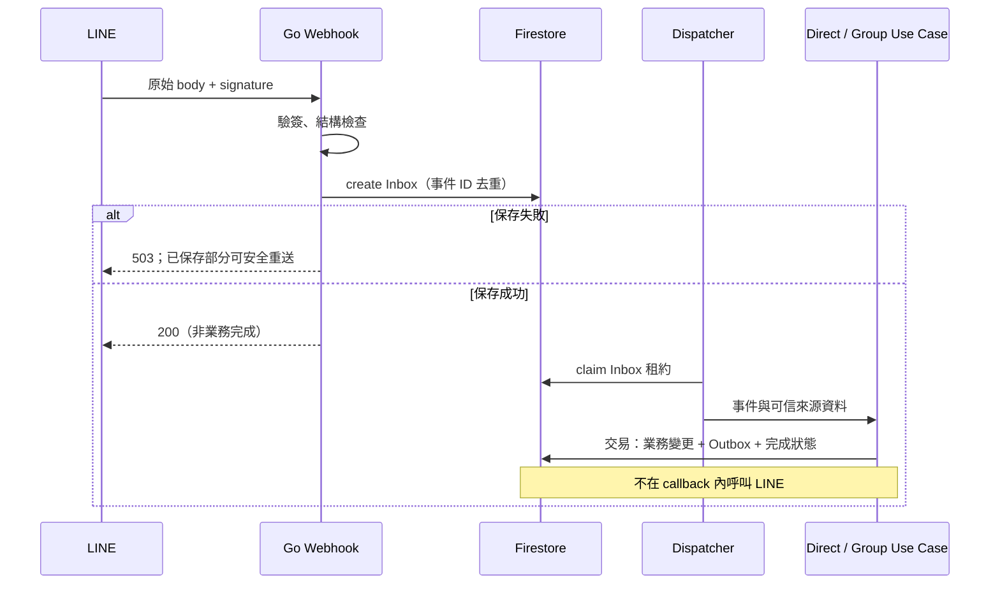

# 事件與發送狀態機

> 狀態：技術契約；外部 API 不提供與 Firestore 跨系統原子交易，不保證 exactly-once。

## Inbox

所有交易先讀後寫；callback 無 LINE 呼叫。重複 event ID 回接收成功，不重設既有狀態。
Inbox completed 只表示處理與通知意圖已提交，不表示通知已送達；Reply 記錄另有狀態。

## Outbox

sending 過期不得當成未發送的 pending。先持久化 sending 再呼叫 API；租約版本只保護資料更新，不能取消已在外部執行的請求。
避免 lease 在呼叫期間失效：外部 timeout 小於剩餘租約，必要時續租；失去租約者不得提交完成。
409 只有在 endpoint 的重複 retry key 語義確認後才能視為 accepted；保存 accepted request ID，不把所有 409 當成功。
Reply 沒有 Push retry key 的同等保障：not_attempted → attempting → accepted/rejected/unknown；unknown 不自動重送或改 Push。
具體 retry 次數、延遲、去重期限由 endpoint 現行規則與 P05 確認，未確認不得開正式自動重送。

## Webhook 時序

Reply 由獨立優先路徑處理，受 token 期限約束；不能用定期慢掃描保證即時 Reply。實作時以延遲測試選定喚醒／掃描策略。
