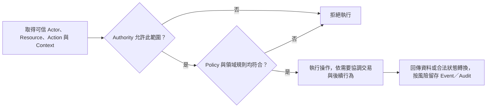

# 資源導向的通用業務操作模型

新增或修改業務操作時，在所屬領域說清楚誰能對哪個資源做什麼，以及成功、拒絕、重送後的可觀察結果。本模型沿用[模組化單體與輕量 Hexagonal](../standards/engineering.md)；個別既有操作的符合程度須循其契約與測試查證。

## 前端操作與業務契約

Web 業務操作遵循 **Frontend → API → Backend**。每個 API 操作以一個可驗證的業務結果為單位，優先沿用能完整表達該結果的既有契約。

| 層級     | 責任                                                                                                                                                            |
| -------- | --------------------------------------------------------------------------------------------------------------------------------------------------------------- |
| Frontend | 收集輸入，處理瀏覽器互動與必要的本地狀態，透過產生的 API client 送出操作，依回應呈現載入、成功、拒絕或待確認狀態。                                              |
| API      | 在 OpenAPI 定義操作的輸入、成功結果與可辨識的錯誤。對可能重送或併發的寫入，明定回應遺失後的重試方式與版本衝突語意。契約變更後重新產生 Go 與 TypeScript 程式碼。 |
| Backend  | Go 依可信身分與目前資料執行授權、權威驗證、業務計算與狀態轉換，維護資料一致性，回傳操作結果。                                                                   |

審查時，若前端必須掃描清單或拼接多個查詢才能推斷操作是否成功，應回頭檢查契約。例如「加入專案引用」的回應遺失時，UI 應顯示結果待確認，依契約重試或查詢原操作，由 Go 回覆結果。清單反映的是目前狀態，可能已被後續操作改變。

## 模型與語意

開發與維運指引

| 概念             | 設計時要回答的問題                                                     |
| ---------------- | ---------------------------------------------------------------------- |
| Actor（Subject） | 操作者是誰？哪一層提供可信身分？                                       |
| Resource         | 對象歸誰所有？適用哪個租戶、群組或資源範圍？                           |
| Action           | 使用者要完成哪個具名業務行為？                                         |
| Context          | 需要哪個時間、版本、環境與目前狀態？                                   |
| Authority        | 誰有執行、審核或決定權？權限範圍從何取得？                             |
| Policy           | 哪些授權條件與領域規則必須成立？兩者分開描述。                         |
| Decision         | 系統允許還是拒絕執行？有權駁回申請的審核者，可以成功完成「駁回」操作。 |
| Result           | 呼叫端取得哪些資料、狀態轉換與後續行為？讀取可只回傳資料。             |

採納提案時才使用 Merge 作為操作或轉換。Event／Audit 依風險決定；寫明需要的證據或不適用原因。

## 實作邊界

- 後端取得可信 Actor，依 Resource 的實際歸屬與範圍授權，預設拒絕未授權操作。角色、審核權與畫面上按鈕的顯示不能由客戶端作證。
- 使用案例協調授權與領域規則。不同入口執行同一操作時，共用必要的使用案例。各領域保有自己的狀態模型；有具體跨領域需求時才抽取共用機制，可沿用現有 identity。
- HTTP、LINE 與資料庫由 adapter 隔離。必須與寫入一致的權限、版本及狀態檢查放入交易協調，避免檢查後無條件寫入。
- 定義重要寫入的失敗、重送與併發語意。追溯資料按需要記錄操作者、對象、時間與結果，排除 token 及不必要個資。外部副作用須說明失敗處理；可重跑的交易 callback 不直接發送通知。
- 這些概念不要求各建一個套件、固定七層、通用引擎、完整 RBAC 階層或事件平台。

## 功能操作契約範本

在對應的[領域規格](../domains/README.md)填寫下表。既有頁面可涵蓋多個操作；規則尚未確定時列出待決問題。

| 欄位                    | 要記錄的內容                                                 |
| ----------------------- | ------------------------------------------------------------ |
| Actor、Resource、Action | 可信身分、資源歸屬與要執行的行為。                           |
| Context、Authority      | 時間、版本、環境、權限來源及範圍。                           |
| Policy、Decision        | 授權與業務規則分列，說明允許及拒絕條件。                     |
| Result                  | 回傳資料、合法狀態轉換、失敗時須保留的資料。                 |
| 重送與併發              | 重複請求與過期版本的行為，不適用時說明原因。                 |
| Event、Audit            | 按風險記錄必要事件及稽核證據。                               |
| 實作與證據              | 連到檔案、符號、測試；分開記錄實際結果、略過項與待確認事項。 |

## 補卡核准對照範例

| 契約問題                     | 在程式哪裡核對                                                                                                                                                                                                                                                                                                |
| ---------------------------- | ------------------------------------------------------------------------------------------------------------------------------------------------------------------------------------------------------------------------------------------------------------------------------------------------------------- |
| 審核者能改誰的出勤？         | 交易讀取 channel 內的申請與審核群組，審核者須屬於該群組的審核範圍，且不能審核自己。[交易 adapter](../../backend/internal/business/attendance/adapter/firestore/attendance_correction.go) · [CanReview](../../backend/internal/business/attendance/domain/policy/review.go)                                    |
| 同一申請再次送出核准會怎樣？ | 使用案例先讀既有決定與核准證據。有核准紀錄時再送核准可成功；要求不同的終態會被拒絕。[ReviewCorrection](../../backend/internal/business/attendance/application/command/review.go) · [NeedsDecision](../../backend/internal/business/attendance/domain/policy/review.go)                                        |
| 成功與失敗各改變什麼？       | 比對版本及事件序列、時段與重疊，通過後更新投影與 revision，寫入決定。原始事件保留；交易失敗不提交部分結果。[ApplyCorrection](../../backend/internal/business/attendance/domain/service/correction.go) · [SaveApproval](../../backend/internal/business/attendance/adapter/firestore/attendance_correction.go) |
| 稽核記錄包含什麼？           | 核准交易建立 proposal、before、after、reviewerKey 與 approvedAt。[Firestore 核准寫入](../../backend/internal/business/attendance/adapter/firestore/attendance_correction.go)                                                                                                                                  |

這是原始碼對照，產品細節見[查詢與更正](../domains/attendance/queries.md)與[工時計算](../domains/attendance/worktime.md)。變更入口時，仍須從身分來源追到使用案例，依[代表整合測試](../../backend/internal/business/attendance/adapter/firestore/attendance_integration_test.go)及適用驗收確認。

## 功能契約範本

有明確需求才新增具名的用例文件。交代目標與非目標、actor、觸發來源、輸入限制、信任與授權、前置條件、狀態轉移、交易讀寫、外部副作用、冪等鍵、錯誤碼、成功與失敗範例、測試命令、驗收及待決策項目。描述函數時連回實作，列出 signature、參數可信度、回傳、錯誤、取消與期限。

## 持續檢查與修正

依[操作符合性流程](../development/workflow/implementation.md#business-operation-compliance)定位與核對契約、實作，再驗證本次變更；適用案例與限制依[業務操作證據](../development/verification/evidence.md#business-operation-evidence)記錄。工具、官方來源與巢狀指引的適用方式以[專案根指引](../../AGENTS.md)為準，不在本契約另訂查證流程或增加操作授權。
