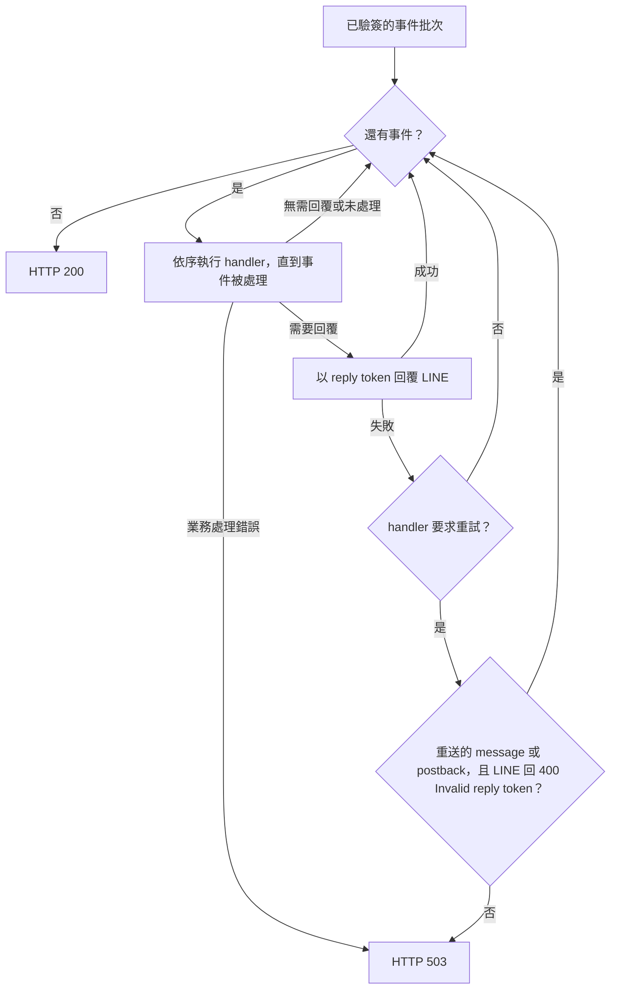
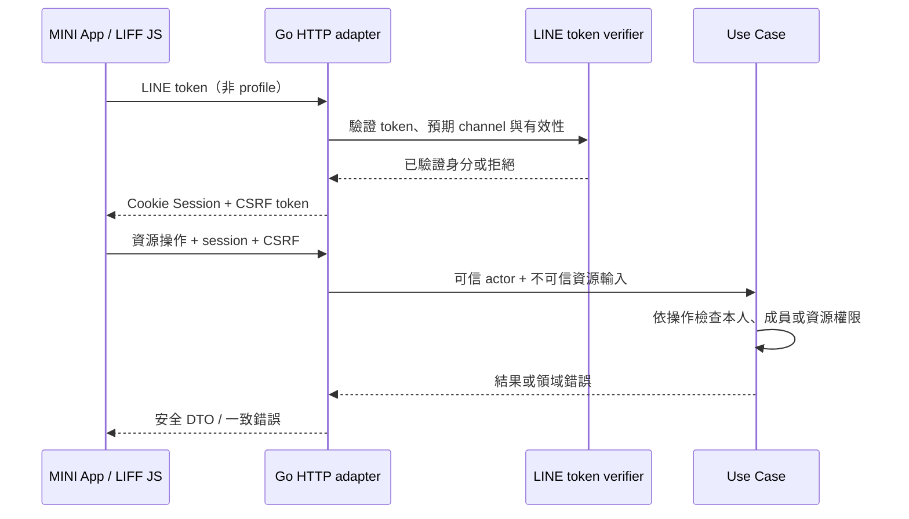

# HTTP 與信任邊界

本頁維護請求、回應、Webhook 信任邊界及模組間的驗證流程。Cookie、CSRF、Session 期限、續期和撤銷以[身分與 Session 契約](identity.md)為準。

## 基礎入口

- [POST /webhooks/line/{channelID} 使用該渠道的 secret 驗證原始請求。未配置的路徑不會註冊。Go 限制 body 為 1 MiB，超限回 413；簽章錯誤回 401，其他解析錯誤回 400。整批事件共用 5 秒處理期限。Webhook 實作](../../backend/internal/transport/line/webhook.go)

- 現行實作

[HTTP 200 表示這次事件迴圈完成，空批次也回 200。持久接收後才回應的流程屬於平台提案。規劃中的 Inbox 時序](../proposals/webhook-delivery/design.md#webhook-接收處理與發送)

## 回應與送達

整合結果若使用 `accepted`，表示外部 API 接受請求；`completed` 表示本地處理完成。LINE 訊息是否送達或已讀須依該流程取得相應證據。未知錯誤依各操作契約判定是否可重試。

## API 一致性

- 公開 API 以 /api/v1 為前綴。共用 JSON 錯誤包含 error.code 與 error.message，例如 {"error ":{"code":"forbidden","message":"operation not allowed"}}。各端點的媒體類型與 HTTP 狀態碼以 OpenAPI 為準。共用契約 · 錯誤回應實作

  - [共用契約](../../api/contract/common/transport.yaml)

  - [錯誤回應實作](../../backend/internal/transport/http/json.go)

- [Cookie Session 的建立、續期、撤銷及 CSRF 檢查見 Session 契約。](identity.md)

## MINI App 信任流程

現行實作

- LINE token 不能當成任意群組授權證明；網址、postback data 都不是授權。 依據：LIFF 後端驗證、LINE 整合。

  - [LIFF 後端驗證](https://developers.line.biz/en/docs/liff/using-user-profile/)

  - [LINE 整合](../integrations/line/capabilities.md)
