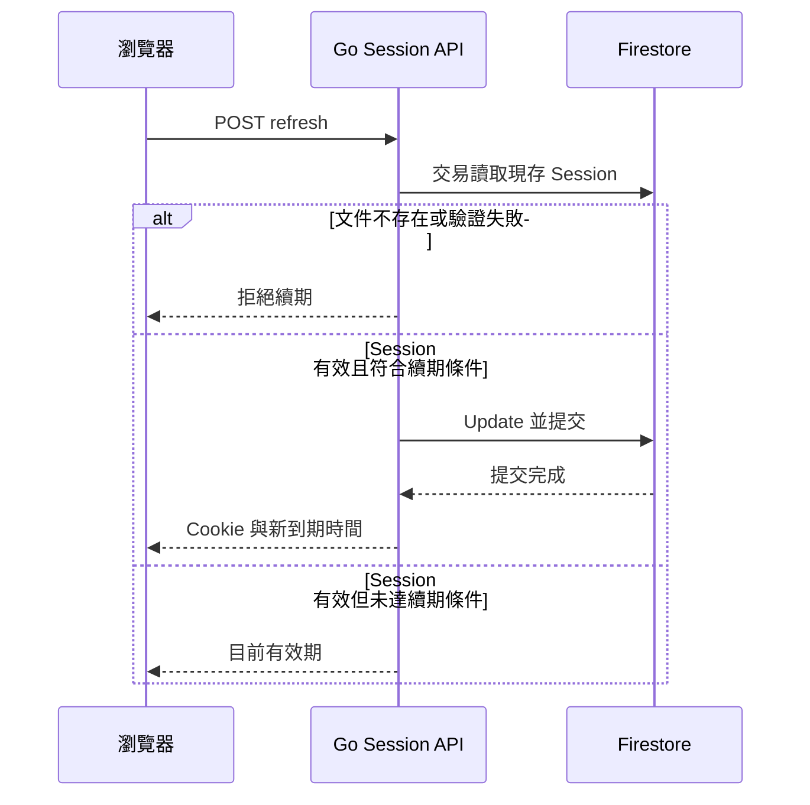

# 身分與應用 Session 契約

本頁維護應用的 Cookie、CSRF、有效期及前端生命週期。[LINE 身分交換](../integrations/line/mini-app-identity.md)定義登入來源，[Firestore Session 持久化](../integrations/firestore/browser-session.md)定義文件、交易與 TTL。[定位診斷](../integrations/geolocation/)另有公開入口。

## 已實作：登入、查詢、撤銷與滑動續期

- 登入交換由 LINE MINI App 身分契約維護。

- Cookie 為 __Host-session：32 bytes crypto/rand 隨機值，以無 padding base64url 編碼，Secure、HttpOnly、Path=/、SameSite=Lax，不設定 Domain。必須經 HTTPS 使用；本機 HTTP 不降級 Cookie。Cloud Run 終止 TLS 後， Go 以 https:// 加請求 Host 檢查 Origin，不信任 X-Forwarded-Host。

- 新 Session 的初始有效期為 min(now+30 分鐘, absoluteExpiresAt)，絕對期限為 min(建立時間+8 小時, 已驗證 LINE token exp)。每次請求由 Go 判斷到期，不依賴 瀏覽器 Cookie 或 Firestore TTL 的清理時間。到期後不能透過續期復活，必須重新 驗證 LINE token；不自動重送未完成的業務寫入。

- 文件欄位、編碼與原子持久化見 Firestore Session 契約。

- GET /api/v1/me 與全部出勤 API 支援 Cookie。Cookie 存在時優先驗證 Session； 遺失、過期、超過絕對期限或 channel 不符回 401；Firestore 故障回 503，不退回 Bearer。已驗證使用者經既有流程放入 request context，供業務 handlers 取得。

- Cookie 認證的修改操作檢查相同 Origin、CrossOriginProtection 與 Session 綁定的 X-CSRF-Token。前端在讀取請求也帶 CSRF token，伺服器收到時同樣檢查，避免 其他頁籤替換 Cookie 後舊畫面顯示另一個帳號的資料。純 Cookie GET /me 仍允許。 Session 建立入口要求 Origin 與 JSON 空物件，防止登入 CSRF；缺少契約必要 header 可能由生成路由先回 400。Session 不代替群組、資料所有權或審核授權。

- DELETE /api/v1/session 先驗證 Origin 與 CSRF，再刪除資料、清 Cookie、回 204。 不存在文件或無 Cookie 可重試回 204；過期但尚未清理的文件仍可帶原 CSRF 撤銷。 刪除失敗回 503 且不清 Cookie。前端立即清除私有畫面，保留登出重試按鈕，不 顯示伺服器登出成功。已通過驗證的執行中操作仍可能完成，登出不是交易取消。

## 續期交易與前端觸發

- POST /api/v1/session/refresh 要求 Cookie、相同 Origin、X-CSRF-Token 與 JSON 空物件。續期保留 Session ID 與 CSRF，不因讀取或續期而輪替識別碼。

- 現行實作

- 續期的交易條件與版本更新依 Firestore Session 契約。

- 原子續期不得復活已撤銷 Session，提交後才回應 Cookie。

- 前端每頁只允許一筆續期進行中，最多每分鐘嘗試一次；僅在頁面可見、兩分鐘內 有使用者活動、距到期不超過十分鐘時觸發。登入完成視為初始活動；之後只由可信 pointerdown、keydown、touchstart、wheel 事件記錄活動。每分鐘的檢查器與 visibilitychange 本身不算使用者活動，背景或閒置頁面不會無限保活。 業務請求前也檢查續期；續期失敗時尚未送出的業務操作不會被偷偷重送。

- CSRF 僅存記憶體。續期 401／403 清除已驗證狀態，要求重新驗證。網路或服務 錯誤保留原期限，後續檢查可重試；不把失敗當作已續期。重新登入、登出與 pagehide 會取消舊請求、拒收舊 generation 的前端結果。

- 多頁籤共用 Cookie。重新開頁面、重新驗證與 BFCache 恢復仍交換新 Session， 可能使其他頁籤的舊 CSRF 失效，需要重新驗證。並行 Cookie  回應仍可能亂序： 續期不換 ID，舊回應最多使瀏覽器提早失效，伺服器仍執行現存文件與絕對期限 檢查；與重新登入或登出交錯時，舊 Cookie 可能被重新帶回但不會使已刪文件復活。 不宣稱跨頁籤無縫登入或 Cookie 回應完全有序。

- 舊文件相容性依 Firestore Session 契約。

## Session 套用範圍

| 範圍                                      | 驗證方式                                                                 |
| ----------------------------------------- | ------------------------------------------------------------------------ |
| MINI App 本人 API、出勤操作（含請假登記） | Cookie Session；既有無 Cookie Bearer 仍相容                              |
| 前端打卡、歷史、申請更正、審核            | 共用 SessionProvider.request，帶 Cookie／CSRF；LINE token 僅用於登入交換 |
| Session refresh／delete                   | Cookie、Origin、CSRF，不以 Bearer 代替                                   |
| Session create                            | 向 LINE 驗證 Bearer ID token，建立應用 Session                           |
| MINI App 設定、靜態頁面、資產             | 公開，不提供使用者授權                                                   |
| /location、/api/location/validate         | 公開無狀態診斷，不授予出勤或本人身分                                     |
| LINE webhook                              | LINE 簽章，不能用瀏覽器 Session 取代                                     |
| /internal/summary                         | Google ID token 的 audience／工作帳號驗證                                |

應用瀏覽器業務已使用 Session，但後端尚未禁止舊 Bearer 客戶端。移除 Bearer 需要獨立契約與客戶端遷移；本次保留相容性，不改公開診斷或服務對服務驗證。

## 部署與驗收界線

- LINE Channel 選擇見 MINI App 設定；執行身分與資料庫見 Firestore 整合。

- TTL 負責背景清除，應用仍在每次讀取時核對有效期。

- 持久化讀寫成本見 Firestore Session 契約。

- 本機編譯、mock 與契約驗證不證明 production IAM、TTL 已啟用或真機 Cookie 行為正常。需分別驗收 LINE iOS、Android、外部瀏覽器，以及真實 Firestore 續期／登出競爭、交易重試、背景頁面、Cookie 回應亂序與多頁籤帳號切換。

## 文件依據

- Context7：Go go1.27.3 的 net/http CrossOriginProtection；它允許缺少 Origin 與 Sec-Fetch-Site 的請求，因此 Session 修改操作額外要求 Origin 與 CSRF。

- Context7：Firestore 交易與重試、 TTL、 IAM、 索引最佳實務。 SDK 方法另以 backend/go.mod 指定版本的 go doc／編譯核對；Google Developer Knowledge 在此對話未提供。TTL JSON 核對 Firebase CLI FieldOverride。

  - [Firestore 交易與重試](https://docs.cloud.google.com/firestore/native/docs/manage-data/transactions)

  - [TTL](https://docs.cloud.google.com/firestore/native/docs/ttl)

  - [IAM](https://docs.cloud.google.com/firestore/native/docs/security/iam)

  - [索引最佳實務](https://docs.cloud.google.com/firestore/native/docs/best-practices)

  - [Firebase CLI FieldOverride](https://github.com/firebase/firebase-tools/blob/main/src/firestore/api-spec.ts)

- [LINE 官方 LIFF 使用者資料， 先前查證 default branch main 的 revision 為 dea09dc；本次不變更 LINE 驗證流程。](https://github.com/line/line-developers-docs-source/blob/dea09dc6e63fc5c6a3754abfbb304fc6fce4cc54/docs/en/docs/liff/using-user-profile/index.html.md)
