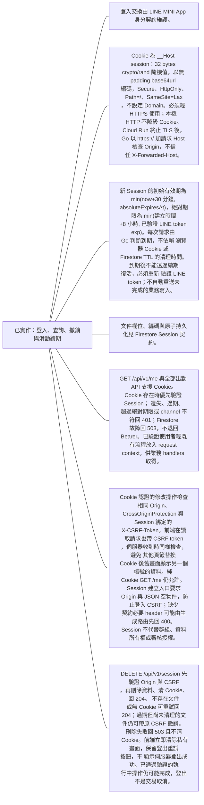
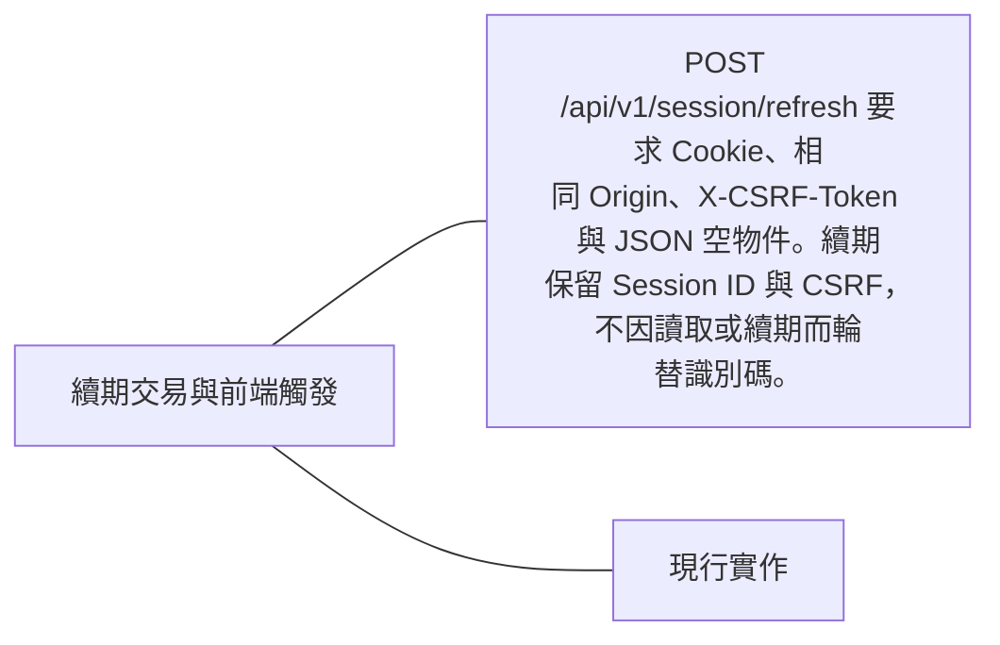
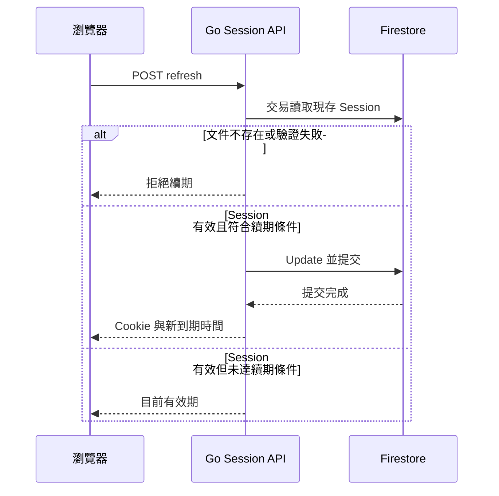
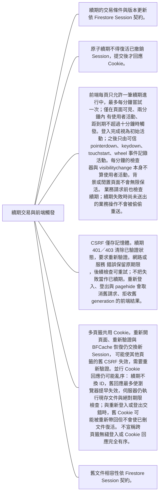
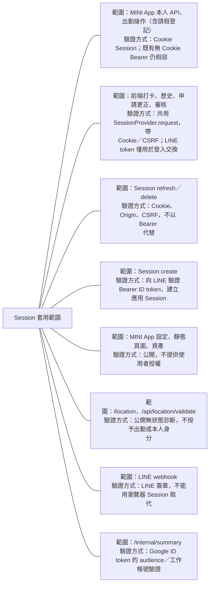
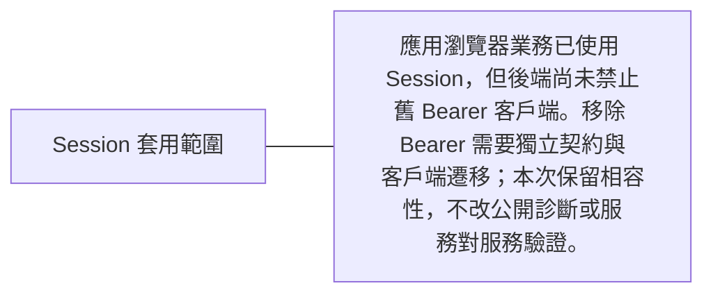
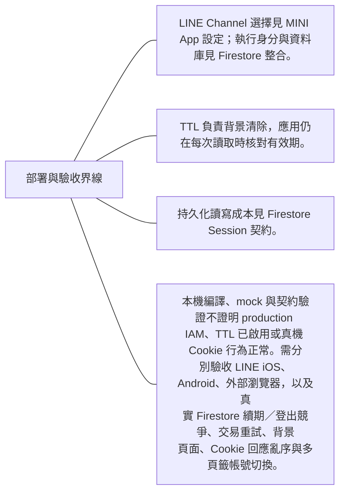
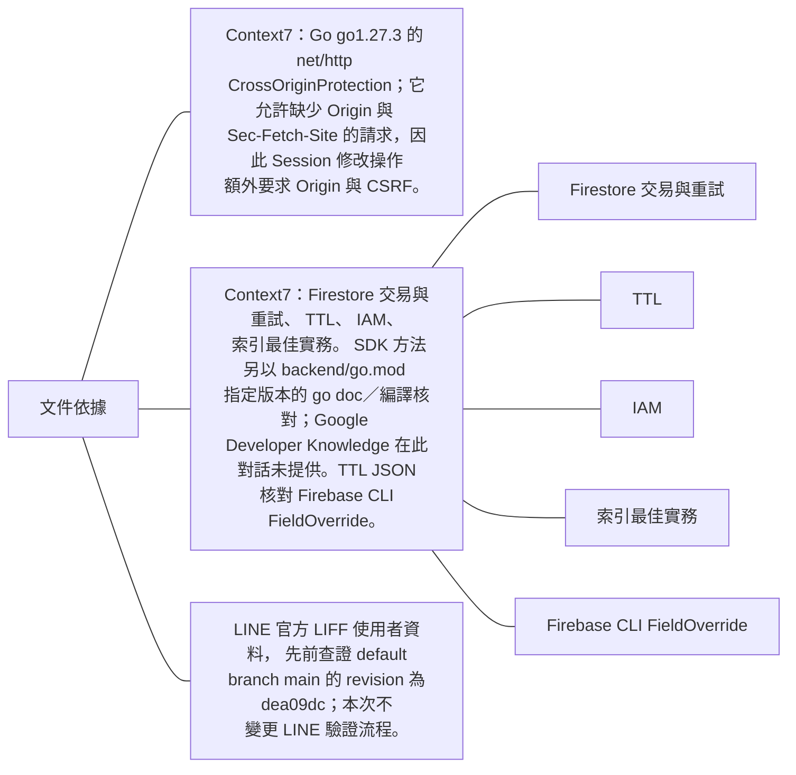

# 身分與應用 Session 契約

本頁維護應用的 Cookie、CSRF、有效期及前端生命週期。[LINE 身分交換](../integrations/line/mini-app-identity.md)定義登入來源，[Firestore Session 持久化](../integrations/firestore/browser-session.md)定義文件、交易與 TTL。[定位診斷](../integrations/geolocation/README.md)另有公開入口。

