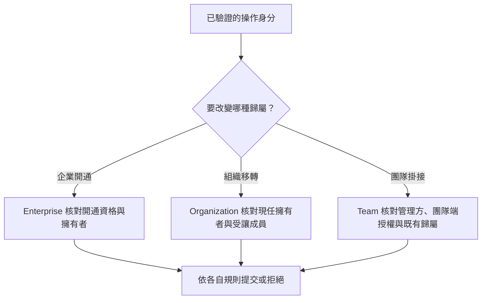

# Organization 所有權與 Team 歸屬

實作範圍：組織與 Team API、Firestore 寫入、側欄切換及團隊清單。文件路徑均位於 channels/{channelId} 下。現行群組資料與授權行為見[儲存庫規格](../domains/repository/README.md)。

[企業、組織與團隊歸屬圖（Mermaid）](diagrams/organization-team.mermaid)

## 管理操作與既有資料

| HTTP 操作 | 用途 |
|---|---|
| POST /api/v1/organizations | 登入者建立獨立組織。 |
| PUT /api/v1/organizations/{organizationId}/owner | 現任 Owner 移轉給組織現有成員。 |
| PUT /api/v1/teams/{teamId}/management | 為已自動建立的 Team 指定管理歸屬。 |
| PUT 或 DELETE /api/v1/organizations/{organizationId}/enterprise-teams/{teamId} | 新增或移除同企業內的 Team 指派。 |

組織的 memberUserIds 代表有效成員；管理歸屬操作讀取服務端維護的 managerUserIds。企業自助開通與組織加入流程見[企業規格](../domains/enterprise/design.md)。既有 LINE 群組在下一筆可信事件時以 groupId 補齊 Team；事件只更新群組名稱與狀態，保留既有管理範圍與權限。

## LINE 一對一建立入口

[LINE 私訊建立流程圖（Mermaid）](diagrams/private-chat-creation.mermaid)

在私訊輸入「建立組織」或「建立企業」，五分鐘內回覆名稱即可建立；輸入「取消」結束。建立企業時，詢問名稱及實際建立時都檢查開通資格。已驗證的 webhook 決定建立者身分。成功回覆附上對應 MINI App 入口。對話狀態依渠道與使用者隔離；資源建立、結束對話及事件回覆紀錄在同一個 Firestore 交易完成，重送同一事件會取得原結果。群組事件沿用原有 Team 流程。

## 企業、組織與團隊的授權邊界

[enterprise](../domains/enterprise/design.md) · [organization](../domains/organization/design.md) · [team](../domains/team/design.md)
