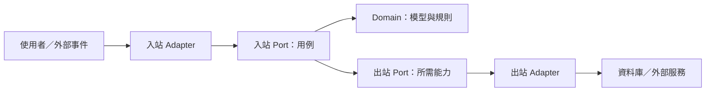
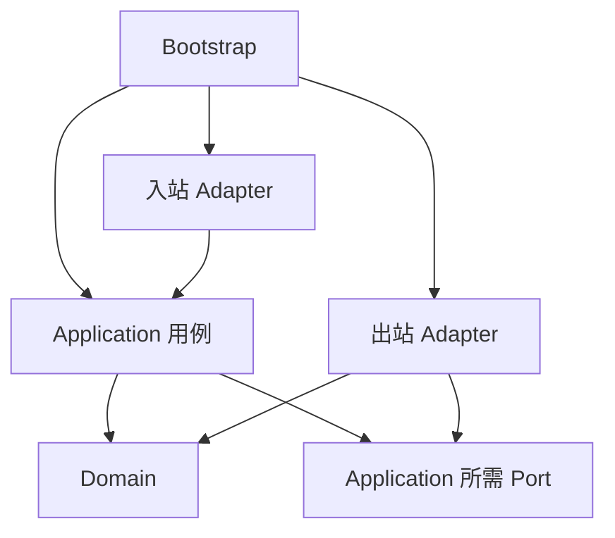

# 六邊形架構（Hexagonal Architecture）

六邊形架構也稱 Ports and Adapters：以應用程式的能力為邊界，讓業務不依賴特定輸入介面、資料庫或遠端服務。重點是內部與外部的分離；六個邊只是畫法，不代表六層、六個 Port 或六個目錄。

DDD 用限界上下文界定模型與業務規則的歸屬。六邊形架構用 Port 與 Adapter 保護這些模型及規則，讓 HTTP、Webhook 或資料庫的細節留在核心之外。[DDD 設計索引](design-guide.md#用例與架構落地)

## 核心、Port、Adapter 與組裝

| 概念             | 責任                                               | 不應混入的內容                            |
| ---------------- | -------------------------------------------------- | ----------------------------------------- |
| 內部核心         | Application 執行用例，Domain 表達規則與模型        | HTTP request、持久化文件、外部 SDK client |
| Port             | 定義某種有目的的互動：操作、輸入、結果、失敗及語意 | 任意可呼叫方法的集合、未說明行為的空介面  |
| Adapter          | 將特定外部技術或模型轉換成 Port 能理解的互動       | 複製用例、另訂角色政策或繞過 Aggregate    |
| Composition Root | 選擇實作、建立 client、注入依賴、管理啟停          | 資源授權與領域狀態轉換                    |

Port 是契約，不等於網路連接埠或 Go interface 關鍵字。公開用例函數或方法也能作為入站 Port；interface 只是一種實作方式。一個 Port 可有多個 Adapter，一個 Adapter 也可實作同一技術下的多項能力。

## 入站與出站依誰驅動判斷

| 方向          | 誰驅動互動               | 通用示例                                | 核心與 Adapter 的關係                          |
| ------------- | ------------------------ | --------------------------------------- | ---------------------------------------------- |
| 入站／Driving | 外部要求應用執行能力     | HTTP handler、Webhook handler、批次入口 | Adapter 呼叫用例；核心不需知道請求來自哪種技術 |
| 出站／Driven  | 應用需要外部完成某項能力 | 儲存、群組資格查詢、訊息傳送            | 用例依賴能力契約，Adapter 實作它               |

依「互動用途」分類，不依網路封包方向：HTTP response 不是出站 Port；HTTP client 查外部資格才是出站互動。訊息送入與訊息送出可以是兩個不同角色的 Adapter。

Webhook 發送者和瀏覽器登入者的身分有不同來源，各自由入站邊界驗證，再轉成用例要求的可信 Actor。共用用例不代表免除各入口的驗簽、同源或輸入限制。

<a id="執行與程式碼依賴"></a>

## 執行流程與程式依賴

### 執行時互動

開發與維運指引；箭頭表示發起呼叫，結果沿呼叫路徑回傳。



用例可多次讀取事實與呼叫模型；圖不表示每次操作都必須用到所有節點。純運算可能不需要出站 Port。

### 程式碼依賴

開發與維運指引；箭頭表示原始碼 import／型別依賴，Port 節點代表獨立契約套件。



執行時用例呼叫注入的出站實作，但 Application 不 import 該實作。這是依賴反轉；不是要求所有箭頭在執行時也向內。Adapter 可以依賴內層型別，內層不能為了呼叫 Adapter 而反向 import SDK。

DDD 的上下文映射箭頭則表示事實與契約的影響方向，與上面兩種圖不同，見[Context Map](context-map.md)。畫圖時必須註明箭頭語意。

## Application 與 Domain 各做什麼

| 問題                                         | 責任                                             |
| -------------------------------------------- | ------------------------------------------------ |
| 哪個 Actor 要對哪個 Resource 做哪個 Action？ | Application 接受入站已驗證事實並協調             |
| 哪個角色可以執行此操作？                     | 所屬領域的政策；Application 取得當前事實並套用   |
| 已撤銷的邀請能否接受？                       | Domain 的合法狀態轉換                            |
| 本次要載入哪些資料、共同保存哪些結果？       | Application 表達需要的原子工作，Adapter 實現交易 |
| 如何解析 JSON、回 HTTP 錯誤？                | 入站 Adapter                                     |
| 如何把 gRPC unavailable 轉成穩定錯誤？       | 出站 Adapter                                     |
| 使用哪個資料庫 client、timeout 或 Secret？   | 組裝及技術設定                                   |

Application 不只是轉呼叫一層：它擁有用例順序、失敗與提交語意。Domain 也不只是 DTO：它保護不變條件。授權與狀態規則的分工見[領域授權](domain-authorization.md)。

## 如何定義 Port

由消費端定義所需能力時，Application 依用例需求定義出站 Port。入站 Adapter 若只需要某個服務的少數方法，也可在消費端定義小介面；不要因此複製整套用例型別。

每個 Port 都要交代以下內容，不能只有 signature：

- 輸入的信任來源、租戶與資源範圍、單位及值限制。
- 操作是否寫入、讀取何種一致性與資料版本。
- 結果的缺席、拒絕、衝突、不可用及部分成功語意。
- context 取消、期限、重試、防重鍵及版本衝突。
- 是否參與工作單元，callback 是否會重跑。

名稱應表達能力，例如 MembershipReader、ReplySender。只需要查詢時，不要求它同時提供建立／更新／刪除。不是每個 struct 都要 interface，也不以 interface 數量衡量架構完整性。

Go 的 I/O 契約可接受 `context.Context`；純領域決策以必要的值與事實作參數。context 不用來偷偷攜帶 SDK transaction 或可由客戶端偽造的角色。

## 跨邊界資料與錯誤

入站 DTO、用例命令／結果、Domain 模型與持久化文件 有不同目的。Adapter 負責明確轉換；不要為少寫轉換而在 Domain 加 HTTP 或持久化標籤，也不要求每次傳遞都無條件複製所有型別。

錯誤在技術邊界轉為核心契約可理解的類別。不可用不等於不存在，查不到資格不等於資格有效。HTTP 再依既有公開契約轉成 status 與 envelope；核心不選 HTTP status。取消與期限保留可識別語意，但逾時不能自行推定沒有提交。

客戶端傳入 userId、resourceId 或 role 的格式合法，仍不代表它們具有操作權。驗證身分、授權操作與驗證領域狀態是三件事。

## 交易與 Unit of Work

Port 隔離技術不自動保證原子性。若用例需要最新授權、邀請與成員一起成立，須設計工作單元，讓相關讀取與寫入共用一致性機制。

以下偽碼只示範交易內的能力如何共用同一工作單元。聚合、公開函數和讀寫集合應從具體用例推導。

```text
AcceptInvitation(actor, command):
    committedResult = UnitOfWork.Run(work):
        prior = work.Receipts.Find(actor, command.resource, "AcceptInvitation", command.requestId)
        if prior exists:
            verifySameRequest(prior, command)
            verifyReplayVisibility(actor, prior)
            return prior.result
        invitation = work.Invitations.Load(command.invitationId)
        verifyRequestedResource(command.resource, invitation.resource)
        scope = work.Scopes.Load(invitation.resource)
        facts = work.Resources.ReadCurrentFacts(invitation.resource)
        authority = work.Memberships.ReadRequiredQualifications(actor, invitation)
        authorizeAcceptance(actor, invitation, facts, authority)
        result = applyDomainTransition(invitation, scope)
        work.Save(invitation, scope, result.receipt, result.audit)
        return result
    return committedResult
```

`UnitOfWork.Run` 只在提交成功後回傳 callback 的結果；失敗須回傳錯誤，不把未提交的記憶體結果視為成功。範例中的 resource 是請求提出的範圍，須與讀取的 invitation.resource 核對，不能只依前端宣告授權。

`work` 暴露的是用例能力，SDK transaction 僅在 Adapter 內。不同 reader 若未綁定同一交易，將它們放進一個結構也不會產生原子性。外部服務查詢無法加入本機資料庫交易，須另行定義證據有效時間與失敗策略，不可宣稱一併原子提交。

冪等回放的回傳可見性、request 指紋與目前身分仍須按操作契約定義。交易重跑不得發通知或洩漏失敗嘗試的結果；提交後通知失敗也不能重新建立資格。跨 Aggregate、本機交易、重送及結果未知的細節見[一致性](consistency.md)。

## 跨限界上下文接線

另一個業務上下文即使在同一程序內，也有自己的模型與契約。消費方的出站 Adapter 可以呼叫提供方公開的應用能力，將結果轉成自己需要的事實；不要直接讀對方的 collection 或 import 對方儲存 Adapter。

例如 Team 查 Organization 資格：Team 定義所需契約，轉譯 Adapter 使用 Organization 公開查詢，再由 bootstrap 注入 Team。這個 Adapter 可構成防腐層；只有實際存在語意轉譯時才值得這個名稱。

整合不強制 HTTP，也不強制每對領域都有專屬 wrapper。語意相符且直接契約足夠時，可採小型函數或直接實作介面；跨上下文的共用 DTO 必須有明確契約擁有者。

避免 A 的資格查詢同步呼叫 B，B 的政策又回頭查 A。把所需事實與純決策分開，明定誰先取得什麼，才能讓失敗、期限與一致性可追蹤。bootstrap 組裝依賴，實際模型轉譯留在具名整合 Adapter。

## Go 檔案配置範例

這棵檔案樹從 API 契約開始，再展開 Go 後端分層與前端入口。尖括號是待替換的名稱。先確認用例與依賴，再建立所需檔案；小模組可合併套件。

```text
<project>/                                            # 專案根目錄
├── api/                                              # OpenAPI HTTP 契約與 TypeScript API 客戶端
│   ├── contract/                                     # 維護公開 API 的 OpenAPI 來源
│   │   ├── openapi.yaml                              # 定義公開 API 入口，引用各業務契約
│   │   └── <bounded-context>/                        # 按業務上下文組織 HTTP 契約
│   │       └── <capability>.yaml                     # 先定義操作、請求、回應、認證與錯誤
│   └── client/                                       # 提供前端共用的型別與請求介面
│       └── src/                                      # API 客戶端套件的入口與生成碼
│           ├── client.ts                             # 封裝型別化的 HTTP 呼叫
│           └── generated/                            # 由 OpenAPI 生成的前端型別
│               └── schema.ts                         # 公開 API 的路徑、輸入與回應型別
├── backend/                                          # 實作 API 契約，執行用例與業務規則
│   └── internal/                                     # 專案內部 Go 套件
│       ├── business/                                 # 按限界上下文組織業務能力
│       │   └── <bounded-context>/                    # 一套通用語言、模型與業務規則的適用範圍
│       │       ├── domain/                           # 領域模型、狀態轉換與不變條件
│       │       │   ├── entity/                       # 以穩定身分追蹤狀態與生命週期
│       │       │   │   ├── <entity>.go               # 依身分辨識實體，維護實體自己的合法狀態
│       │       │   │   ├── <aggregate-root>.go       # 聚合的異動入口，維護成員之間的不變條件
│       │       │   │   └── <aggregate-root>_test.go  # 驗證合法轉換、拒絕後狀態與聚合不變條件
│       │       │   ├── valueobject/                  # 依內容判等、沒有獨立身分的領域值
│       │       │   │   ├── <value-object>.go         # 封裝值的正規化、合法性、等值比較與運算
│       │       │   │   └── <value-object>_test.go    # 驗證合法值、非法值、邊界與等值比較
│       │       │   ├── service/                      # 不自然歸屬單一實體或值物件的領域運算
│       │       │   │   └── <domain-service>.go       # 依傳入模型與事實執行領域決策
│       │       │   ├── policy/                       # 集中表達可獨立辨識的業務政策
│       │       │   │   └── <policy>.go               # 依明確事實判斷允許條件與拒絕原因
│       │       │   ├── event/                        # 表達已發生的業務事實
│       │       │   │   └── <domain-event>.go         # 記錄事實及必要識別，由外圍協調發布
│       │       │   └── factory/                      # 封裝複雜模型的建立
│       │       │       └── <factory>.go              # 建立滿足初始不變條件的領域物件
│       │       ├── application/                      # 協調用例、授權事實及提交順序
│       │       │   ├── command/                      # 寫入用例與狀態異動
│       │       │   │   ├── <command>.go              # 公開入站用例，取得事實、套用規則並協調提交
│       │       │   │   └── <command>_test.go         # 以替身驗證成功、拒絕、重送與依賴失敗
│       │       │   ├── query/                        # 查詢用例與讀取投影
│       │       │   │   └── <query>.go                # 公開入站用例，核對可見性並回傳查詢結果
│       │       │   ├── dto/                          # 用例邊界的輸入與輸出
│       │       │   │   └── <use-case-dto>.go         # 表達用例輸入及結果，供 Adapter 轉換
│       │       │   └── port/                         # 用例需要的出站能力契約
│       │       │       ├── <output-port>.go          # 定義外部操作、結果、錯誤與取消語意
│       │       │       └── <unit-of-work-port>.go    # 定義必須共用一次提交的讀寫能力
│       │       └── adapter/                          # 轉接核心契約與外部技術
│       │           ├── http/                         # HTTP 入站 Adapter
│       │           │   ├── <handler>.go              # 驗證身分與輸入、呼叫用例、轉換回應
│       │           │   └── <handler>_test.go         # 驗證請求解析、身分傳遞與公開錯誤映射
│       │           ├── messaging/                    # 訊息入站與出站 Adapter
│       │           │   ├── <consumer>.go             # 驗證並轉換外部訊息，再驅動用例
│       │           │   └── <publisher>.go            # 將待發布的事實轉成外部訊息
│       │           ├── storage/                      # 持久化出站 Adapter
│       │           │   ├── <repository>.go           # 保存與重建聚合，轉換持久化格式及錯誤
│       │           │   ├── <unit-of-work>.go         # 將用例讀寫能力綁定到同一筆技術交易
│       │           │   └── <repository>_test.go      # 以實際支援的儲存環境驗證版本衝突、回滾與重送
│       │           └── external/                     # 外部服務或其他上下文的出站 Adapter
│       │               └── <client>.go               # 呼叫外部契約，轉譯資料與失敗語意
│       └── bootstrap/                                # 組裝根，管理外部依賴與啟停
│           └── <bounded-context>.go                  # 建立具體 Adapter、注入用例並註冊入口
└── frontend/                                         # TypeScript、Next.js 與 shadcn/ui 前端
    └── <app>/src/business/<capability>/              # 按能力組織前端畫面與互動
        └── <view>.tsx                                # 用 shadcn/ui 呈現與處理輸入，透過 API 客戶端呼叫後端
```

### Go 實作的關鍵限制

- 小型限界上下文可直接用 `domain/*.go`、`application/*.go`。只有封裝或依賴有實際需求才拆子套件。
- 聚合根與保護同一不變條件的邏輯應保持內聚。若分包迫使公開可直接修改的內部狀態，應先重新檢視分包。檔案樹中的 `entity` 位置不決定哪些實體是聚合根。
- 出站介面由消費端按實際能力定義。入站 Port 可直接是公開用例方法。單純的領域建構也可使用具名函數，無須獨立工廠套件。
- `command` 與 `query` 可按用例需求分類，共用資料來源；此拆分不要求完整 CQRS。
- Adapter 可依賴核心契約。核心不可 import 具體 Adapter 或使用它的 SDK 型別。Bootstrap 負責接線，業務政策及狀態轉換由核心擁有。

## 如何核對設計

| 核對層面    | 應取得的證據                                     |
| ----------- | ------------------------------------------------ |
| Domain      | 合法／非法轉換、不變條件、純決策可用明確輸入解釋 |
| Application | 相同業務入口共用政策；取消、重送與錯誤結果明確   |
| Adapter     | 格式、驗簽、技術錯誤與核心契約轉換符合約定       |
| 儲存整合    | 交易衝突、並行撤權、防重與資料相容性有實際證據   |
| 組裝        | 實際注入正確實作，生命週期及設定完整             |

替身可協助隔離核心。資料庫交易和外部服務的實際行為仍需整合測試。

常見反例：handler 直接讀庫再決定角色、核心 import SDK、Adapter 彼此串接以繞過用例、只有 CRUD interface 卻沒有業務契約、Unit of Work 各方法實際開不同交易、bootstrap 長出業務規則。這些都不能靠重新命名目錄修正。

## 來源與適用限制

概念來源：[Alistair Cockburn：Hexagonal Architecture 原文](https://alistair.cockburn.us/hexagonal-architecture)，2005-09-04 v0.9，2026-11-21 查閱。[Domain-Driven Hexagon](https://github.com/sairyss/domain-driven-hexagon)提供另一種依賴與組裝示例。

[DDD 設計索引](design-guide.md) · [Application Service](application-service.md) · [上下文整合模式](context-mapping-patterns.md) · [Factory](factory.md)
