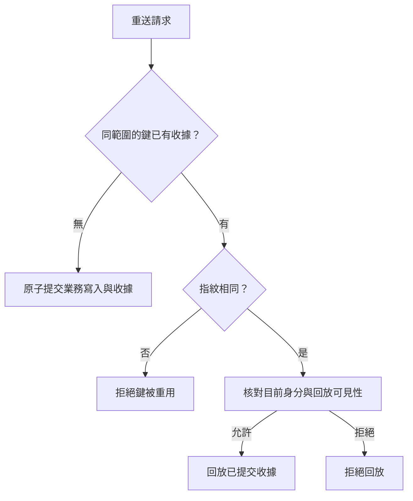

# 冪等（Idempotency）

同一意圖重送時只產生一次預期的邏輯效果。

## 設計時要確認

定義鍵的作用域、有效期及請求指紋；防重紀錄與受保護的寫入一起提交。

## 示例

同鍵同內容可依可見性規則回放收據，同鍵不同內容應拒絕。

## 圖解

**設計參考。**

## 延伸閱讀

[command](command.md) · [transaction](transaction.md) · [integration-event](integration-event.md) · [DDD 設計索引](design-guide.md)
