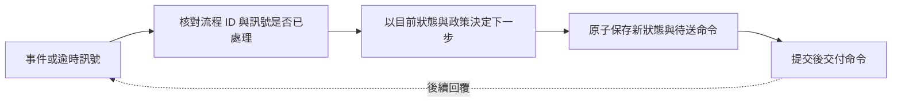

# 流程管理器（Process Manager）

**採用方式：按需。** 依具體用例、替代方案與成本決定是否採用。

Process Manager 根據目前流程狀態與收到的事件，決定下一個應發出的命令。適合需要跨事件等待、關聯回覆、逾時或續跑的流程；不只是把多個函數集中在一個 Service。

## 何時按需採用

流程需要跨請求或程序重啟保留進度，且下一步取決於先前結果時再採用。簡單且可在一次用例完成的步驟，使用直接協調即可。

## 狀態與可靠推進

持久流程須定義 processId、流程版本、目前狀態、已處理訊息、等待條件、期限與終態。處理一筆事件時，狀態推進與待送命令若必須一起成立，需有可靠保存機制；只先存狀態再直接發訊息仍有遺失窗口。

接收端須驗證事件來源與關聯對象，處理重複、延遲、亂序及已結束流程的晚到事件。Timer 也可能重送，逾時與成功回覆的競爭必須只選出合法結果。

## 圖解

**設計參考。**

## 與 Saga 的關係

Process Manager 著重流程決策與狀態；Saga 著重跨局部交易的一致性與補償。Process Manager 可用來協調 Saga，但不是每個等待審核的流程都需要補償，也不是所有 Saga 都有集中管理器。

各領域繼續擁有自身業務規則。管理器發出下一步意圖，不能直接改寫參與領域的資料表或把所有規則集中進流程定義。

## 設計例子與核對

未來多方審核可在收到所有必要決定後發出完成命令；人員移除或期限到達時，需依目前政策重新判斷。此例不表示現有 Workflow 已提供相關能力。

列出流程圖或狀態表、輸入事件、輸出命令、等待／取消／逾時、重啟恢復、流程版本遷移與人工介入方式。長期流程不能因部署新版而失去原本的續跑語意。

來源：[Enterprise Integration Patterns：Process Manager](https://www.enterpriseintegrationpatterns.com/patterns/messaging/ProcessManager.html)，2026-11-21 查閱。

[Saga](saga.md) · [領域事件](domain-event.md) · [Outbox](outbox-pattern.md)

[DDD 設計索引](design-guide.md)
