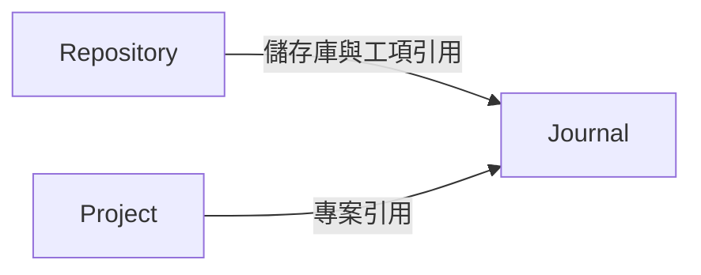

# 上下文映射圖（Context Map）

用圖呈現模型邊界、依賴及關係。

下圖只示範日誌引用的局部關係。箭頭由資料語意的提供方指向使用方；標籤說明交換的事實。它只描述範例的資料關係，團隊協作模式需另行確認。

開發與維運指引。以下是局部上下文關係示例。

**設計產出**　圖旁附上關係的依據、圖例及範圍。現況與目標若不同，分圖說明。

[DDD 設計索引](design_guide.md)
