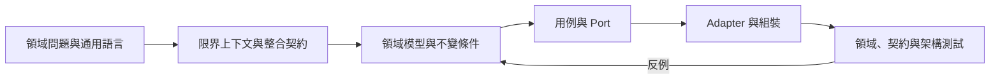
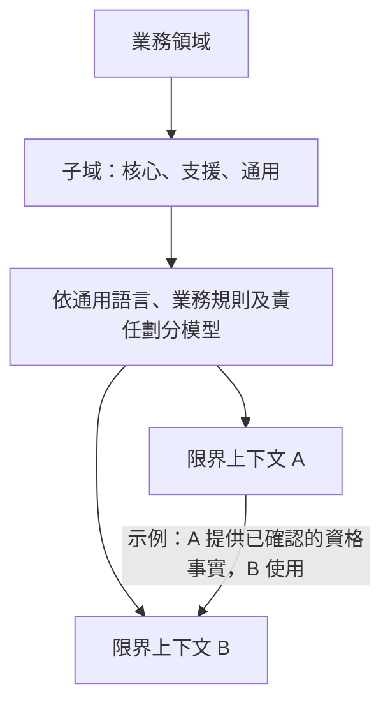
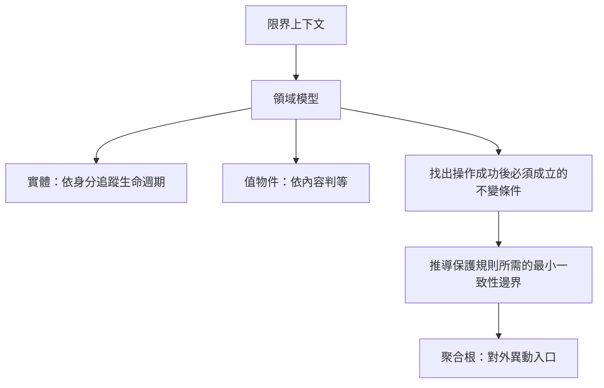

# DDD 與六邊形架構圖解

開發與維運指引。依問題選圖，主題入口見[DDD 設計索引](design_guide.md#mermaid-圖表)。

下圖為設計參考，從業務問題推進至模型、用例與驗證。模型和上下文可以隨反例反覆調整。

## 戰略設計：從問題到模型邊界

開發與維運指引。子域劃分業務問題，限界上下文劃分模型適用範圍。先用語言、規則與責任決定哪些模型應分開，再畫出具體契約。子域分類不會自動決定上下文的數量或邊界。

最後一條箭頭表示契約的影響方向，由提供者指向使用者。若 B 另有契約提供給 A，應以另一條具名關係表達。詳見 [限界上下文](bounded_context.md)與[上下文映射圖](context_map.md)。

## 戰術設計：從不變條件到聚合

開發與維運指引。圖中連線表示設計推導，無程式呼叫含義。實體和值物件各按業務語意建模，只有共同保護不變條件所需的狀態才納入同一聚合。

聚合可以只有根實體。工廠、領域服務、政策與事件按需要採用，詳見[聚合](aggregate.md)與[不變條件](invariant.md)。

## 六邊形架構：一次用例如何執行

[執行時互動圖](hexagonal_architecture.md#執行時互動)說明 HTTP、Webhook 或排程如何驅動用例，以及應用如何透過出站 Adapter 使用資料庫、外部服務或訊息系統。[程式碼依賴圖](hexagonal_architecture.md#程式碼依賴)說明出站 Adapter 如何依賴核心契約並由 Bootstrap 注入。

[六邊形架構](hexagonal_architecture.md#執行與程式碼依賴)分開呈現執行與程式碼依賴，[交易](transaction.md#提交與發布)呈現提交和發布的時間差。

概念參考：[Domain-Driven Hexagon](https://github.com/sairyss/domain-driven-hexagon)。
