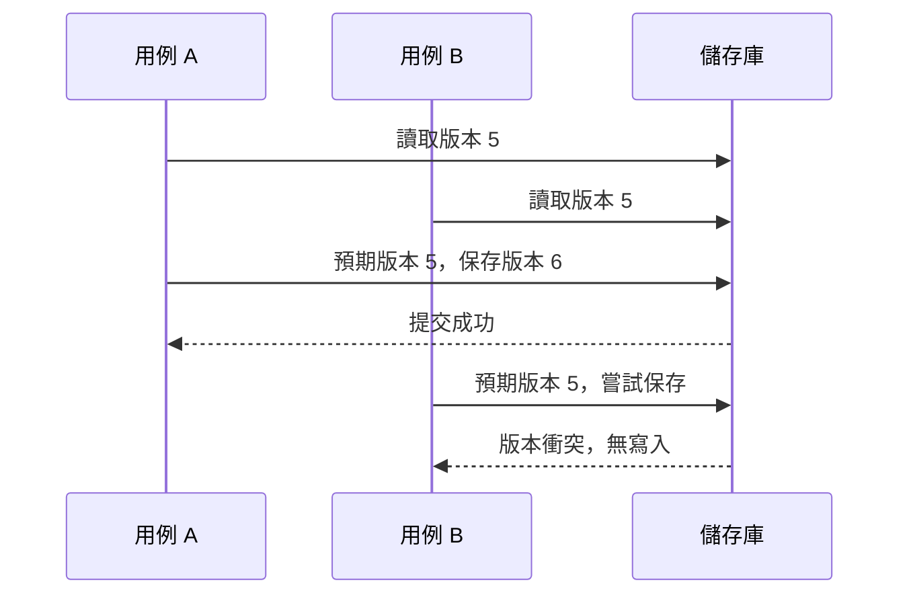

# 樂觀並行控制（Optimistic Concurrency）

更新時檢查讀取版本以偵測並行修改。

## 設計時要確認

比對預期版本並原子更新；重試前重讀並重新授權及判斷。

## 示例

兩個請求讀到版本 5，其中一個提交版本 6，另一個應回衝突或重讀。

## 圖解

**設計參考。**

## 延伸閱讀

[transaction](transaction.md) · [aggregate-root](aggregate_root.md) · [DDD 設計索引](design_guide.md)
