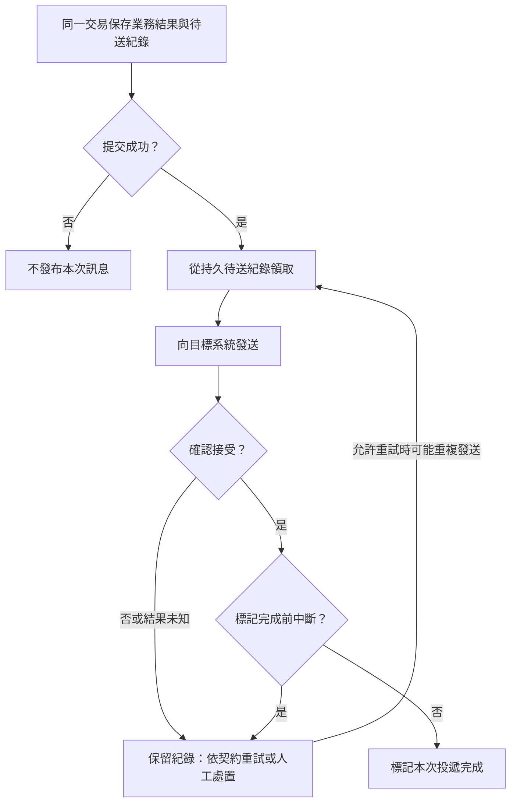

# 交易式待送紀錄（Transactional Outbox）

**採用方式：按需。** 依具體用例、替代方案與成本決定是否採用。

Outbox 將業務資料變更與待發布訊息保存在同一筆本機交易，再由提交後的投遞步驟發送。它銜接的是「提交業務資料」與「保留發布意圖」，不是將遠端服務納入本機交易。

## 何時按需採用

只有在要求資料已提交後，即使程序中斷也不能遺失發布意圖時才採用。可由人員補送的低重要性通知，應先比較較簡單的失敗處理方案。

## 提交與投遞

1. 用例在同交易保存業務結果及待送紀錄；任一失敗則不提交。
2. 投遞程序讀取已提交紀錄，發送至目標系統。
3. 確認結果後更新投遞狀態；失敗重試，無法處理者告警與保留修復入口。

待送內容須在發布前完整保存，並有穩定 messageId、目的地及契約版本。多個投遞者並行時，須設計領取／租約或等效機制；同一 Aggregate 的順序需求另以序號等方式保護，不能假設所有訊息自然有序。

投遞可由同程序的背景工作或獨立執行單位負責；關鍵是程序重啟後仍能從持久待送紀錄續送，而非一定要新增服務。執行方式須符合部署環境的生命週期。

## 保證與失敗窗口

發送成功後、標記已送出之前若中斷，可能再次發送。因此 Outbox 通常需要接收端冪等，不自動提供 exactly-once。重試、告警及修復才讓持久發布意圖有機會持續前進；保存一筆紀錄不等於永遠保證遠端可用。

非冪等外部 API 須另外處理接受結果未知的情況。不得在可能重跑的資料庫交易 callback 中直接發送訊息，也不得在首次失敗後刪除待送紀錄來假裝完成。

## 提交與失敗窗口圖

開發與維運指引；以下只描述按需採用 Outbox 後的責任與失敗窗口，不表示現有系統已提供此流程。

目標接受與本機標記不是同一筆交易；去重與順序需由契約另外保護。投遞完成的確認範圍也須明定：broker 接受訊息不等於下游業務已執行完成。

## 設計例子與核對

未來若角色異動後必須可靠通知另一個上下文，可同交易建立待送紀錄；通知重送不能再執行一次角色異動。此為示例，不表示已導入通用 Outbox。

列出投遞狀態、重試節奏、去重、順序、保留期限、存取權限、積壓監測及人工補送。需驗證提交前後與發送前後的中斷窗口，不只驗證正常發送。

來源：[Chris Richardson：Transactional Outbox](https://microservices.io/patterns/data/transactional-outbox.html)，2026-11-21 查閱。

[一致性](consistency.md) · [領域事件](domain_event.md) · [Saga](saga.md)

[DDD 設計索引](design_guide.md)
