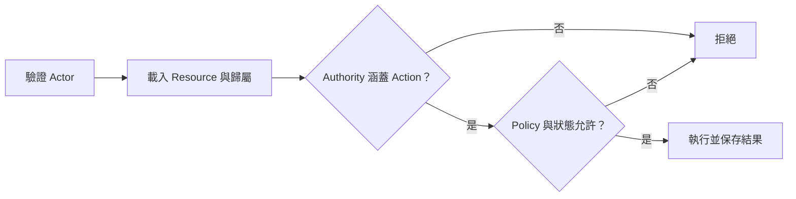

# 授權設計

授權回答「哪個可信 actor 可以對哪個 resource 執行哪個 action」。身分驗證只建立 actor，不代表擁有資源權限。

## 決策輸入

| 輸入      | 說明                                                      |
| --------- | --------------------------------------------------------- |
| Actor     | 經 LINE、Session 或服務身分驗證的操作者                   |
| Resource  | 具體資源及其 organization、team、group、repository 等歸屬 |
| Action    | 具名讀取、建立、修改、審核、停用或其他操作                |
| Context   | 當前狀態、版本、時間、channel 與環境                      |
| Authority | 成員關係、擁有權、審核資格或服務帳戶允許範圍              |
| Policy    | 業務規則；與「有沒有權」分開判斷                          |

## 決策流程

後端是決策點。前端可依已知能力改善 UI，但不得以隱藏按鈕、route guard、LINE profile 或客戶端角色作為安全控制。

## 一致性

若權限、資源狀態與寫入必須針對同一版本判斷，adapter 應在同一 Firestore transaction 內讀取並提交。外部 LINE 資格無法納入 Firestore 原子快照時，必須說明觀察時點、失敗方式與可接受風險。

群組庫操作使用本次請求取得的 LINE 成員查詢結果，查詢失敗時拒絕操作。成功查詢至 Firestore 提交之間可能發生撤權，包含交易重試所花的時間；LINE 查詢的 timeout 只限制查詢時間。產品若要求撤權與寫入具備相同提交順序，資格須由能參與該交易的權威來源提供。

## 拒絕與記錄

未登入、無權限、狀態不允許與版本衝突是不同結果，應映射為穩定錯誤 code。稽核依風險記錄 actor reference、resource、action、時間與結果，不記錄 token 或完整敏感 payload。

## 團隊資格世代

- 獨立模式須有有效的 Team `member` 或 `maintainer` 關係。成員關係記錄的上層類型、資源 ID 與世代須符合管理歸屬指定的有效 Organization 或 Enterprise 資格。查詢沿用呼叫端的 Firestore 交易。上層撤權使衍生 Team 資格失效，重新加入後也須重新授予。[資格讀取實作](../../backend/internal/business/membership/adapter/firestore/qualification.go) · [世代判定](../../backend/internal/business/membership/domain/qualification.go)

## 組織邀請的接受與重送

1. A 建立組織後，向官方帳號傳送 `邀請加入 <組織 ID>`。Bot 建立邀請後回傳可直接轉傳的指令。
2. A 私下把 `接受邀請 <邀請碼>` 傳給 B。B 開啟自己的官方帳號私聊，送出該指令即可加入。有效期為 24 小時。A 也可傳送 `撤銷邀請 <邀請碼>`。
3. LINE Adapter 使用已驗簽私聊事件的 Actor 與事件 ID。Membership Application 核對目前 Owner、效期和接受資格。Firestore Adapter 在同一交易消耗邀請、寫入稽核並更新現行 `memberUserIds` 權威。Organization Owner 移轉在原交易中遞增 Owner 版本。

邀請碼依渠道、Actor 與事件 ID 經服務端密鑰產生；同一發邀事件可重建同一邀請碼，儲存只保留摘要。接受結果以同一已驗簽事件重送為準。Bot 在交易提交後才回覆。此相容切片僅可在 legacy 模式執行，未建立第二套成員權威，Organization 獨立資格切換仍待交付。

[邀請處理](../../backend/internal/business/membership/adapter/line/invitations.go)

## 標籤分類與改名

分類操作只更新同庫的標籤引用，以及 Issue 可選的里程碑。Go 重新核驗操作者資格、資源歸屬與版本。只有分類權的操作者若同時修改正文或問題狀態，整筆拒絕。Discussion 沿用同一套標籤規則。

授權改名時保留 Label ID；新名稱仍需在同庫唯一，名稱綁定與標籤在同一交易更新。以原建立鍵重送原請求，應取回同一 ID 與目前名稱。改名不需要逐筆更新 Issue 或 Discussion。群組 Repository 的所有目前成員均可分類及改名；個人 Repository 僅限本人。改名須提交讀到的原名稱，名稱過期回 409。

[標籤契約](../../api/contract/repository/labels.yaml) · [改名及重送案例](../../backend/internal/business/repository/adapter/firestore/labels_test.go)

## 企業自助開通資格

開通資格由服務端配置於同一渠道下的 `enterpriseEntitlements/{SHA-256(userId)}`（文件鍵使用專案 firestorekey.Digest）。設定 `enabled: true` 提供一次企業開通資格。建立成功後由後端保存 enterpriseId；缺少資格時直接呼叫建立 API 也回 403。頁面使用 OpenAPI 生成的型別，顯示後端回傳的清單與管理操作。

[企業開通交易](../../backend/internal/business/enterprise/adapter/firestore/store.go)

## 組織偏好與 Owner 移轉

後端用例負責清單、排序、預設值、授權與偏好保存；HTTP adapter 轉成生成的 DTO。後續組織資源請求須明確帶目標 organizationId，後端逐次核對資源歸屬與操作權限。切換選單只更新個人偏好。

組織頁的「設定」提供 Owner 移轉。畫面從 People 名單選擇接任者，確認後以 `memberId` 呼叫 `PUT /api/v1/organizations/{organizationId}/owner`，成功回 204 並重讀名單與側欄。後端在指定組織的交易內解析成員代碼；既有使用 `userId` 的呼叫仍回 200。兩個目標欄位只能提供其一。

[組織契約](../../api/contract/organization/context.yaml)
