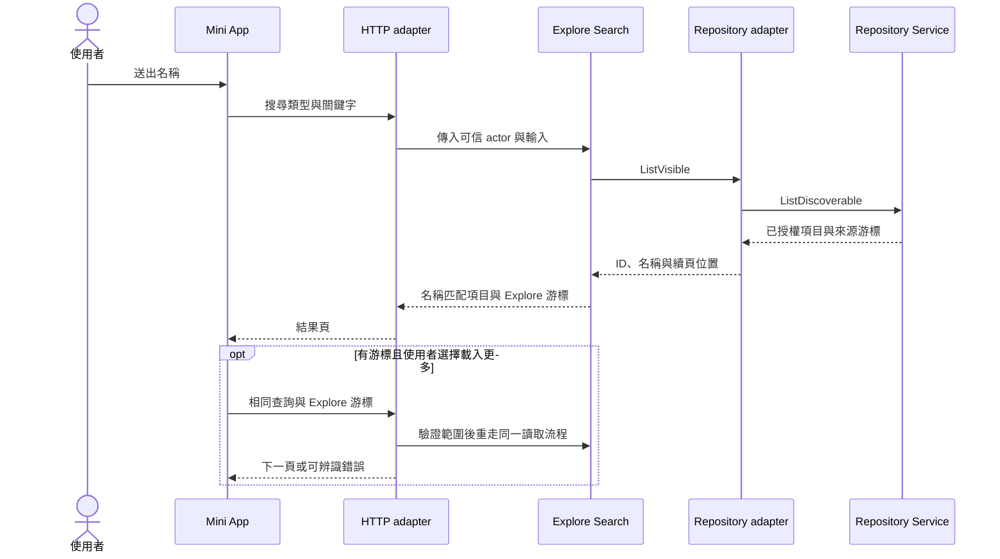

# Explore 跨領域搜尋設計

Explore 讓已登入的 Mini App 使用者以名稱尋找站內資源。目標涵蓋儲存庫、組織、使用者與企業。第一版只開放儲存庫，交付從搜尋到進入儲存庫的完整流程。以下是實作提案，HTTP 格式以實作時先建立的 OpenAPI 為準。

## 領域與依賴

Explore 是獨立的唯讀查詢模組，負責搜尋入口、類型選擇及結果摘要。資源所屬領域擁有名稱、生命週期與可見性。第一版每次只查一種類型，採同步查詢，無須跨類型排名、聚合根或獨立索引。[查詢指引](../ddd_hexagonal/query.md)與[上下文整合指引](../ddd_hexagonal/bounded_context_integration.md)說明此分工。

### 擁有者控制探索曝光

已登入使用者可以搜尋擁有者明確同意曝光的啟用中資源。每個資源獨立設定；使用者本人決定自己的個人檔案是否出現，組織與企業的選擇不會自動公開其成員或旗下儲存庫。建議新資源與舊資料缺少設定時一律視為關閉。開啟後僅揭露契約列出的摘要；閱讀詳情、加入或修改資源仍依原領域授權。關閉後即使既有成員也無法透過 Explore 找到它，原有成員入口照常使用。

設定由各資源領域保存。個人檔案僅本人可改；儲存庫、組織及企業由經該領域確認的擁有者設定。群組擁有的儲存庫須由後端確認操作者有代表群組管理該設定的權限。於資源設定頁提供「允許其他已登入使用者在 Explore 找到此項目」開關。更新操作須重新授權，重送相同值維持相同結果；搜尋與續頁逐頁確認最新設定。

HTTP adapter 從可信會話取得操作者。Explore 向來源傳入操作者及游標，取得允許曝光的摘要，再比對名稱。Repository 公開查詢由 bootstrap 注入，詳情頁獨立授權。

## 第一版查詢契約與執行

現有 [Explore OpenAPI 草案](../../api/contract/explore/draft.yaml) 的成員限定敘述待同步。實作第一步須改為擁有者選擇曝光的摘要，並在資源所屬契約定義設定讀寫與拒絕語意，再產生型別。

1. 在 [API 契約目錄](../../api/contract/) 定義單一搜尋操作，建議形狀為 `GET /api/v1/explore?type=repository&q=名稱`，後續頁附上不透明游標。第一版只接受 repository。回應只投影資源類型、穩定 ID、顯示名稱與下一頁游標。契約應明定長度限制、穩定順序、錯誤碼及不快取使用者結果，並產生 client。
2. 後端修剪關鍵字並做大小寫不敏感的子字串比對。Repository 以啟用且開放探索的資源為候選，依穩定 ID 升冪取一個有界頁。既有成員列表只涵蓋已互動的儲存庫，無法作為全站曝光來源。
3. 游標只延續同一操作者、類型及正規化查詢。空頁仍可能有下一頁；來源不可用須回報錯誤，不可回傳「無結果」。測試並記錄來源順序及游標行為後再凍結契約。

## 第一版實作藍圖

下列檔案與函數是第一版的實作藍圖。「新增」代表提案名稱；既有入口以連結標示，產生碼一律由專案的契約工具更新。

### 目標檔案樹

```text
api/
  contract/explore/draft.yaml                   現有草案；發布時由公開 OpenAPI 引用同一操作
  contract/openapi.yaml                         登錄 Explore 操作
  contract/capabilities.json                    登錄操作與能力歸屬
  client/src/generated/schema.ts                重新產生型別
backend/internal/
  business/explore/                             新增
    application/query/search.go                 用例、查詢輸入、結果與單方法出站介面
    application/query/cursor.go                 綁定搜尋範圍與來源續頁位置
    application/query/search_test.go            驗證用例與分頁
    adapter/http/routes.go                      身分、輸入、錯誤與回應轉換
    adapter/http/routes_test.go                 驗證 HTTP 契約
    adapter/repository/source.go                連接既有 Repository 用例
  business/repository/application/              新增曝光設定與可發現摘要查詢；詳情沿用既有授權
  business/repository/adapter/firestore/        保存設定、按曝光條件分頁
  bootstrap/                                    組裝並註冊 Explore handler
  transport/http/api/generated/                 重新產生 HTTP 型別
frontend/miniapp/
  src/pages/miniapp/explore.tsx                 新增；組合 Shell 與搜尋畫面
  src/business/explore/View.tsx                 新增；表單、結果與續頁
  src/shell/                                    在既有導覽加入 Explore 入口
  tests/explore.test.tsx                        驗證搜尋、續頁與過期回應
```

### 六邊形邊界與函數

依[六邊形架構](../ddd_hexagonal/hexagonal_architecture.md)，公開用例方法就是入站 port。出站介面由 Explore application 定義；Repository adapter 匯入該介面所使用的型別，並依賴 Repository 公開用例。[組裝根](../ddd_hexagonal/composition_root.md)負責把實作傳入建構子。HTTP DTO、Firestore 文件與 Repository entity 都在各自 adapter 邊界完成轉換。

| 位置與提案函數                                                                       | 實作責任                                                                                                                                                |
| ------------------------------------------------------------------------------------ | ------------------------------------------------------------------------------------------------------------------------------------------------------- |
| HTTP 入站 adapter · `SearchExplore`                                                  | 從既有身分入口取得 actor；驗證 HTTP 輸入後呼叫用例，把結果映射為產生的 DTO，依草案設定狀態碼與快取標頭。                                                |
| Application 入站 port · `Search(ctx, actor, input) (Page, error)`                    | 正規化關鍵字、驗證類型與游標，向來源取一頁，在已授權的名稱上做比對；保留順序並產生下一頁游標。                                                          |
| Application 出站 port · `ListVisible(ctx, actor, sourceCursor) (VisiblePage, error)` | 只回傳可見資源的 ID、名稱與來源續頁位置。名稱比對集中於 Search，故出站 port 無須關鍵字。傳遞呼叫者的 context 以支援取消。                               |
| Repository 出站 adapter · `ListVisible`                                              | 呼叫 Repository 提供的 `ListDiscoverable`，投影符合曝光條件的 ID 與名稱，保留來源游標與錯誤。                                                           |
| Application 私有函數 · `encodeCursor`、`decodeCursor`                                | 封裝版本、搜尋範圍摘要與來源游標；範圍含 actor、類型與正規化關鍵字。檢查版本、長度、範圍及來源位置；Repository 仍逐頁複核可見性。來源耗盡時回傳空字串。 |
| 前端 · `View`                                                                        | 使用同一個 API client 送出與續頁；以既有 [Repository 導覽](../../frontend/miniapp/src/shell/repository_navigation.ts)使用的 href 能力開啟詳情。         |

組裝時沿用 [newRepositories](../../backend/internal/bootstrap/repository.go) 建立的服務。來源未設定時仍應讓已驗證的搜尋請求取得契約中的 unavailable 回應。第一版只需一個來源；加入第二種類型時再擴充來源選擇。

### 搜尋與續頁時序

以下為目標呼叫時序。每次搜尋或續頁最多讀一個來源頁。



來源游標指向最後處理的候選位置，即使整頁因關閉曝光或名稱不符而沒有結果，也能繼續。載入更多失敗時保留既有項目與游標；切換查詢或身分時清除舊頁。點入詳情後由 Repository 重新授權，無讀取資格時顯示無法存取狀態。

## Mini App 互動

採 GitHub 搜尋結果頁的互動方式，重用 Mini App 既有輸入框、清單、狀態提示及儲存庫導覽。使用者送出名稱後由產生的 API client 取得結果，點選列項進入既有頁面。第一版只有一種類型，不顯示空分頁。第二種類型啟用時才加入類型選擇器。

送出新查詢或切換類型時清除舊結果與游標，忽略過期回應；切換類型保留輸入文字。有游標便提供「載入更多」，僅在累積結果為空且游標耗盡時顯示「找不到結果」。前端不另外維護搜尋索引、授權篩選或全域 store。

## 擴充條件

- 組織：提供組織擁有者設定及可發現摘要查詢。
- 使用者：由本人設定個人檔案曝光；啟用前確認可用於導航的公開識別碼，不投影私人聯絡資料或身分提供者識別碼。
- 企業：由企業擁有者設定曝光；停用企業必須排除。

每種類型具備明確可見性、可用的詳情入口及授權測試後，才擴充契約與前端選項。

## 實施順序與驗收

1. 先定 OpenAPI 並重新產生型別，再完成 Repository 查詢介面、Explore 用例、HTTP adapter 和 bootstrap 注入。確認既有儲存庫列表仍相容。
2. 以兩個同名儲存庫驗收：擁有者開啟其中一個後，非成員可搜到它的摘要，詳情仍依原授權；另一個保持隱藏。關閉後以新搜尋或舊游標續頁均不得再次回傳該項目。驗證非擁有者無法變更設定、缺少設定的舊資源保持隱藏。使用者目錄上線時另驗證只有本人可切換個人檔案曝光。
3. 驗證空頁有游標時可繼續至匹配結果、游標耗盡時停止、變更查詢後無法誤用舊游標，以及較慢的舊請求不會覆蓋新結果。
4. 接上 Mini App，驗收搜尋、翻頁、空狀態、失敗重試與點入儲存庫。依[驗證流程](../workflows/verification.md)執行契約、後端邊界、前端型別、相關測試及靜態建置檢查。
