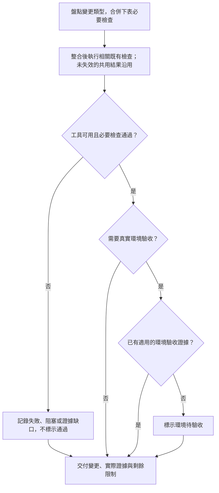

# Acceptance and evidence

目前階段依[已接受的基線](../decisions/0002-baseline.md)：不新增測試方案、案例或工具，保留並執行與變更相關的既有檢查。此限制不代表停止執行既有測試；若既有案例不足，列出證據缺口與待決定的階段調整，不自行宣稱驗收通過。

行為變更以使用者入口驗收。沿入口核對實際涉及的契約、產生碼來源、呼叫者、儲存或設定與測試；更名或遷移時搜尋舊識別字，確認保留的引用有用途。整合後核對差異與原需求，從正常入口執行適用檢查，清楚記錄未驗證的行為。

## 變更驗收矩陣

**開發與維運指引**

下表命令從儲存庫根目錄透過 `bash scripts/tooling/tool-exec.sh <command>` 執行；`git diff --check` 除外。流程依下表與[證據限制](#evidence-limits)，不代表本次變更已通過所列檢查。

| 變更類型 | 必要的既有檢查 | 條件式證據與限制 |
| --- | --- | --- |
| Markdown | `git diff --check`；核對變更頁面的本機路徑、標題錨點與相關索引 | 不執行無關應用測試；圖形變更依[文件規範](../standards/documentation.md#增量驗證)渲染 |
| 設定、腳本、Agent 設定 | `python3 scripts/check/check-config.py`；相關既有腳本檢查或 smoke check | 依腳本實際影響補相應類型；不為驗證文件執行部署或外部寫入 |
| Go 行為 | 開發時執行受影響套件的既有測試；交付前執行 `mise run fmt-check`、`mise run lint`、`mise run check`、`mise run build`、`mise run vuln` | `check` 已含模組驗證、vet 與完整 race 測試，不重複執行全套 race；不得格式化他人檔案 |
| 公開 HTTP API | 依 [API 流程](../../api/README.md)更新契約與生成碼，執行 `pnpm api:check`；Go／前端變更另套對應列 | 核對相容性、認證、錯誤格式及既有行為；不手改產生檔或任意刷新 baseline |
| 前端 | `pnpm --filter @repo/miniapp check`、`pnpm --filter @repo/miniapp test` | 靜態輸出、路由或資產變更另執行 `pnpm --filter @repo/miniapp build`；UI 另核對[元件規範](../../frontend/miniapp/src/shared/ui/AGENTS.md)與相關畫面 |
| 依賴 | 核對 manifest 與鎖檔；執行受影響工作區的既有檢查 | Go 執行模組下載／驗證及 `mise run vuln`；不把下載成功當整合通過 |
| Firestore | 套用 Go／API 對應列；核對功能契約中的路徑、授權、交易、防重與相容性 | 索引或遷移須依既有指南驗證；沒有真實資料庫證據時，讀寫與交易整合仍待驗收 |
| LINE 身分／Webhook | 套用 Go／API／前端對應列，檢查既有案例涵蓋的無效簽章／token、越權與重送 | 未涵蓋者列為證據缺口；真實渠道及裝置另驗收 |
| Cloud Run／定位 | 套用設定與受影響程式的對應列；依下方環境驗收要求記錄 | 設定檢查、編譯與 mock 均不取代部署或裝置驗收 |

命令定義以 [mise.toml](../../mise.toml)、[根 package.json](../../package.json) 與[前端 package.json](../../frontend/miniapp/package.json)為準。模組局部操作仍由各 README 維護，本頁集中決定何時需要執行。

## Evidence limits

交付時明列既有測試未涵蓋的授權、重送、取消或併發情境。環境診斷與模擬資料只證明各自涵蓋的範圍。角色交接時沿用仍適用的[驗收證據](workflow.md#minimal-handoff-and-evidence-reuse)。

Graphify AST extraction can omit TOML, documentation and dynamic calls. Repomix
is a source bundle, not a correctness proof. Configuration parsing, MCP handshake,
host tool exposure and representative tool operations are separate checks.
Do not claim a fresh Cloud environment works based on an existing tool cache.

## Cloud Run and browser location

Cloud Run changes: verify image contents, HTTP routing, service account, IAM, secrets,
revision readiness and shutdown behavior; config parsing is not a deployment test.
Geolocation changes: permission denied, unavailable, timeout, unsupported/insecure context,
coordinate validation, missing fields, cancellation/watch cleanup and authorization.
Report LINE iOS/Android and external-browser acceptance separately; mocks do not prove device support.

## Business Operation evidence

業務變更須對照 [操作契約](../architecture/contracts/business-operations.md#功能操作契約範本) 與 [符合性流程](workflow.md#business-operation-compliance)：

- Actor 的可信來源、Resource 歸屬、Action 與 Authority 範圍可定位至實作。
- 授權條件、領域規則、系統判定與合法轉換一致；前端不能取代後端授權。
- 依風險提供成功、越權、非法狀態及重要寫入的重送／併發證據，說明失敗不應改變的資料。
- 分別記錄 Graphify 範圍、Repomix 遺漏、Context7／官方文件來源與版本，以及實際執行、跳過或待確認項目。

本階段沿用既有 CI 與適用檢查，不因本規範自動新增測試方案、案例或工具；tester 的一般職責受此階段限制。需要新增案例時先明列缺口與所需階段調整，不用缺少證據宣稱通過。純文件變更驗證連結與 whitespace；角色設定變更另跑 check-config。
