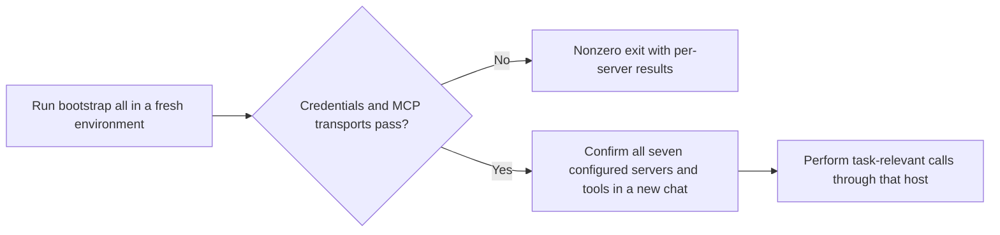

# Codex Cloud: mise + MCP

Run the `all` mode from [Bootstrap](setup.md#bootstrap).

The script verifies/installs mise 2026.11.3, installs pinned Go and MCP tools,
checks Go compilation/vet/race, builds the Graphify index, then probes all seven
MCP servers. Re-running reuses matching tool installations and caches. It does
not publish an environment, deploy an application, change Codex trust, or copy
credentials. Requires Linux x64/arm64, bash, curl, tar, sha256sum, Python 3.11+
and a C compiler for Go race testing.

For transport diagnostics, run `bash scripts/tooling/tool-exec.sh mise run doctor-mcp`.

Browser MCPs and Google Cloud CLI remain separate optional installations.
All local MCP commands use scripts/tooling/tool-exec.sh to load writable tool paths in
/workspace/tooling without changing HOME or CODEX_HOME. Existing explicit
CLOUDSDK_CONFIG and DOCKER_CONFIG values are preserved. This does not control
writes performed by the platform itself or arbitrary third-party code.

## Required host configuration

The actual Codex host must start in /workspace/line-mini-app-bot and load this
repository's .codex/config.toml through its supported project/trust configuration.
A setup script cannot register tools in an already running conversation. Do not
assume that running a second Codex CLI in the container configures the Cloud host.
Use the host's supported configuration; do not bypass managed trust restrictions.

Configure GITHUB_MCP_TOKEN securely for the MCP host at runtime.
Do not commit the token, print it, or paste it into chat. A setup-only secret is
insufficient if removed before the agent/MCP phase. The GitHub app connection
used by this chat does not automatically provide the remote MCP bearer token.
If the Cloud product cannot supply runtime credentials or load project MCP
configuration, bootstrap alone cannot meet the seven-server startup requirement.

Network access must be available both during installation and during remote MCP
calls. Remote endpoints are developers.openai.com/mcp, mcp.context7.com/mcp,
and api.githubcopilot.com/mcp/. Tool downloads also require their package
registries and release asset destinations; an installation allowlist alone does
not enable agent-phase MCP traffic.

## Acceptance

Local `codex mcp list --json` checks local configuration. Chat host loading and tool execution require the separate checks in the diagram. The doctor checks initialize, paginated tools/list and enabled_tools names.

After source changes, rebuild Graphify with `bash scripts/tooling/tool-exec.sh mise run graphify-update`. Go workspace analysis requires an application go.mod.

Verified in the current container: Go doctor and all seven MCP transport probes pass.
GitHub uses GITHUB_MCP_TOKEN and returns 46 tools. The local Codex CLI previously
reported no configured servers, so host loading and new-environment startup remain
unverified.
Fresh-download installation and /home syscall tracing were not repeated here.
