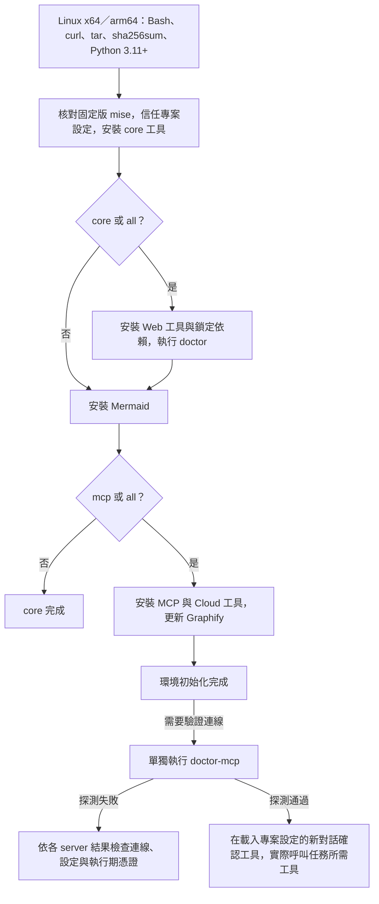
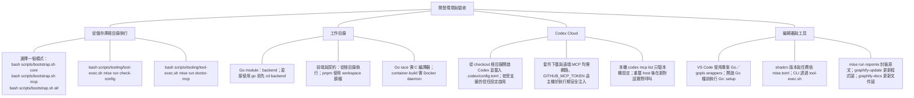

# 開發工具初始化

## Codex Cloud 環境設定

Install script、Start skill、更新與新聊天驗收由 [Codex Cloud 環境手冊](codex-cloud.md)維護。

## 一般開發與 MCP 安裝

以下流程涵蓋明確指定的 `core`、`mcp` 或 `all`。省略模式時使用 `cloud`。

`mcp` 與 `all` 完成本機工具準備後即可結束。需要驗證 MCP 連線時，從儲存庫根目錄另外執行：

```bash
bash scripts/tooling/tool-exec.sh mise run doctor-mcp
```

**開發與維運指引**




