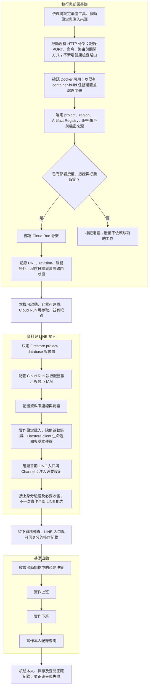

# 基礎設施與分階段落地

先建好可執行、可部署、可連線的基礎，再實作 [基礎出勤](../features/attendance/attendance.md)。
沿用 [架構基線](../foundation/architecture/decisions/0002-baseline.md)與
[部署決策](../foundation/architecture/decisions/0003-cloud-run-primary.md)，應用只部署至 Cloud Run。
本文件是工作順序與完成條件，不表示資源已建立，也不授權建立雲端資源或部署。
目前不新增測試方案、案例或工具，保留既有 CI。

## 目前狀態

| 項目 | 版本庫可確認的狀態 | 尚未證明的事項 |
| --- | --- | --- |
| 本機工具 | 有 mise 設定與 bootstrap／doctor 指令 | 乾淨環境是否可完整重建 |
| HTTP 骨架 | 有 cmd/server、可選 LINE 接入與正常關閉，沒有健康檢查路由 | 目標環境實際啟動狀態 |
| 容器與部署 | 有 Dockerfile、deploy/cloudbuild.yaml 與來源上傳範圍設定 | Cloud Run／Artifact Registry、IAM、secrets、Trigger 與實際部署尚未驗收 |
| 設定 | 已讀 PORT、Messaging API、MINI App 設定，不自動讀 .env | 真實渠道與環境對應尚未確認 |
| Firestore | 已有 cmd/firestorecheck 唯讀連線工具，以及出勤和群聊摘要的 Firestore adapter | 目標環境的資料庫、身分、IAM 與讀寫驗收 |
| LINE | 已有 Webhook、1:1／群組、Flex／Postback、MINI App 驗證及 Rich Menu CLI | 真實收發、登入、選單設定與 MINI App 發布尚未確認 |
| 基礎出勤 | 已有群組定位上下班、1:1 選群組查本人紀錄及 Firestore 持久化 | 目標環境的 LINE／Firestore 交易與手機定位端到端驗收 |

不以設定檔存在、工具索引成功或依賴已下載，推論服務已可用。

## 第一階段：執行與部署基礎（目前優先）

**開發與維運指引**　圖中列出各階段的工作與驗收條件。

操作依據：[環境設定](setup.md) · [Cloud Run 指南](../foundation/operations/cloud-run.md)。圖表示本階段工作順序，不代表已執行部署。

尚未授權或缺憑證的項目標記阻塞，不把出勤功能混入這一階段。

## 第二階段：資料與 LINE 接入基礎

設定與整合依據：[Firestore 文件](../foundation/persistence/firestore.md) · [LINE 設定契約](../foundation/integrations/line-environment.md)。圖表示接入順序，不代表真實環境已連通。

在選定環境驗證。失敗時能從日誌定位問題，且不記錄憑證與原始身分 token。
這是基礎連線確認，不新增自動化測試工程。

## 第三階段：基礎出勤

規則依[出勤規格](../features/attendance/attendance.md)；只新增這些操作需要的 API、資料欄位及 adapter。圖表示實作順序，不是使用者每次查詢的前置操作。

基礎設施與接入尚未完成時，不宣稱出勤可以落地；文件中的完成條件也不是完成證據。
