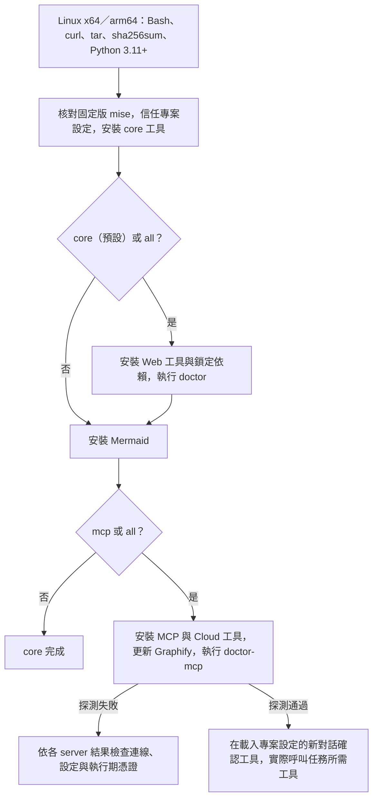

# Environment setup

Current priority is the execution/deployment foundation, not attendance behavior.
Follow [the phased foundation plan](foundation.md) for prerequisites, current
evidence and completion criteria before implementing [attendance](../features/attendance/attendance.md).

## Bootstrap

From the repository root:

```bash
bash scripts/tooling/bootstrap.sh core
bash scripts/tooling/tool-exec.sh mise run check-config
bash scripts/tooling/tool-exec.sh mise run doctor
# Optional tools, separate from core Go development:
bash scripts/tooling/bootstrap.sh mcp
# Full Cloud setup, including optional tools and MCP probes:
bash scripts/tooling/bootstrap.sh all
```

**開發與維運指引** — 選擇 bootstrap 模式與驗證 MCP



[Bootstrap 腳本](../../scripts/tooling/bootstrap.sh)定義執行順序。[mise 前置條件](../tooling/mise.md)列出工具需求；Go race 測試需要 C 編譯器。

## Required host configuration

Codex Cloud 主機須以 `/workspace/line-mini-app-bot` 開啟專案，透過受支援的信任機制載入 [.codex/config.toml](../../.codex/config.toml)。在容器另啟 Codex CLI 或執行 `codex mcp list --json` 只能檢查該 CLI 的設定。安裝階段要能下載套件與 release assets，使用工具時還要能連到設定中的遠端 MCP 端點。

透過主機的執行期秘密設定提供 `GITHUB_MCP_TOKEN`，不要提交、印出或貼到對話。只在安裝階段提供的憑證無法供稍後啟動的 MCP 使用。使用 `bash scripts/tooling/tool-exec.sh mise run doctor-mcp` 重查連線；要驗證目前對話可用的能力，需在該對話實際呼叫工具。

MINI App 的 shadcn CLI 由 mise 固定版本管理；前端依賴仍透過既有 pnpm workspace 安裝流程。元件生成路徑、Tailwind 編譯入口及 MCP workspace 設定見 [shadcn UI 與 MCP](../tooling/mcp/shadcn.md)。更新 MCP 設定後需重新載入 host，並分別驗證本機 transport 與 host 工具。
Application commands require go.mod and application source; do not create them
merely to make environment checks pass.

## Monorepo 工作目錄

Go module 位於 `backend/`；直接執行 Go 命令請先 `cd backend`。mise 的 Go 任務已指定工作目錄。前端與契約命令由儲存庫根目錄執行；流程見 [Monorepo 決策](../foundation/architecture/decisions/0004-monorepo.md)。
