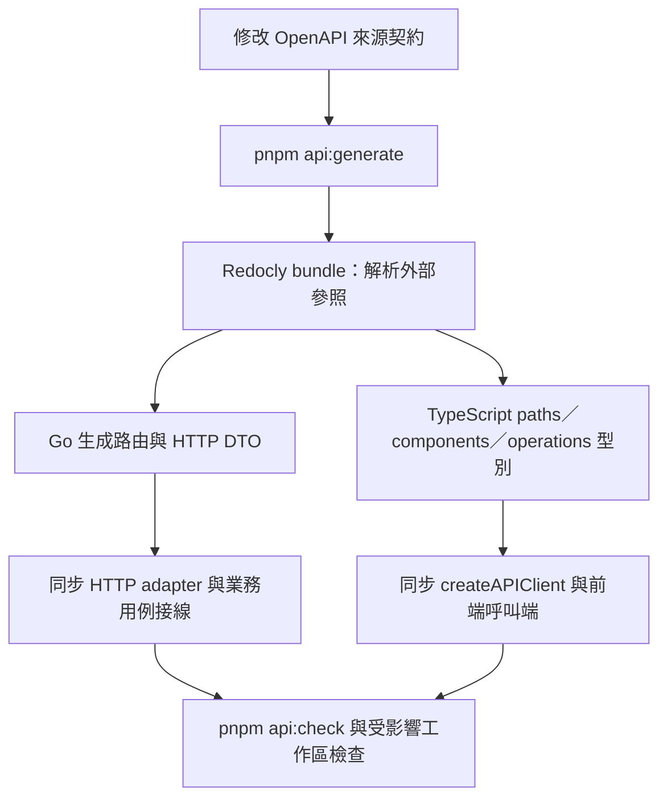

# 修改 HTTP API

公開路由、請求、回應或錯誤格式變更時使用。先確定受影響的操作、既有呼叫者和已發布的契約版本。

1. 依[契約工作指引](../../../../api/AGENTS.md)與[能力索引](../../../../api/contract/README.md)定位 OpenAPI 來源、認證和錯誤格式。
2. 修改來源契約，再依[契約生成流程](#契約生成流程)執行 `pnpm api:generate`。由同一契約重新產生 Go 與 TypeScript 檔案。
3. 從 [HTTP adapter](../../../../backend/internal/transport/http/api/README.md)或對應領域的 handler 核對路由與用例接線。沿 [API client](../../../../api/client/README.md)追受影響的前端呼叫端。
4. 透過專案 wrapper 執行 `pnpm api:check`，再按[驗收矩陣](../testing/commands.md#變更驗收矩陣)合併 Go 與前端的適用檢查。

完成時列出改動的操作、生成碼與呼叫端，並區分當前契約同步結果和歷史相容性證據。需要確認對既有客戶端的影響時，列出比較版本與變更的輸入或回應。

## 契約生成流程

**開發與維運指引**



圖表示開發與生成順序，依據[生成腳本](../../../../scripts/generate/api-generate.mts)；不表示業務核心依賴 HTTP DTO。從儲存庫根目錄執行，前置工具安裝使用 `bash scripts/tooling/tool-exec.sh mise run install-web`：

```bash
bash scripts/tooling/tool-exec.sh pnpm api:generate
bash scripts/tooling/tool-exec.sh pnpm api:check
```

API capability checks use a limited, comment-aware Go token reader to validate
embedded interface methods, generated signatures, adapter ownership and route
composition. Unsupported composition forms fail closed; full Go type checking
remains in the generated interface assertion and Go checks. `pnpm api:check`
runs dispatch regression tests before validating contracts and generated output.

[操作配方](../../recipes/README.md)
