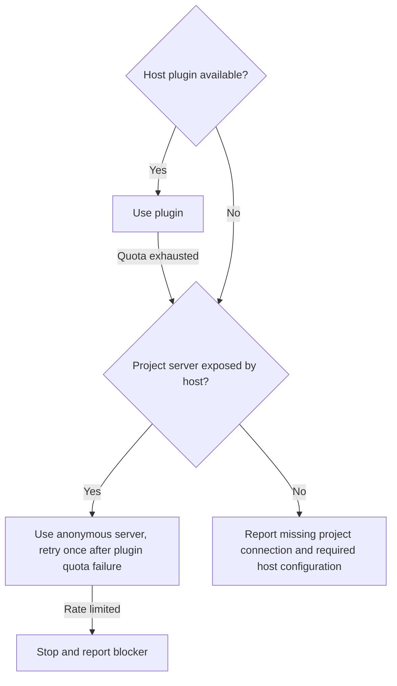

# context7

Primary roles: Context7; TypeScript, Next.js, Golang, Researcher, Implementer and Tester may also use the service.

## When to use

Look up version-matched library, language, framework, SDK and tool documentation.

## Prerequisites and configuration

Remote service; check current schemas in tools/list. Compare documentation versions with the relevant package manifest, lockfile, go.mod or mise.toml.
Connection, timeouts and enabled tool names are owned by `.codex/config.toml`.
Tool versions are owned by `mise.toml`; never copy token values into documentation.

## Operation

Call resolve-library-id first, then query-docs with its exact library ID and a focused version-aware question. Return source URLs, documented versions and applicability limits. If the installed version is unavailable, state the mismatch rather than treating another version as verified. Do not send secrets or private source in queries.

## Anonymous fallback

This procedure addresses a quota error returned by an exposed tool. If the native tool is missing, follow the [root exposure procedure](../../../../AGENTS.md).

**開發與維運指引**



The two connections are separate. The project server uses no API key or credential header. Resolve the library ID on the selected connection before querying documentation.

## Verification and failures

```bash
bash scripts/tooling/tool-exec.sh python3 scripts/mcp/mcp-doctor.py --server context7
```

This checks initialize, tools/list and configured allowlists. Verify a representative
operation separately. For failures distinguish missing binary, network, credential,
workspace prerequisites and host loading; see [troubleshooting](../../environment/troubleshooting.md).

## Source routing and evidence

Follow the [root source-verification policy](../../../../AGENTS.md#mandatory-documentation-verification),
including its Codex, LINE and Google Cloud official-source routes. Context7 does
not replace those sources or define product requirements. Role handoffs follow
[the agent workflow](../../workflow.md#delegation-depth-and-role-selection).
If the service or required evidence is unavailable, report the blocker and leave
the affected decision pending. A successful query does not prove application
behavior or host loading.

## 歷史查證範圍

2026-11-07 曾透過 Context7 核對 Go 命名與建構函數、LINE 事件來源、模式、retry key 與 Reply，以及 Firestore 交易重試與刪除。當時來源 ID 為 `/websites/go_dev_doc`、`/line/line-openapi`、`/websites/cloud_google_firestore_native`。目前的版本、資格及期限須依適用文件與實測重查。
