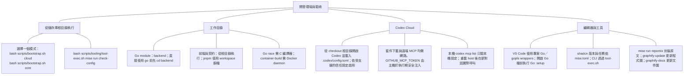

# 開發工具初始化

## Codex Cloud 環境設定

Install script、Start skill、更新與新聊天驗收由 [Codex Cloud 環境手冊](../../environment/codex-cloud.md)維護。

## 一般開發與 MCP 安裝

省略模式時使用 `cloud`，本機開發使用 `core`。初始化只安裝該模式的開發工具。需要 MCP 時，依 [mise 工具任務](mise.md)另行準備，再執行 [MCP 診斷](../../environment/troubleshooting.md#設定與-mcp-診斷)。

**開發與維運指引**

