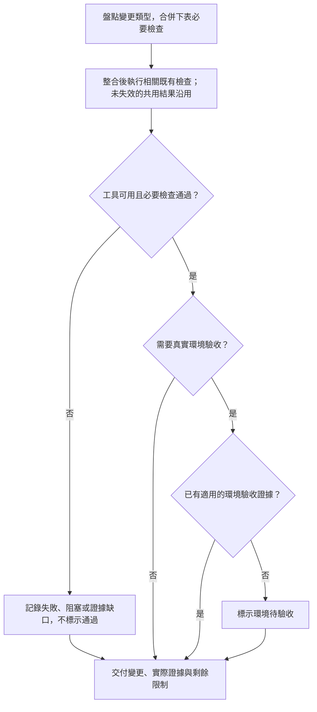

# 驗收矩陣與命令

驗證範圍與新增回歸案例的條件依[工程決策與交付要求](../../../../AGENTS.md#工程決策與交付要求)。

行為變更以使用者入口驗收。沿入口核對實際涉及的契約、產生碼來源、呼叫者、儲存或設定與測試；更名或遷移時搜尋舊識別字，確認保留的引用有用途。整合後核對差異與原需求，從正常入口執行適用檢查，清楚記錄未驗證的行為。

## 變更驗收矩陣

**開發與維運指引**

下表命令從儲存庫根目錄透過 `bash scripts/tooling/tool-exec.sh <command>` 執行；`git diff --check` 除外。流程依下表與[證據限制](../../verification/evidence.md#evidence-limits)，不代表本次變更已通過所列檢查。

| 變更類型 | 必要的既有檢查 | 條件式證據與限制 |
| --- | --- | --- |
| Markdown | `git diff --check`；核對變更頁面的本機路徑、標題錨點與相關索引 | 不執行無關應用測試；圖形變更依[文件規範](../../../standards/documentation.md#增量驗證)渲染 |
| 設定、腳本、Agent 設定 | `python3 scripts/check/check-config.py`；相關既有腳本檢查或 smoke check | 依腳本實際影響補相應類型；不為驗證文件執行部署或外部寫入 |
| Go 行為 | 開發時執行受影響套件的既有測試；交付前執行 `mise run fmt-check`、`mise run lint`、`mise run check`、`mise run build`、`mise run vuln` | `check` 已含模組驗證、vet 與完整 race 測試，不重複執行全套 race；不得格式化他人檔案 |
| 公開 HTTP API | 依 [API 流程](../../../../api/README.md)更新契約與生成碼，執行 `pnpm api:check`；Go／前端變更另套對應列 | 核對相容性、認證、錯誤格式及既有行為；不手改產生檔；歷史相容性比較需另列 base revision |
| 前端 | `pnpm --filter @repo/miniapp check`、`pnpm --filter @repo/miniapp test` | 靜態輸出、路由或資產變更另執行 `pnpm --filter @repo/miniapp build`；UI 另核對[元件規範](../../../../frontend/miniapp/src/shared/ui/AGENTS.md)與相關畫面 |
| 依賴 | 核對 manifest 與鎖檔；執行受影響工作區的既有檢查 | Go 執行模組下載／驗證及 `mise run vuln`；不把下載成功當整合通過 |
| Firestore | 套用 Go／API 對應列；核對功能契約中的路徑、授權、交易、防重與相容性，依[整合驗收流程](#firestore-integration)執行適用測試 | 索引或遷移須依既有指南驗證；沒有真實資料庫證據時，讀寫與交易整合仍待驗收 |
| LINE 身分／Webhook | 套用 Go／API／前端對應列，檢查既有案例涵蓋的無效簽章／token、越權與重送 | 未涵蓋者列為證據缺口；真實渠道及裝置另驗收 |
| Cloud Run／定位 | 套用設定與受影響程式的對應列；依[環境驗收要求](../../verification/evidence.md#cloud-run-and-browser-location)記錄 | 設定檢查、編譯與 mock 均不取代部署或裝置驗收 |

命令定義以 [mise.toml](../../../../mise.toml)、[根 package.json](../../../../package.json) 與[前端 package.json](../../../../frontend/miniapp/package.json)為準。模組局部操作仍由各 README 維護，本頁集中決定何時需要執行。

## Firestore integration

變更涉及交易、併發、重送或持久資料相容性時，Codex 須辨識對應整合案例並執行。依[本機操作指引](firestore-emulator.md#firestore-emulator)檢查 loopback emulator 是否可達；需要時自行用 mise 準備依賴並啟動，待服務可用後設定測試端點並執行指定案例。若先前因環境未準備而跳過，準備好後重跑。

使用 `-count=1 -v`，逐一確認指定案例實際執行且通過。套件顯示成功但案例出現 `SKIP`，或篩選條件未選中任何案例，均不得列為整合證據。若工具無法準備、服務無法啟動或案例仍未執行，記錄原因及尚未驗證的行為，繼續其餘可執行的檢查。

## Go verification

執行時機見上方驗收矩陣。

Use `deadcode` as review input, not an automatic deletion rule. Supply callgraph
arguments with `mise run callgraph -- -algo=static .`; supply Delve
arguments with `mise run debug -- .`. Debugging may require ptrace
support from the host; installing Delve does not establish that permission.
Use stringer through package-specific `go:generate` directives when needed.

`coverage` writes `.artifacts/go/coverage.out`; inspect it with
`go tool cover -func=.artifacts/go/coverage.out`. `bench` runs existing benchmarks.
`profile ./path/to/package` accepts one package and writes a test binary, CPU
and memory profiles under `.artifacts/go/`. Inspect with
`go tool pprof .artifacts/go/profile.test .artifacts/go/cpu.pprof`.
These tasks do not create test cases or benchmarks. No Firestore Emulator is used.

工具安裝見 [mise tooling](../shared/mise.md)。交接時沿用仍適用的[檢查證據](../../workflow/handoff.md#minimal-handoff-and-evidence-reuse)。

[驗收索引](../../verification/README.md)

## API contract verification

API capability checks use a limited, comment-aware Go token reader to validate
embedded interface methods, generated signatures, adapter ownership and route
composition. Unsupported composition forms fail closed; full Go type checking
remains in the generated interface assertion and Go checks. `pnpm api:check`
runs dispatch regression tests before validating contracts and generated output.

契約修改與生成操作見 [HTTP API 指南](../api/change-api.md#契約生成流程)。

## 容器驗收入口

本機建置、CA 前置條件與 smoke 涵蓋範圍見[容器驗收工具](../../../operations/container-build.md#本機建置與-smoke-驗收)。
