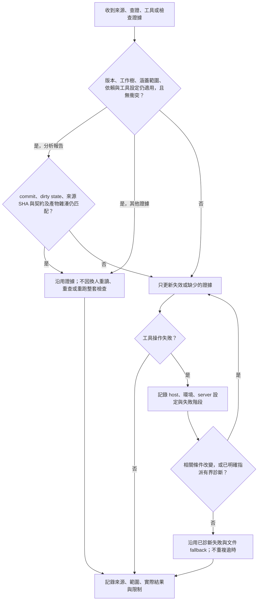
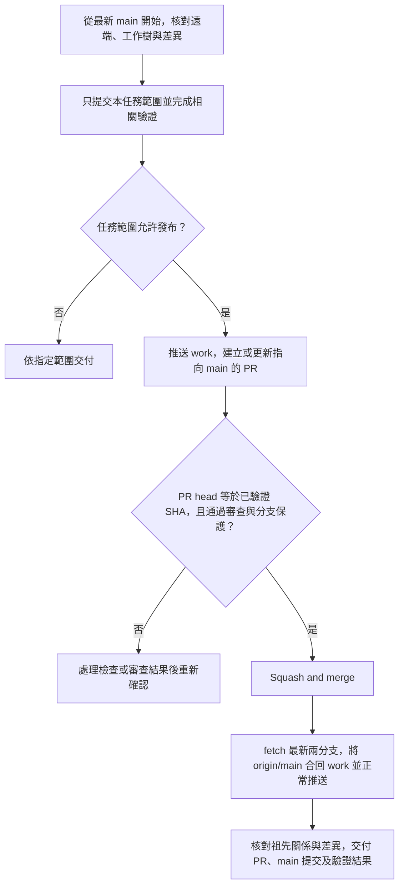
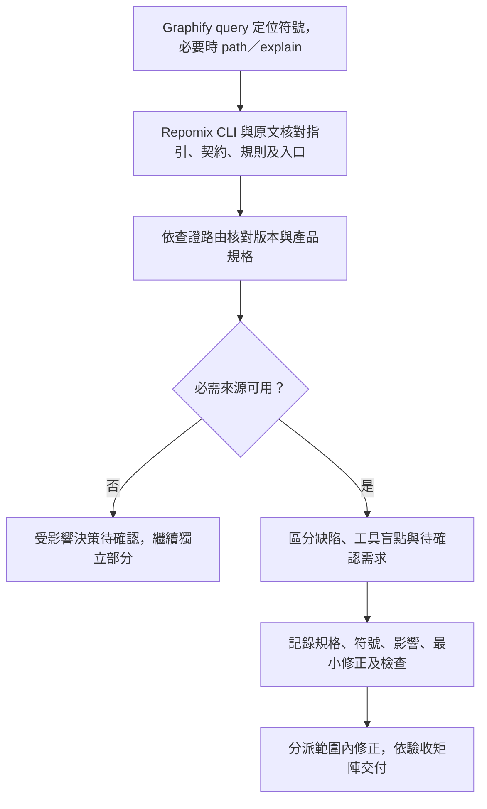

# Agent delivery workflow

Registered roles are capabilities, not mandatory execution stages.
The primary agent completes single-owner work directly. Select the relevant specialist
for substantial changes and use tester/reviewer when their checks add evidence.
Add architect/researcher/explorer for a specific unresolved question and integrator
when separate patches require it.
Delegate only when a bounded independent subproblem or context isolation justifies
the handoff. When parallel work is useful, start with at most two or three workers
within host limits. One writer owns each file, including test fixtures.

For errors, logs and unexplained test failures, use debugger under the
[systematic debugging contract](debugging.md); orchestrator keeps coordination
and acceptance ownership.

## Delegation depth and role selection

When coordination is needed, the delegation topology is primary agent (depth 0) → orchestrator
(depth 1) → specialist (depth 2). Specialists return results to orchestrator and
MUST NOT spawn agents. Keep `agents.max_depth = 2` for V1 threads; the official
schema says V2 ignores this setting, so routing instructions and actual host
controls must enforce the no-spawn boundary there. More registered roles do not
require deeper nesting. `agents.max_concurrent_threads_per_session = 6` caps spawned
threads, excluding the primary; the orchestrator occupies one of those threads.
The current host's actual limits take precedence, and configuration cannot raise
them. Schedule independent work within both limits instead of launching every role.

Configuration semantics were checked against the [official subagent guide](https://learn.chatgpt.com/docs/agent-configuration/subagents)
and [Codex schema revision](https://github.com/openai/codex/blob/4413deac572eb5d4cdb49295794cbe30f8622935/codex-rs/core/config.schema.json)
on 2026-11-13. The existing depth and thread values support this topology;
adding specialist roles is not a reason to increase them.

| Task | Specialist and handoff |
| --- | --- |
| Locate symbols and relationships | `graphify` returns a scoped graph and current-source evidence; it remains read-only unless graph output updates are explicitly assigned |
| Cross-file source corroboration | `repomix` returns a scoped bundle, included/excluded paths and source checks; no source edits or skill generation |
| Version-matched library documentation | `context7` returns library IDs, versions, sources and applicability limits; root official-source routes take priority |
| Go implementation | `golang` owns assigned Go files and uses gopls evidence plus applicable Go checks |
| TypeScript implementation | `typescript` owns assigned language-level changes and verifies version-matched APIs |
| Next.js application changes | `nextjs` owns assigned framework changes and checks the installed version and router conventions |
| UI composition and registry work | `shadcn` owns assigned UI integration, preserving official components under the existing protection policy |
| Markdown maintenance | `documentation` owns assigned Markdown and necessary direct-reference updates under the documentation policy |
| Architecture, relationship, operation or state diagrams | `mermaid` owns assigned diagram hunks and checks source semantics and rendering separately; follow the [Mermaid workflow](../../.codex/README.md#mermaid) |

Use evidence specialists first when needed, then assign implementation to an
explicit owner. For a mixed Next.js/TypeScript/shadcn task, choose one primary
writer; the other specialists provide read-only advice. Parallel writers require
disjoint file ownership. A single writer owns the requested behavior across all necessary layers. Coordinate reassignment when another writer owns a required file or the requested behavior changes.
Tool operations and fallbacks remain in the [MCP guides](tooling/mcp/README.md).

The orchestrator or current owner MAY call the relevant tools directly; a tool
does not require its namesake specialist. Do not build a mandatory
graphify → repomix → context7 → implementer chain. Select only the steps required
by the question and root policies. The root Graphify-first and official-source
requirements, and the Business Operation compliance steps, still apply.

Custom roles inherit the parent's model, permissions and MCP servers unless a
supported setting explicitly changes behavior. A role description does not grant
tool access or create a sandbox. If the host cannot select a registered role,
pass its role instructions to an available worker or have the current owner adopt
them, and report the fallback rather than claiming native role execution.

## Go verification

Go 變更的必要檢查、條件與執行方式統一依 [驗收矩陣](acceptance.md#變更驗收矩陣)。工具安裝與額外分析任務見 [mise tooling](tooling/mise.md)；不要因角色交接重跑未失效的完整檢查。

## Assignment contract

For Markdown work, apply the [documentation policy](../standards/documentation.md).
Assign documentation explicit files/hunks and necessary direct-reference updates;
it may edit that scope directly. Keep one writer per file and return code/tooling
changes to their assigned owner. Small edits may stay with the current owner.

Provide the goal, owned files, dependencies, behavior to preserve and acceptance
commands. Return changed paths, actual commands/results, skips and open issues.
Do not repeat an investigation already answered unless new evidence conflicts.

### Minimal handoff and evidence reuse

Use six fields rather than forwarding the full conversation or raw logs:

| Field | Required content |
| --- | --- |
| Goal | One bounded question or change and its completion condition |
| Ownership | Repository, revision, relevant dirty paths, owned files/hunks and read-only boundaries |
| Inputs | Located paths/symbols, applicable instructions and constraints; read required instructions if not already supplied and current |
| Evidence | Only relevant source/query results with version, scope and artifact locations; include host/server/tool identity for MCP evidence |
| Checks | Exact commands already run, actual results and required checks still pending |
| Open issues | Missing evidence, conflicts, failures and cross-scope work needing reassignment |

**開發與維運指引**

適用邊界：

- HEAD 相同不足以證明證據有效；須核對相關 dirty paths、query／bundle 範圍與來源版本。Context7 只重用相同問題與版本涵蓋的結果；Repomix 另核對包含／排除路徑。
- 每位實際探索程式的代理仍須執行首次 Graphify query；只消費已提供證據而未探索者不必另造查詢。新問題、過期圖譜或矛盾觀察須重新定位並核對當前來源。
- MCP inventory 與連線重用依 [工具操作指南](tooling/mcp/README.md#task-scoped-tool-use)；host／server／allowlist、服務、角色或來源不符會使相關證據失效。註冊成功不等於 runtime 驗收。
- reviewer 依獨立判斷補足挑戰結論所需的證據；流程不限制必要審查。

## Reading and handoff

Read [acceptance](acceptance.md) before choosing checks. The root AGENTS.md routes
roles to relevant documents. Resolve routine issues within the authorized scope;
report host restrictions accurately. Consult [MCP guidance](tooling/mcp/README.md)
for tool selection and transport diagnostics. Integration does not grant permission
to push or deploy. The user-established [publication default](#repository-publication)
is separate authorization, not permission inferred from delegation.

## Repository publication

**開發與維運指引**

`work` 可保存多筆開發提交，`main` 每項可獨立回退的變更保留一筆提交，可涵蓋同一功能的前端、API 與後端。PR 描述最終行為、驗證和限制。同步時若他人已推進分支，先核對新增內容。版本驗收後可按發布安排加標籤。重寫已發布歷史需單次明確授權與可還原備份，遠端拒絕時遵循分支保護與審核結果。

GitHub MCP 與 Git CLI 的使用見 [GitHub 工具指南](tooling/mcp/github.md)。推送、CI 與正式部署分別核對，見 [發布驗收](../guides/release/release-acceptance.md)。

## Deployment and browser location routing

部署與瀏覽器定位任務分別依[部署指引](../../deploy/AGENTS.md)與[定位指引](../../frontend/miniapp/src/shared/location/AGENTS.md)載入適用決策與操作文件；實際驗收依 [acceptance](acceptance.md#cloud-run-and-browser-location)。本節不另外維護部署政策。

## Mandatory documentation verification

All roles MUST follow the [root source-verification policy](../../AGENTS.md#mandatory-documentation-verification)
and the [Markdown policy](../standards/documentation.md). Reuse applicable
evidence; report unavailable sources and leave affected decisions pending.
Documentation evidence does not replace implementation checks or authorize
additional writes.

## Business Operation compliance

業務開發、審查及修正必須先讀 [操作模型](../architecture/contracts/business-operations.md)。任務分派附上操作契約、規格來源、既有實作、檔案所有權與驗收條件。

**開發與維運指引**

圖譜可能過期或漏掉動態關係，無節點時核對原始碼。核對 Repomix 打包範圍，Markdown／TOML 等遺漏內容直接讀取並記錄。產物放任務專屬的未提交目錄。

Context7 先解析 library ID 再查適用版本。LINE、Google Cloud 與 Codex 依[工具查證指引](tooling/mcp/AGENTS.md)。產品決策以使用者與已接受規格為準。

Explorer 與 reviewer 維持唯讀並回報 orchestrator，implementer 修正，必要時由 debugger 定位。保留既有變更，範圍外另列。主機不支援角色時由主代理直接承接並說明。依[驗收矩陣](acceptance.md)核對契約、實作與證據。程式修改後依根指引更新 Graphify，重新打包受影響內容並沿用有效證據。

交付列出：發現 → 規格依據 → 修改位置 → 檢查結果 → 剩餘限制。不把工具成功等同業務正確，不無限重跑全庫檢查。此流程不增加 push、部署或資料遷移授權。

沿用已註冊角色即可，不新增 compliance agent。協調者可直接完成小任務；角色是責任分工，不是必須逐一啟動的階段。
