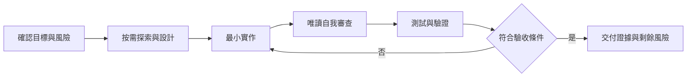

# 單一代理能力入口

目前代理直接執行任務，不建立子代理。能力是按需閱讀的指引，不是必須全部執行的階段；模型、MCP 與權限由目前工作階段提供。

依[環境入口的能力選擇表](../../environment/README.md#依任務選擇能力)選讀本目錄指引；選擇表集中維護於該處。

先讀根 AGENTS.md 與目標目錄指引；專業文件中的唯讀或寫入限制適用於該階段。完成探索或審查後，才切換至授權的實作階段。自我審查不等於獨立 reviewer；需要獨立驗收時明列缺口。

工具入口見[工具索引](../../tooling/README.md)，命令見[驗收矩陣](../../tooling/testing/commands.md)，工作流程見[開始任務](../task-start.md)。

## 執行流程

現行工作流程；來源為[任務規則](../task-start.md)與 `.codex/config.toml`，所有階段由同一代理執行。

