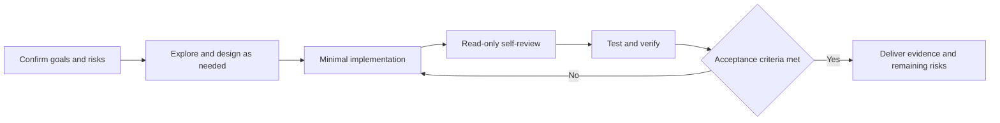

# Single-agent capability entry point

The current agent executes tasks without subagents. Capabilities are on-demand guidance, not mandatory stages; the current session supplies model, MCP and permissions.

Select guidance using the [environment capability table](../../environment/README.md#依任務選擇能力), maintained there exclusively.

Read root AGENTS.md and target guidance first. Professional guides' read/write restrictions apply within their stages; switch from exploration/review to authorized implementation afterward. Self-review is not independent review; report gaps when independence is required.

See the [tool index](../../tooling/README.md), [acceptance matrix](../../tooling/testing/commands.md) and [task start](../task-start.md) for tools, commands and workflow.

## Execution flow

Current workflow, sourced from [task rules](../task-start.md) and `.codex/config.toml`; one agent executes every stage.

