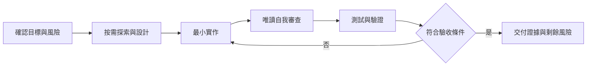

# 單一代理能力入口

目前代理直接執行任務，不建立子代理。能力是按需閱讀的指引，不是必須全部執行的階段；模型、MCP 與權限由目前工作階段提供。

| 任務 | 指引 |
| --- | --- |
| 計畫、範圍、風險與交付 | [規劃](planning.md) |
| 原始碼、依賴與官方來源查證 | [探索](explorer.md) |
| 模型、架構與交易邊界 | [設計](architect.md) |
| 最小修改與根因除錯 | [實作](implementer.md) |
| 唯讀檢視差異與風險 | [自我審查](reviewer.md) |
| 回歸、契約與整合驗收 | [測試](tester.md) |
| Markdown、Mermaid 與授權 Wiki 工作 | [文件](documentation.md) |

先讀根 AGENTS.md 與目標目錄指引；專業文件中的唯讀或寫入限制適用於該階段。完成探索或審查後，才切換至授權的實作階段。自我審查不等於獨立 reviewer；需要獨立驗收時明列缺口。

工具入口見[工具索引](../../tooling/README.md)，命令見[驗收矩陣](../../tooling/testing/commands.md)，工作流程見[開始任務](../task-start.md)。

## 執行流程

現行工作流程；來源為[任務規則](../task-start.md)與 `.codex/config.toml`，所有階段由同一代理執行。

