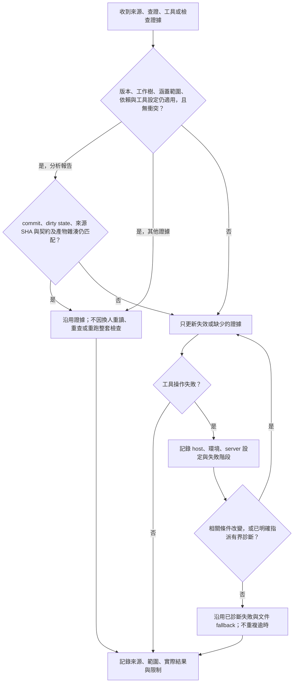

# 交接與證據重用

跨聊天或跨角色接手時，交付足以重現狀態的六欄摘要。

## Minimal handoff and evidence reuse

Use six fields rather than forwarding the full conversation or raw logs:

| Field       | Required content                                                                                                                  |
| ----------- | --------------------------------------------------------------------------------------------------------------------------------- |
| Goal        | One bounded question or change and its completion condition                                                                       |
| Ownership   | Repository, branch, revision, relevant dirty paths (including untracked files), owned files/hunks and read-only boundaries        |
| Inputs      | Located paths/symbols, applicable instructions and constraints; read required instructions if not already supplied and current    |
| Evidence    | Only relevant source/query results with version, scope and artifact locations; include host/server/tool identity for MCP evidence |
| Checks      | Exact commands already run, actual results and required checks still pending                                                      |
| Open issues | Missing evidence, conflicts, failures, and the next executable step or decision owner                                             |

**開發與維運指引**



適用邊界：

- HEAD 相同不足以證明證據有效；須核對相關 dirty paths、query／bundle 範圍與來源版本。Context7 只重用相同問題與版本涵蓋的結果；Repomix 另核對包含／排除路徑。
- 探索工具依[根指引](../../../AGENTS.md#graphify)按問題選用；新問題、過期圖譜或矛盾觀察須重新定位並核對當前來源，不因交接而強制新增查詢。
- MCP inventory 與連線重用依 [工具操作指南](../environment/troubleshooting.md#設定與-mcp-診斷)；host／server／allowlist、服務、角色或來源不符會使相關證據失效。註冊成功不等於 runtime 驗收。
- reviewer 依獨立判斷補足挑戰結論所需的證據；流程不限制必要審查。

交接需求時，將需求 ID 對到用例、實際檔案或函數與代表測試；HTTP 拒絕、重送與失敗須連到相應契約。版本以 [mise.toml](../../../mise.toml) 和 [Go 模組](../../../backend/go.mod) 為準。圖譜和打包可定位來源，行為仍需適用的驗收證據。

## 六欄交接範本

在目前聊天輸出以下格式，接手者須能判斷版本、範圍與下一個動作。

```text
Goal｜目標與完成條件
Ownership｜儲存庫、分支、提交、相關未提交檔案與負責範圍
Inputs｜必讀檔案、符號、設計或操作限制
Evidence｜已確認的事實、來源、可讀的產物位置與適用範圍
Checks｜已執行的命令、實際結果、未驗證項目
Open issues｜阻礙、待決事項、下一個動作
```

## 範例：接手補卡重送問題

以下示範唯讀調查剛開始時如何交接。實際交接時填入當下的版本及結果。

```text
Goal｜判斷同一補卡核准請求再次送達時，會不會重複套用。
Ownership｜line-mini-app-bot／<分支>@<提交>；相關未提交檔案 <實際清單或無>；唯讀調查。
Inputs｜從出勤 application/command/review.go 的 ReviewCorrection 追到 domain/policy/review.go。
Evidence｜出勤目錄為 backend/internal/business/attendance/；交易實作在 adapter/firestore/attendance_correction.go。
Checks｜尚未執行測試；交易與重送結果待核對。
Open issues｜先讀 NeedsDecision 對既有核准紀錄的判斷，再對照交易測試。
```

涉及實作時，在 Inputs 補充用例、介面、函數簽名、允許的依賴與交易邊界；Checks 補充適用的成功、拒絕、重送、失敗與取消案例，以及外部驗證前置條件。

## Sidebar handoff

1. **交出去。** 使用者要求交接時，直接在目前聊天輸出[可複製的六欄摘要](#六欄交接範本)。Goal 寫完成條件，Open issues 以接手後第一個動作收尾；已完成就寫「無待辦」。發送到另一個聊天需有使用者指定的目標及主機支援；只產生摘要時，交付狀態寫「摘要已備妥」。
2. **按需附原始碼。** 附上接手所需的路徑與符號。需要跨檔來源包時，按 [Repomix 主題打包流程](../tooling/agents/repomix-skills.md#按需打包任務來源)產生並核對內容。在 Evidence 填實際產物位置及涵蓋範圍。工具受阻時仍交付六欄，將缺口列在 Open issues。
3. **接手。** 先核對工作區、分支、提交及相關已修改和未追蹤檔案。不同 checkout 須確認內容已帶到，參考包也須可讀；只收到 SHA 或另一台機器的本機路徑時，標記缺少的內容。沿用仍有效的證據，從 Open issues 的第一個動作開始。接手者依本次指示確認範圍與授權。

## Reading and handoff

Read [acceptance](../tooling/testing/commands.md) before choosing checks. The root AGENTS.md routes
roles to relevant documents. Resolve routine issues within the authorized scope;
report host restrictions accurately. Consult [MCP guidance](../environment/troubleshooting.md#設定與-mcp-診斷)
for tool selection and transport diagnostics. Integration does not grant permission
to push or deploy. The user-established [publication default](publication.md#repository-publication)
is separate authorization, not permission inferred from delegation.

[開發流程索引](./)
